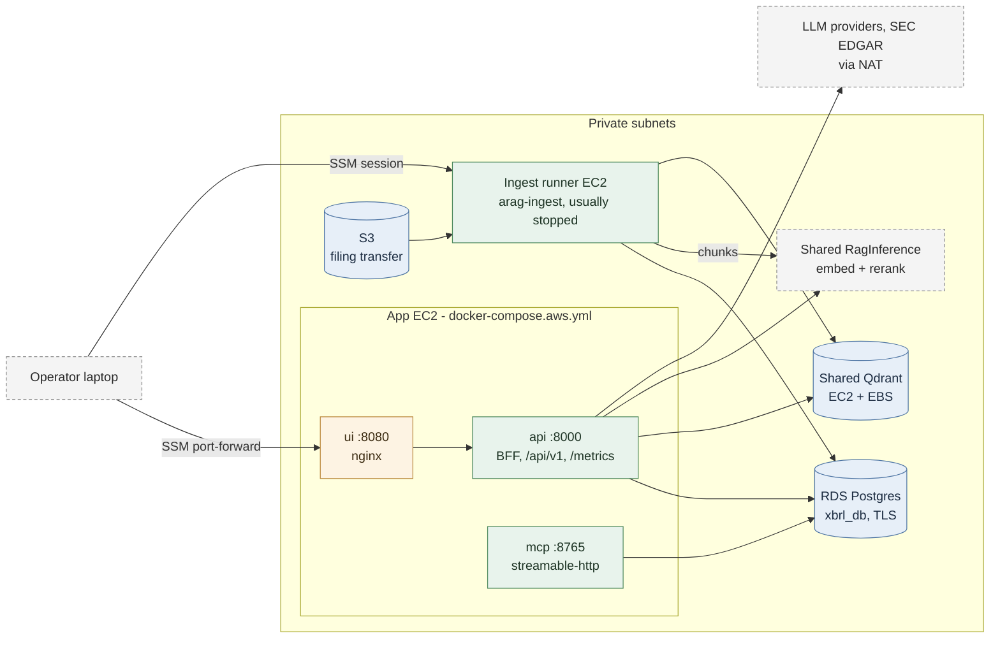

# XbrlRag — Local / AWS Dual-Mode Deployment (XBRL flow)

How the same code runs on a laptop and on AWS, for anyone changing storage, database or
service wiring, or packaging the images. One switch, **`XBRLRAG_DEPLOY_MODE`**, selects the mode:

- `local` (default): filings on the local filesystem, local Postgres / Qdrant / RagInference.
  With the switch unset, behaviour is exactly the local behaviour.
- `aws`: filings on **S3**, Postgres on **RDS** with TLS required, an in-VPC **Qdrant**, a
  shared **RagInference** service (the embedding and reranking service), and the serving
  containers on EC2.

**Provisioning boundary.** All AWS infrastructure (VPC, EC2, RDS, S3, IAM, security groups,
secrets, ECR) is owned by the separate **`aws-genai-iac`** repo. This repo owns the
application-side seams, the three container images and their build/push, and the compose file
the app host runs. This document specifies those and what the app needs from infra; it contains
no IaC.

Operating guides: [guide 10](../guides/xbrl-flow/10-packaging-images.md) (build and push the
images), [guide 4 §4.13](../guides/xbrl-flow/04-ingest-and-populate.md#413-running-on-aws-the-on-demand-ingest-runner)
(ingest on AWS), [`deploy/README.md`](../../deploy/README.md) (compose, Helm, CI).

---

## 1. Principles

1. **Local is the default and never regresses.** Every switch falls back to the local
   behaviour when its env var is unset.
2. **The mode selects backends and policies, not endpoints.** Connection details stay in their
   per-service env vars (`XBRL_DB_*`, `QDRANT_*`, `RAGINFER_URL`, `XBRLRAG_S3_*`). An explicit
   per-service switch (`XBRLRAG_STORAGE_BACKEND`, `XBRL_DB_SSLMODE`) overrides the mode-derived
   default. An unrecognized mode or storage-backend value raises at startup, so a typo cannot run
   an AWS host on local storage with optional TLS.
3. **No `if aws:` branches in business logic.** A few factory seams read env once.
4. **Query serving is stateless and filesystem-free.** The query path reads facts from Postgres
   and narrative from Qdrant only, so S3 matters only for ingest.
5. **Images are torch-free.** Serving and ingest both reach the embedder and reranker over HTTP
   via `RAGINFER_URL`, so it must be set in every real deploy.

---

## 2. The code seams

| Seam | Module | Behaviour |
|---|---|---|
| Mode switch | [`src/config/deploy.py`](../../src/config/deploy.py) | `deploy_mode()` → `local` \| `aws`. |
| Filings storage | [`src/ingest/sec_edgar/storage.py`](../../src/ingest/sec_edgar/storage.py) | `FilingStore.from_env()` → `LocalFilingStore` or `S3FilingStore` (boto3, instance role, never static keys). Two roles: `sec_edgar` (raw downloads, `SEC_EDGAR_ROOT`) and `normalized` (canonical HTML, `XBRLRAG_NORMALIZED_ROOT`); one root each locally, one bucket with two prefixes on S3, keys mirroring `{TICKER}/{YEAR}/{FORM}/…`. Path-based parsers such as Arelle get real files through `localize_dir()` / `localize_file()`. Every stage fails loud on empty discovery and preflights writability. |
| Postgres | [`src/db/conn.py`](../../src/db/conn.py) | One `conn_params()` / `connect()` over `XBRL_DB_*`; `sslmode` from `XBRL_DB_SSLMODE`, else `prefer` (local) / `require` (aws). |
| Qdrant | [`src/vectorstores/qdrant_vectordb_client.py`](../../src/vectorstores/qdrant_vectordb_client.py) | Reads `QDRANT_HOST`, `QDRANT_PORT`, `QDRANT_API_KEY`, `QDRANT_HTTPS`, `QDRANT_VERIFY`; unset means `localhost:6333`. |
| Embeddings / rerank | `src/embeddings/remote_embedder.py`, `src/retriever/remote_reranker.py` | HTTP to RagInference when `RAGINFER_URL` is set; in-process torch models only when unset, which is dev-only. |
| Project root | `src/__init__.py` | `PROJECT_ROOT` is derived from the package location (override `XBRLRAG_PROJECT_ROOT`). Config path keys stay empty and are filled from env, because a Windows absolute path is a *relative* path on POSIX and would resolve to `/app/D:/…` in a container. |

`boto3` is an ingest-only dependency (`requirements.txt`, `requirements-ingest.txt`), never in
`requirements-serve.txt`.

---

## 3. Images

| Image (ECR name) | Dockerfile | Contents |
|---|---|---|
| `arag` | `infra/docker/Dockerfile` | BFF (`src.api.main`) + MCP server from `requirements-serve.txt`; no torch, transformers, faiss or boto3. |
| `arag-ui` | `ui/Dockerfile` (context `ui/`) | Vite build served by nginx, which proxies `/api` and `/metrics` to `XBRLRAG_API_UPSTREAM` (substituted at container start, so no rebuild per environment). |
| `arag-ingest` | `infra/docker/Dockerfile.ingest` | `requirements-ingest.txt` (serving subset + edgartools + `arelle-release` + lxml + boto3), torch-free; Arelle is the pip `arelleCmdLine` console script, no JRE. |

[`scripts/build_push_images.py`](../../scripts/build_push_images.py) builds, gates (an import
smoke test inside the built `arag` image) and pushes SHA-tagged arm64 images to ECR, resolving
the registry from STS; tags are never `:latest`. The ECR names keep the pre-rename `arag*`
prefix on purpose (owned by `aws-genai-iac`). `fastapi`, `starlette` and `pydantic` are pinned
together in `requirements-serve.txt`, because newer versions break FastMCP's tool inspector.

---

## 4. AWS topology (as the app sees it)

*Green: app code · Blue: data store · Grey: external or shared service · Amber: user-facing.*

- **One app host** runs `api`, `mcp` and `ui` from
  [`infra/docker/docker-compose.aws.yml`](../../infra/docker/docker-compose.aws.yml); no
  Postgres, Qdrant or RagInference runs on it. Non-secret config and image tags come from
  `/opt/app/.env` and `deploy.env`; secrets (provider keys, RDS-managed DB credentials) from
  `/opt/arag/.env` (mode 600), re-fetched every boot, so a rotated DB password needs only a
  service restart.
- **The shared Qdrant fronts a self-signed certificate**: TLS stays on, verification is off
  (`QDRANT_VERIFY=false`).
- **nginx's proxy read timeout must stay above `RAGINFER_TIMEOUT_S`**, or the UI gets a 504 while
  the API is still reranking (defaults: `XBRLRAG_PROXY_READ_TIMEOUT` 600 s, `RAGINFER_TIMEOUT_S`
  300 s).
- **No authentication** exists on the BFF, `/api/v1` or MCP. The network is the trust boundary;
  the app host is private and reached through SSM port-forwarding.
- Compose also reads the legacy `ARAG_*` variable names, because `aws-genai-iac` may still render
  them.

---

## 5. Ingest on AWS

Ingest is operator-driven: the documented CLI runs on the **ingest runner** over SSM Session
Manager; no API endpoint launches an ingest, and the serving image cannot ingest (no edgartools
or Arelle).

**Current approach: hybrid.** Downloaded filings are uploaded to S3 and pulled onto the runner's
local disk; the runner then runs with `XBRLRAG_STORAGE_BACKEND=local` while RDS, Qdrant and
RagInference stay remote. S3 is the transfer pipe, not the working store.

**Why not pure `aws` mode yet.** The read-side stages (`dom_position_populator`,
`xbrl_html_base_chunking`, `load_to_vectordb`) locate `canonical.htm` by making
`accession.entry_url` relative to `SEC_EDGAR_ROOT`
(`DomPositionPopulator._resolve_canonical_path`). In pure S3 mode Arelle loads from a localized
**temp** path, which it writes into `entry_url`; resolution then fails and every filing is
skipped, leaving the citation table, chunk table and Qdrant load silently empty. The fix is to
persist a stable relative key at ingest and resolve canonical HTML from it through the stores.
The upstream stages (download, Arelle facts, registries, concept mapping, labels, geography,
canonicalization) already work in `aws` mode.

**After every load:** rebuild the materialized views (`scripts/rebuild_mvs.py`). **On a new
RDS:** `scripts/bootstrap_db.py` applies the DDL; the Arelle base DDL's inlined `pgcrypto`
functions fail safely for a non-superuser because nothing calls them
([`scripts/ddl/base/README.md`](../../scripts/ddl/base/README.md)).

---

## 6. What the app needs from infra

| Service | Used for |
|---|---|
| EC2 | app host (api + mcp + ui), ingest runner |
| RDS for PostgreSQL | `xbrl_db`: facts, Layer-0, materialized views, `audit` and `eval` schemas; TLS on |
| S3 + gateway endpoint | filing transfer (and the S3 storage backend once pure-S3 ingest lands) |
| Qdrant (EC2 + EBS) | the `xbrl_sec10k_text` / `xbrl_sec10k_metadata` collections |
| RagInference | embeddings + reranking over HTTP |
| ECR | `arag`, `arag-ui`, `arag-ingest` |
| Secrets Manager | provider keys, DB credentials, injected as env |
| IAM instance roles | ingest: S3 read/write + secrets read; app: secrets read; no static keys |
| SSM Session Manager | operator shell and port-forwarding, no inbound ports |
| NAT egress | LLM providers and SEC EDGAR from private subnets |
| Backups | RDS snapshots and Qdrant EBS snapshots, the only stateful stores |

---

## 7. Open items

| Item | Notes |
|---|---|
| Pure-S3 ingest | §5. Until then, ingest uses the hybrid approach. |
| Authentication | None in the app (feature `WS6-B6`, deferred). Needed before any exposure beyond the private network, especially for MCP. |
| Automated view refresh | A manual step after each load; an ingest DAG (`WS5-B3`, deferred) would own it. |
| RDS credentials | Static secret today; RDS IAM-token auth would slot into `src/db/conn.py`. |
| RagInference sizing | CPU reranking takes tens of seconds to minutes per narrative step; a GPU instance would cut latency. |

---

## Key decisions

- **Mode selects backends, env selects endpoints** — the two concerns never mix, and a mistyped
  mode fails at startup.
- **Infrastructure lives in `aws-genai-iac`** — this repo ships images and app seams only, so app
  changes never require IaC review and vice versa.
- **Torch-free images, models behind RagInference** — small images and one shared embedding
  service for serving and ingest.
- **Serving reads no files** — the app host is stateless; Postgres and Qdrant snapshots are the
  only backups needed.
- **Hybrid ingest until the read side is S3-aware** — a pure-S3 run today would silently skip
  every filing's citations and chunks.
- **The private network is the trust boundary** — there is no app-level authentication yet.

## Related

[Architecture](XbrlRag_Architecture.md) · [`deploy/README.md`](../../deploy/README.md) ·
[guide 10](../guides/xbrl-flow/10-packaging-images.md) ·
[`src/ingest/sec_edgar/CLAUDE.md`](../../src/ingest/sec_edgar/CLAUDE.md)
