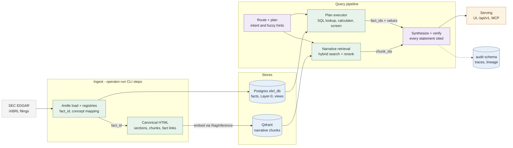

# XbrlRag — Architecture (XBRL flow)

XbrlRag answers analyst questions over SEC 10-K / 10-Q / 20-F filings with **cited, audited
numbers**. This is the system-level design for engineers and reviewers: why the system is
hybrid, how ingest and query fit together, and the decisions that shape every component. Read
it first; subsystem detail is in the [other design docs](README.md) and operating instructions
are in the [XBRL-flow guides](../guides/xbrl-flow/README.md).

**In this doc:** [Overview](#1-overview) · [Ingest](#2-ingest) · [Query](#3-query) ·
[Serving](#4-serving-surfaces) · [Cross-cutting](#5-cross-cutting) · [Not built](#6-not-built-by-decision) ·
[Key decisions](#key-decisions)

---

## 1. Overview

*Green: deterministic code · Purple: LLM call · Blue: data store · Grey: external · Amber: output.*

**iXBRL replaces document reading only for tagged facts.** The financial statements, segment
tables and tagged disclosures carry machine-readable values with exact periods, units and
dimensions. Risk factors, MD&A narrative, strategy and most footnote discussion do not. The
system is therefore **hybrid by design**:

- a **structured fact store** (Arelle xbrlDB in Postgres, XbrlRag-owned tables and materialized
  views) answers every numeric question through deterministic SQL;
- a **narrative RAG path** (canonical-HTML chunks in Qdrant, dense + sparse search, reranking)
  answers prose questions;
- both are keyed on the same canonical HTML, so a fact and the prose that discusses it are
  linked deterministically ([HTML-canonical design](XbrlRag_HTML_Canonical_Source.md)).

**SQL computes, the LLM narrates.** Every figure in an answer resolves to a source `fact_id`
reached by SQL, and arithmetic runs in a sandboxed calculator over those values. The LLM
classifies, plans and writes the prose; it never writes SQL, never emits a final XBRL concept
name (QName) and never does arithmetic. An independent verifier drops statements that their own
citations do not support.

**A wrong number that looks right is worse than "I'm not sure".** Low confidence flows to the
user: the system declines, or answers with the nearest facts and says it could not determine the
value. The release gate is a silent-wrong rate (confident, cited and wrong) of zero
([evaluation](XbrlRag_Evaluation.md)).

---

## 2. Ingest

Ingest has two arms over each downloaded filing (primary iXBRL `.htm` + `manifest.yaml`, on
local disk or S3):

| Arm | Steps | Writes |
|---|---|---|
| **Facts** | Arelle xbrlDB load (assigns `fact.fact_id`), accession patch, registries (`filing_registry`, `fiscal_calendar`, `entity_master`), concept mapping with namespace expansion and per-filer overrides, labels, dimension catalog, geography and member aliases | Postgres `xbrl_db` |
| **Prose** | Canonical HTML → section tree + iXBRL byte positions, `fact_dom_position`, section assignment, chunks + `chunk_cross_links`, embedding via RagInference | Postgres + Qdrant |

Then the materialized views are rebuilt and the **publish gate** runs (hard checks block, soft
checks warn); a pass writes `publish_manifest` and bumps `query_cache_epoch`, which invalidates
cached answers ([fact-store reference](XbrlRag_Materialized_Views.md#6-publish-gate)).

- **Ordering invariant.** Arelle assigns `fact_id` at load time, and every DOM, chunk and
  cross-link step bridges back via `fact.xml_id → fact.fact_id`. The Arelle load completes
  before any prose step runs.
- **Idempotent.** Every write is an upsert keyed on `fact_id`, accession, `chunk_id` or CIK, so
  any step can be re-run; a filing already loaded is skipped by accession number.
- **Degraded mode.** If the prose arm fails, numeric lookups still work; only narrative context
  and fact ↔ prose links are missing.
- **Operator-driven.** Ingest is ordered CLI steps (`scripts/bootstrap_db.py` drives the full
  order); there is no scheduler or EDGAR polling (§6). Steps and flags:
  [guide 4](../guides/xbrl-flow/04-ingest-and-populate.md); invariants:
  [`src/ingest/sec_edgar/CLAUDE.md`](../../src/ingest/sec_edgar/CLAUDE.md). On AWS the same steps
  run on an on-demand runner ([AWS deployment](XbrlRag_AWS_Deployment.md)).

---

## 3. Query

```mermaid
flowchart LR
  Q["Question"]:::out --> DEC["Decomposer<br/>compound to sub-queries"]:::llm
  DEC --> RT["Intent router<br/>LLM intent, SQL entity resolve"]:::llm
  RT --> BD["Branch dispatcher"]:::det
  BD -->|"fast path"| EX["Plan executor"]:::det
  BD -->|"complex"| PG["Plan generator<br/>+ validator"]:::llm --> EX
  EX --> NUM["lookup, compute,<br/>screen, aggregate, breakdown"]:::det
  EX --> NR["narrative<br/>Qdrant + rerank"]:::det
  NUM --> SY["Synthesizer<br/>per-statement citations"]:::llm
  NR --> SY
  SY --> VF["Faithfulness verifier<br/>drops unsupported"]:::llm
  VF --> MG["Merge sub-answers"]:::det --> A["Cited answer"]:::out

  classDef det fill:#e8f3ec,stroke:#4f8a5f,color:#1d3324;
  classDef llm fill:#f1eaf7,stroke:#7d5ea0,color:#2b1f3a;
  classDef store fill:#e7eff8,stroke:#4d74a3,color:#1b2b40;
  classDef ext fill:#f4f4f4,stroke:#8a8a8a,color:#2a2a2a,stroke-dasharray:4 3;
  classDef out fill:#fdf3e3,stroke:#b9873a,color:#3a2a10;
```

*Green: deterministic code · Purple: LLM call · Amber: input / output.*

| Stage | Does |
|---|---|
| Decomposer | Splits a compound question into ordered sub-queries (usually one passthrough); a dependent one names an earlier screen's top-N via `<<TOP:id:n>>`. Any error falls back to one passthrough. |
| Intent router | LLM: intent (`NUMERIC_LOOKUP` / `_COMPUTE` / `_SCREEN` / `NARRATIVE` / `HYBRID`) and company, period and concept phrases lifted verbatim. SQL then resolves companies to CIKs (`entity_master` exact + trigram, committed alias table) and periods via `fiscal_calendar`. A trivial lookup or narrative query gets a one-step plan here. |
| Plan generator | LLM: a typed `{"steps": [...]}` plan; the validator checks ids, DAG order, concept families and derived-metric names. One retry, then one model tier up. |
| Plan executor | `lookup` (one fact, one unit, with confidence), `compute` (sandboxed AST arithmetic over step ids), `screen` (cross-filer ranked rows), `aggregate` (a total or median over exactly a screen's rows, computed in code), `breakdown` (one filer's partition of a total), `narrative` (section-aware Qdrant hybrid search + rerank). |
| Synthesizer, verifier | Answer with per-statement `fact_ids` / `chunk_ids`. A deterministic citation check then drops any statement citing an unknown id or stating a number none of its cited values match; the LLM verifier drops statements their own citations do not support. |

Orchestrated by `XbrlRetrievalPipeline.generate` in
[`src/pipelines/xbrl/retrieval_pipeline.py`](../../src/pipelines/xbrl/retrieval_pipeline.py),
optionally behind the semantic query cache. Module invariants:
[`src/retriever/xbrl/CLAUDE.md`](../../src/retriever/xbrl/CLAUDE.md); operator view:
[guide 6](../guides/xbrl-flow/06-retrieval-pipeline.md).

### 3.1 Division of labour: fuzzy intent vs deterministic resolution

The planner emits **intent with fuzzy hints**: a `concept_family` ("Revenue"), dimension hints
(`{"product": "data center"}`), a period. A deterministic resolver maps those hints to exact
QNames, members and rows using authoritative data: `concept_mapping`, the filer's own dimension
catalog and member labels, `concept_pref_rank`, units and fiscal calendars.

The planner's prompt deliberately omits the us-gaap taxonomy, the filer's dimension catalog and
the database schema. It carries the plan schema, the concept-family list, the derived-metric
names and worked examples, which keeps it small and cacheable. This split is what handles filer
extension concepts and the date-stamped taxonomy namespaces that change every year.

### 3.2 Why lookups are strict, and where they relax

A lookup resolves to exactly one value in one unit, scored for confidence; ambiguity is returned
as `AMBIGUOUS` rather than guessed. Real filings break literal rules, so the lookup and executor
tolerate known, safe variations, each accepted only when the result is OK and matches the fact
one-to-one:

- the same number tagged at two precisions is one value (the most precise fact wins);
- member hints match labels ignoring case, spacing, punctuation, `[Member]` and a trailing
  "segment";
- a NOT_FOUND `ServiceRevenue` / `ProductRevenue` with a named member retries as `Revenue` with
  the same hint;
- a hint that glues two members ("A and B") retries split;
- sibling lookups for one cell that did not all resolve retry as one intersection lookup;
- a NOT_FOUND `GrossProfit` is derived as Revenue − CostOfRevenue, citing both facts.

Every fallback emits a `decision` event, so its use is visible in the trace.

### 3.3 Concept vocabulary

`concept_mapping` is bootstrapped from **HiFi-KPI** synonym mining
(`scripts/run_synonym_mining.py`, `src/ingest/util/hifi_kpi.py`) plus manual curation. HiFi-KPI
helps the resolver with synonyms and hierarchy but not with dimensions, for which the
per-filing dimension catalog Arelle loads is authoritative.

---

## 4. Serving surfaces

| Surface | What | Docs |
|---|---|---|
| BFF (`src/api/`) | FastAPI for the UI: query + SSE stream, traces, lineage, metrics, ingestion, logs, eval, `GET /metrics` | [`src/api/README.md`](../../src/api/README.md), [guide 7](../guides/xbrl-flow/07-api-ui-observability.md) |
| Analyst API (`/api/v1`) | Granular deterministic services (coverage, concepts, fact lookup / compute / bridge, metrics grid, screen, narrative search) plus a full `answer` endpoint | [guide 9](../guides/xbrl-flow/09-programmatic-access-rest-and-mcp.md) |
| MCP server (`src/mcp_server/`) | The same v1 services as MCP tools (`arag-analyst`), stdio or streamable-http | [`src/mcp_server/README.md`](../../src/mcp_server/README.md) |
| UI (`ui/`) | Business and Technical consoles on one `query_id` spine | [UI design](XbrlRag_UI_Design.md) |

The v1 API and MCP share one service layer, so resolution, citation and mapping logic exist once.
Embeddings and reranking come from the sibling **RagInference** service over HTTP
(`RAGINFER_URL`), which keeps the serving image free of torch.

---

## 5. Cross-cutting

- **LLM calls** go through one gateway: retry, cost, tracing, prompt registry, escalation and a
  per-run budget ([LLM harness](XbrlRag_LLM_Harness.md)).
- **Every query is a trace** persisted to the `audit` schema, with numeric lineage for every
  displayed number ([observability](XbrlRag_Observability_Tracing.md)).
- **Accuracy is measured** against answer keys independent of the generator; results live in
  the `eval` schema and render at `/tech/eval` ([evaluation](XbrlRag_Evaluation.md),
  [v2 architecture](XbrlRag_Eval_v2_Architecture.md)).
- **Local and AWS** run the same code, selected by `XBRLRAG_DEPLOY_MODE`
  ([AWS deployment](XbrlRag_AWS_Deployment.md)).

---

## 6. Not built (by decision)

Live status: `python scripts/harness/check_features.py`.

| Item | Feature id |
|---|---|
| Ingest DAG (orchestrator, resume checkpoints, in-pipeline view refresh) | `WS5-B3` |
| EDGAR feed polling / event-driven ingest | `WS5-B4` |
| Authentication, SSO, per-user rate limits, multi-tenancy | `WS6-B6` |
| Conversational follow-ups (multi-turn memory) | `WS3-A5` |
| Active ambiguity clarification (a second pass that picks a row instead of returning `AMBIGUOUS`) | `WS3-A6` |
| Hierarchy-aware segment percentages | `WS1-A4` (open defect) |
| External benchmark adapters (FinanceBench, FinLoRA) | `WS9-E6` |

---

## Key decisions

- **Hybrid, not document-only RAG** — tagged facts are exact; only untagged prose needs
  retrieval.
- **The LLM never produces a number, QName or SQL** — every figure stays auditable back to a
  `fact_id`; the LLM's job is intent, plan and prose.
- **Fuzzy hints, deterministic resolution** — keeps prompts small and survives yearly taxonomy
  churn and filer extensions (§3.1).
- **Strict lookups with narrow, logged fallbacks** — ambiguity is surfaced, never guessed (§3.2).
- **Prefer declining to a silent wrong** — the release gate is zero silent-wrong answers.
- **One canonical HTML for facts and prose** — fact ↔ prose links are joins, not heuristics.
- **Operator-run ingest, no scheduler** — the corpus changes rarely and deliberately (§6).

## Related

[Design docs index](README.md) · [Fact-store data model](XbrlRag_Materialized_Views.md) ·
[HTML canonical source](XbrlRag_HTML_Canonical_Source.md) · [LLM harness](XbrlRag_LLM_Harness.md) ·
[Observability](XbrlRag_Observability_Tracing.md) · [XBRL-flow guides](../guides/xbrl-flow/README.md)
