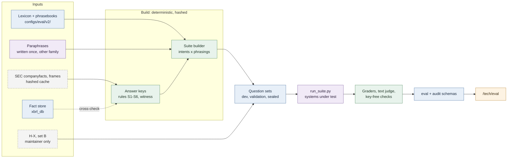
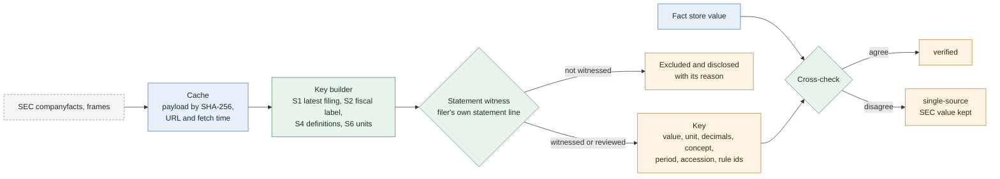
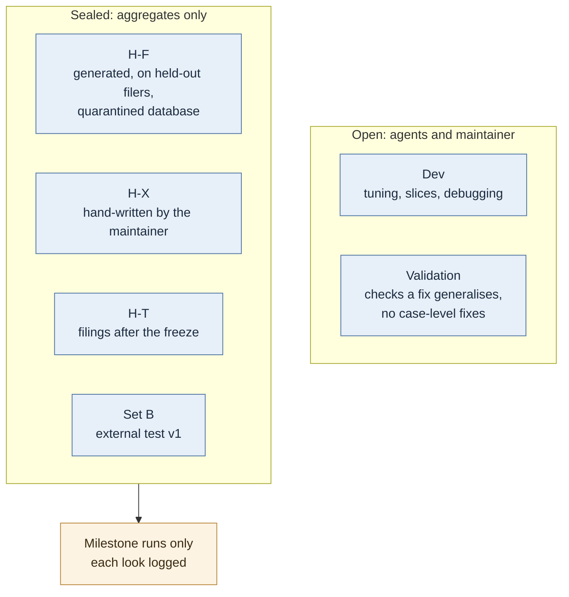
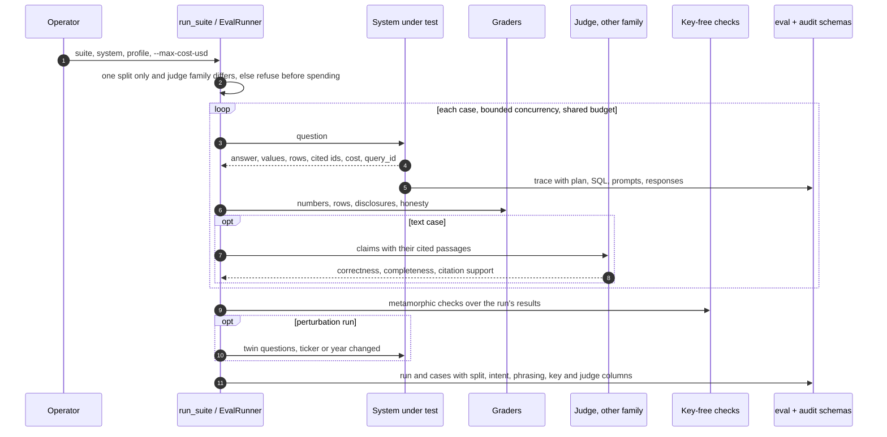

# Evaluation v2: architecture and flow

How XbrlRag's v2 evaluation works: where the questions come from, where the right answers come
from, who may see which questions, how a run is graded and what the record keeps. It is for
anyone building or changing a v2 component, or reading a v2 scorecard. The framework it extends
(cases, graders, metrics, the `eval` schema) is in the [evaluation design](XbrlRag_Evaluation.md);
what each question *means* (rules S1–S6) is in the [evaluation semantics](XbrlRag_Eval_Semantics.md);
the reasons and phases are in the [v2 plan](XbrlRag_v2_Plan.md) §3.

**In this doc:** [1. Why](#1-why-it-is-built-this-way) · [2. The whole flow](#2-the-whole-flow) ·
[3. Questions](#3-where-the-questions-come-from) · [4. Answer keys](#4-where-the-right-answers-come-from) ·
[5. Who sees which questions](#5-who-sees-which-questions) · [6. A run](#6-a-run-end-to-end) ·
[7. Grading](#7-grading) · [8. Scorecard](#8-what-a-scorecard-reports) ·
[9. Components](#9-components-and-status) · [Key decisions](#key-decisions)

---

## 1. Why it is built this way

The first test outside the development loop scored far below the in-loop v1 suite
([external test v1](../eval/external_test_v1/README.md)). The v1 suite shared three things with
the system it graded: its **answer keys** came from the same database views, its **wording**
from the templates the pipeline was tuned on, and its **questions** were the ones every fix was
checked against. v2 cuts each link:

| Shared in v1 | Separated in v2 |
|---|---|
| Keys read from XbrlRag's own materialized views | Keys from the SEC's companyfacts and frames APIs, witnessed by the filer's own statement; XbrlRag's views are only a cross-check (§4) |
| Wording from the tuned templates | Templates, plus paraphrases written once by a model family the system never uses, plus hand-written questions (§3) |
| One suite for tuning and scoring | Dev for tuning, validation for checking a fix generalises, sealed sets nobody tunes on (§5) |
| Numbers only | Text answers scored by a calibrated judge from another model family; key-free consistency checks (§7) |
| Semantics decided by the code | Semantics written down before any key (S1–S6); every key names the rules it used |

The comparison it serves is **XbrlRag (`xbrlrag_full`) against `frontier_sec_tools`**, a
frontier model in a bounded tool loop over the SEC's public APIs. `long_context_oracle` (the
case's own filing, whole) is the single-filer ceiling, `closed_book` the floor, and
`naive_rag_filtered` runs once on dev. `html_rag` is not an arm
([decision](XbrlRag_HtmlRag_Decision.md)); which arm runs on which set is fixed in the
[pre-registration](../eval/heldout_v2/preregistration.md).

---

## 2. The whole flow

*Green: deterministic code · Purple: LLM call · Blue: data store · Grey: external source · Amber: output.*

Everything before the run is deterministic and hashed, so a suite rebuilds byte for byte,
offline, from its cache. The text judge is the only LLM in grading (§7).

---

## 3. Where the questions come from

A question starts as an **intent**: a structured description with no wording (kind, filers,
fiscal years, metrics, dimension, operation, universe). The intent id is a SHA-1 of those
fields, so the same question asked many ways is one intent; a case id is the intent id plus a
phrasing hash.

- **Templates** render each intent in several phrasing families (terse, conversational, formal)
  from a lexicon of surface forms (ticker, short or legal name; metric label, synonym,
  shorthand; several period styles). They are deterministic and exercise named forms on purpose.
- **Paraphrases** bring real analyst idiom ("top line", "y/y", typos, the ask buried in
  context). Batches are exported, written once in an LLM UI of a family used neither as an arm
  nor as the development model, then imported with a format check, a **meaning check** (a lost
  company, period or metric, a fiscal year turned calendar, a widened universe is rejected to a
  review list, never silently dropped), dedupe, freeze and hash. They are never regenerated per
  run.
- **Hand-written** questions: a dev slice, and the sealed H-X set (§5).
- **Compound** cases (a top-3 ranking, then a dependent ratio or the leader's growth) are
  generated into their own suite files.

**Kinds.** Single-filer numeric (lookup, compute, ratio, dimensional, breakdown); cross-filer
(top/bottom, sum, median, peer-relative rank); cross-period (trend, CAGR, point-in-time and
restatement); compound; honesty (stated assumptions, false premises, correct declines); text.
The plan fixes the dev mix.

Some arms are too costly for the whole dev suite, so they run on a **frozen dev sample**: one
phrasing per intent, stratified by shape, seeded, and pre-registered by content hash
(`src/eval/suites/dev_sample.py`).

---

## 4. Where the right answers come from

*Green: deterministic code · Blue: data store · Grey: external source · Amber: result.*

- **Independence.** The SEC extracts the same XBRL the filer tagged, so independence is partial.
  A key two sources agree on is `verified`, one source is `single-source`, and scores are
  reported both ways.
- **Concept from the statement, not the product's mapping.** A key's concept is confirmed against the line
  the filer presents in its primary statement (SEC's Financial Statement Data Sets), so a gap in
  the product's concept mapping cannot make key and product agree. A line the rules cannot
  vouch for needs a reviewed resolution, or the member is excluded with a stated reason
  ([key-statement-witness](../specs/key-statement-witness.md), S3).
- **Derived values** are computed in the key builder from independently keyed inputs (S4),
  never by the pipeline's calculator or views.
- **Provenance.** Every key records its source, the payload hash it was read from and the
  semantics rules it applied.
- **No guessing.** An intent with no key is dropped and counted with its reason.
- **Cross-filer answers** rank only filers with a key in the right unit; every filer left out is
  named with its reason, and the answer must disclose it (S3, S5, S6).

The builder refuses to write a suite with an unwitnessed key, an unreviewed or unused
resolution, or evidence naming a line the filing does not hold; the accepted rule files are
pinned by SHA-256.

---

## 5. Who sees which questions

*Blue: question set · Amber: output.*

**The split is a hash, not a choice.** A case is in validation when its intent, its template or
its paraphrase persona falls on the validation side of a salted SHA-1, so validation holds both
unseen questions and unseen wording, and no intent or template crosses the split. A run holds
one split only.

**Sealed sets.** Their roles, sizes, which arms run on each and how many looks are allowed are
fixed in the [pre-registration](../eval/heldout_v2/preregistration.md); sets are reported
separately and never pooled. The sealed tooling prints only ids, counts and kinds, never a
question, answer, amount or ticker. No agent reads a sealed set or connects to the quarantined
`xbrl_heldout` database; the maintainer runs held-out scripts, and only aggregates and
failure-class counts leave a held-out run.

**The held-out draw.** The held-out filers (H-F) were drawn from the S&P 100 minus the corpus
and the coverage waves, ranked by a SHA-256 of a public NIST beacon pulse whose minute was
committed in advance. Nobody can steer the draw and anyone can recompute it
([draw record](../eval/heldout_v2/README.md)).

---

## 6. A run, end to end

**Cost control.** Every LLM call goes through the gateway with a per-run budget that judge
calls share; `--max-cost-usd` is checked between cases. A run can resume from its checkpoint
([eval-run-checkpoint](../specs/eval-run-checkpoint.md)), record an OpenAI service tier
(`--service-tier`), and share a cached filing prefix across the long-context arm's cases
([long-context-cache-reuse](../specs/long-context-cache-reuse.md)). Development runs use the
low-cost development profile; decision runs use the profile the pre-registration names, and
runs on different models are never pooled.

---

## 7. Grading

Deterministic graders handle every number (`src/eval/core/graders/v2.py`,
[v2-grading](../specs/v2-grading.md)); precision follows S6.

| Kind | Passes when |
|---|---|
| Lookup, compute, ratio | The value matches the key at its precision; a ratio states its definition (S4) |
| Growth, CAGR with a base ≤ 0 | The answer says "not meaningful" and gives no number |
| Breakdown | The members that partition the filer's total, each with its value |
| Trend | Every year's value |
| Point-in-time | Both values, each labelled (as originally reported vs latest) |
| Screen, peer-relative | The right ranking (peer-relative: the subject's stated rank, else the rank its rows' values imply, never the row order) **and** the universe stated **and** every expected exclusion named |
| Compound | Both parts pass |
| Honesty | Ambiguous: the assumption stated. False premise: corrected. Decline: no number, the right reason |
| Text | Judge scores per claim: correctness, completeness, citation support, unsupported claims |

**The judge** is never from the generator's model family, and its scores are reported only after
it agrees with a person on human-labelled answers (at least 100 per verdict kind). Each kind is
gated on Cohen's kappa ≥ 0.7, except a kind whose human labels are at least 99% one class,
where kappa is uninformative and the gate is observed agreement ≥ 0.95
([judge-calibration](../specs/judge-calibration.md),
[judge-calibration-one-class](../specs/judge-calibration-one-class.md)). The gate is fixed from
the human labels before any judge runs; one labelled set can calibrate several candidate judges,
and the cheapest that passes is used. Agents never label calibration answers.

**Key-free checks** need no answer key, so they scale to every filer at almost no cost
([keyfree-checks](../specs/keyfree-checks.md)):

- **Metamorphic:** the same number reached by two routes agrees (breakdown rows sum to the
  total; growth equals the change in two lookups; a ranking matches the lookups; Q4 equals the
  full year minus nine months).
- **Perturbation:** change the ticker or the year, and the plan changes in exactly that slot and
  the answer changes with it.

---

## 8. What a scorecard reports

- Value accuracy by split, kind, phrasing family and key source, with paraphrase stability.
- **Confident-wrong rate** (wrong and neither refused nor hedged, cited or not).
- **Grounding precision and recall**: whether the *right* fact is cited. A v2 case has no
  `expected_fact_ids`, so each cited `fact_id` is resolved through the fact store and compared
  with the key's fact identity (`src/eval/core/graders/grounding_v2.py`,
  [v2-grounding](../specs/v2-grounding.md)). Precision is `None` when nothing is cited, so the
  agent and baseline arms read n/a. `run_suite.py` attaches it; `regrade_run.py` fills it for a
  stored run only when the run's corpus fingerprint is the store's, since fact ids are row ids.
  It never changes a grade.
- Accuracy versus coverage: accuracy over the questions answered, at each decline rate.
- Judge scores, only for a calibrated judge version; key-free consistency counts.
- Cost and latency per case and per system.

The success bar and its thresholds are fixed in the
[pre-registration](../eval/heldout_v2/preregistration.md), not here. Measured values are at
`/tech/eval`.

---

## 9. Components and status

Live build status is `python scripts/harness/check_features.py` (the `WS10-*` items); this
table only maps each component to its code and spec.

| Component | Where | Spec |
|---|---|---|
| Intents, phrasings, split | `src/eval/suites/intents.py`, `configs/eval/v2/` | [eval-intents](../specs/eval-intents.md) |
| SEC answer keys, live source | `src/eval/keys/` (`core.py`, `sec_live.py`, `key_definitions.py`) | [sec-keys](../specs/sec-keys.md), [sec-live-source](../specs/sec-live-source.md), [key-definitions](../specs/key-definitions.md) |
| Statement witness | `src/eval/keys/statement_witness.py`, `src/eval/suites/v2_witness.py`, `configs/eval/v2/` | [key-statement-witness](../specs/key-statement-witness.md) |
| Suite builder, compound suites | `src/eval/suites/v2_suite.py`, `scripts/eval/build_v2_suite.py` | [v2-suite-build](../specs/v2-suite-build.md), [compound-shape](../specs/compound-shape.md) |
| Held-out (H-F) build | `src/eval/suites/heldout_build.py` | [hf-suite-build](../specs/hf-suite-build.md) |
| Paraphrase export, import, suite | `src/eval/suites/paraphrases.py`, `paraphrase_suite.py`, `scripts/eval/export_paraphrase_batches.py`, `import_paraphrases.py` | [eval-paraphrases](../specs/eval-paraphrases.md) |
| Frozen dev sample | `src/eval/suites/dev_sample.py`, `scripts/eval/build_dev_sample.py` | — |
| Run and case columns | `src/eval/core/run_columns.py`, `scripts/ddl/eval/` | [eval-run-columns](../specs/eval-run-columns.md) |
| v2 kinds and disclosure grading | `src/eval/core/graders/v2.py`, `grounding_v2.py` | [v2-grading](../specs/v2-grading.md), [v2-grounding](../specs/v2-grounding.md) |
| Text judge and calibration | `src/eval/core/graders/judge.py`, `judge_calibration.py`, `configs/eval/judge.yaml`, `scripts/eval/judge_calibration.py` | [eval-judge](../specs/eval-judge.md), [judge-calibration](../specs/judge-calibration.md) |
| Key-free checks | `src/eval/keyfree/` | [keyfree-checks](../specs/keyfree-checks.md) |
| Judge and checks inside a run | `src/eval/core/judge_wiring.py`, `src/eval/keyfree/runner.py`, `run_suite.py --judge --keyfree --perturb-twins` | [judge-runner-wiring](../specs/judge-runner-wiring.md) |
| Re-grading stored runs | `src/eval/core/regrade.py`, `scripts/eval/regrade_run.py` | [eval-regrade](../specs/eval-regrade.md) |
| H-X authoring tools | `src/eval/set_b/hx.py`, `scripts/eval/hx.py` | [hx-authoring](../specs/hx-authoring.md) |
| Held-out draw | `src/eval/aprime/v2.py`, `scripts/eval/aprime_draw.py` | [heldout-draw-v2](../specs/heldout-draw-v2.md) |
| `frontier_sec_tools` arm | `src/eval/systems/frontier_sec_tools.py`, `src/eval/sec_tools/` | [frontier-sec-tools](../specs/frontier-sec-tools.md), [tools and prompt](../eval/frontier_sec_tools.md) |
| `long_context_oracle`, `closed_book`, `naive_rag_filtered` arms | `src/eval/systems/long_context.py`, `closed_book.py`, `naive_rag.py` | [long-context-arm](../specs/long-context-arm.md), [baseline-arms](../specs/baseline-arms.md) |

The code also holds arms that are no longer in the comparison (`html_rag`,
`long_context_resolved`, `long_context_multi`, `naive_rag_plain`); they stay runnable but run on
no v2 set. Not built: the per-filer coverage card behind S5 and the committed groups file
behind S3 (see the gaps listed in the [semantics](XbrlRag_Eval_Semantics.md)).

## Key decisions

- **Keys come from the SEC, witnessed by the filer's statement**, not from the product's views or mapping:
  a key that shares the system's choices cannot catch the system's mistakes.
- **The comparison is against an agent over the SEC's own data** (`frontier_sec_tools`), not a
  RAG pipeline over HTML ([decision](XbrlRag_HtmlRag_Decision.md)).
- **Splits and the held-out draw are hashes**, so no one chooses which questions are hard to see.
- **The judge is from another model family and gated by human labels** fixed before it runs.
- **Rules, sets and bars are pre-registered** before the sealed sets are written or looked at
  ([pre-registration](../eval/heldout_v2/preregistration.md)).
