# XbrlRag — Evaluation & Benchmarking

How XbrlRag measures its central claim, that **numbers are audited, not generated**. This doc
covers the evaluation framework shared by every suite (cases, systems under test, graders,
metrics, persistence) and the **v1 SQL-derived suite** built on it, plus the rules for
validating a change. Read it before changing a grader, a suite or anything the suite measures;
the v2 evaluation that now carries the headline comparison builds on this framework and has its
own doc.

- **Operating it** (commands, flags, slices, reading a scorecard):
  [guide 11](../guides/xbrl-flow/11-evaluation.md).
- **Measured results** live in the `eval` schema and render at `/tech/eval`. They are the
  record; this doc quotes no accuracy figures.
- **Scope:** the XBRL flow. PDF-legacy evaluation (`src/eval/deepeval/`) is maintenance-only.

**In this doc:** [Overview](#overview) · [1. Current result](#1-current-result) ·
[2. Why a SQL-derived suite](#2-decision-an-internal-sql-derived-suite-is-the-primary-benchmark) ·
[3. Framework](#3-architecture) · [4. The SQL-derived suite](#4-the-sql-derived-suite) ·
[5. Grading](#5-grading) · [6. Persistence, API and UI](#6-persistence-api-and-ui) ·
[7. Rules from the eval work](#7-what-the-eval-taught-us) ·
[8. Validating a change](#8-how-changes-are-validated) · [9. v1 and v2](#9-the-v2-evaluation) ·
[10. Not built](#10-not-built)

## Overview

```mermaid
flowchart LR
  SQL["analyst_queries.sql<br/>canonical SQL per question"]:::store
  TPL["Template spec<br/>sql_derived_templates.yaml"]:::det
  BLD["Suite builder<br/>build_sql_derived_suite.py"]:::det
  SUITE["sql_derived_v1.json<br/>committed suite"]:::store
  RUN["run_suite.py<br/>EvalRunner"]:::det
  SYS["System under test<br/>xbrlrag_full or a baseline"]:::llm
  GR["Deterministic graders<br/>numeric, screen, breakdown, citation"]:::det
  EV["eval schema"]:::store
  AU["audit schema<br/>trace per answer"]:::store
  UI["/tech/eval<br/>scorecards, compare"]:::out
  SQL --> TPL --> BLD --> SUITE --> RUN --> SYS --> GR --> EV --> UI
  SYS --> AU --> UI
  classDef det fill:#e8f3ec,stroke:#4f8a5f,color:#1d3324;
  classDef llm fill:#f1eaf7,stroke:#7d5ea0,color:#2b1f3a;
  classDef store fill:#e7eff8,stroke:#4d74a3,color:#1b2b40;
  classDef ext fill:#f4f4f4,stroke:#8a8a8a,color:#2a2a2a,stroke-dasharray:4 3;
  classDef out fill:#fdf3e3,stroke:#b9873a,color:#3a2a10;
```



*Green: deterministic code · Purple: LLM call · Blue: data store · Amber: output.*

The expected answer to each case is the result of running canonical SQL against the fact
store; the same question in natural language goes through the system under test, and the
answer is graded without an LLM. Every graded case links to the full trace of the answer.

---

## 1. Current result

The current results are at `/tech/eval` (`v_recent_runs`, `v_run_trend`), not in this doc.
The current v1 baseline is the latest full-tier run of the `sql_derived` suite there; a run's
`split`, `tier` and `grader_version` say what kind of number it is.

Read any v1 figure with two caveats:

- **It is an in-loop result.** The pipeline was tuned on this suite, whose questions share one
  templated voice and whose keys come from the same views the pipeline queries. The first test
  outside that loop scored far lower ([external test v1](../eval/external_test_v1/README.md)),
  which is why the v2 evaluation (§9) now carries the headline comparison.
- **Noise band.** Repeated full runs vary by a standard deviation of about 0.9 points, so one
  full run cannot resolve a change smaller than about 2 points. Judge a change on its slice and
  a case-by-case compare (§8).

Narrative cases are not in the v1 suite (§10).

---

## 2. Decision: an internal SQL-derived suite is the primary benchmark

[`scripts/xbrl/analyst_queries.sql`](../../scripts/xbrl/analyst_queries.sql) is the
authoritative, human-validated map from analyst question to canonical SQL. Running a query's
SQL **is** the correct answer, so the suite needs no human labelling, is deterministic, and
regenerates whenever the corpus changes. It covers what no external benchmark tests
(cross-filer screens, dimensional lookups, IFRS/TWD, point-in-time) and can tell "wrong number"
from "right number, wrong fact", but it carries **no external credibility**: results are
reported as "XbrlRag SQL-derived suite v1", never as a third-party score.

External benchmarks were surveyed and not adopted:

| Benchmark | Why not |
|---|---|
| FinanceBench (open subset) | Page-level evidence does not map to a fact store, and fewer than 10 cases overlap the corpus. |
| FinLoRA XBRL tasks | Closest fit, but context is pre-filtered, so it tests the fact layer in isolation. The cheapest external option if one is ever scheduled. |
| FinQA / ConvFinQA / TAT-QA, FiNER-139 / FinTagging | Probe synthesis or ingest-side tagging only. |

External work re-opens if the internal suites stop finding defects, a stakeholder needs
third-party comparability, or a corpus-extension budget is approved. The adapters are tracked
in the feature manifest (`WS9-E6`, deferred).

---

## 3. Architecture

```
src/eval/
  core/         case, system protocol, runner, report, store, fingerprint, repeats, regrade,
                checkpoint/ (resume), run_columns (v2), judge_wiring (v2)
    graders/    numeric, precision, screen, breakdown, citation, honesty, dispatch,
                grounding_v2, v2 (v2 kinds), judge + judge_calibration (v2 text judge)
  suites/       sql_derived (v1), golden_xbrl, and the v2 builders (intents, v2_suite,
                paraphrases, dev_sample, heldout_build)
  keys/         v2 answer keys from SEC companyfacts/frames, statement witness
  keyfree/      v2 metamorphic and perturbation checks
  systems/      xbrlrag_full and the baseline arms
  sec_tools/    the frontier_sec_tools arm's SEC API tools
  xbrl/         13-case golden set, drift check (scheduled CI entry points)
  regression/   prompt-version x model matrix
```

**`SystemUnderTest`** returns a `SystemAnswer` (text, audited values, rows, cited `fact_id`s,
chunk ids, cost, latency) carrying the pipeline's **`query_id`**. That id is load-bearing: with
`--persist-audit`, every graded case links to its trace in `audit.*` (plan, SQL, every LLM
prompt and response, per-call cost), so the eval UI reuses the Trace Explorer.

**One grader for both generations.** The golden set, drift check and regression matrix
(`src/eval/xbrl/`) are still the scheduled CI entry points; `src/eval/xbrl/numeric.py`
re-exports `src/eval/core/graders/numeric.py`, so everything grades through one
implementation.

**Runner.** Per-kind concurrency (narrative cases run serialized: the CPU-bound reranker has
segfaulted under unbounded batching), a hard `--max-cost-usd` budget checked between cases,
resume from a checkpoint, and retry of transient backend failures.

---

## 4. The SQL-derived suite

**A template spec, not parsing the `.sql`.** The reference queries are hard-coded to one filer
and year; [`configs/eval/sql_derived_templates.yaml`](../../configs/eval/sql_derived_templates.yaml)
is their parameterised form. Each template has a `source:` back-pointer, phrasings, SQL over
bound parameters and an `expect` block holding **raw store values** (not display-scaled).

**Generation** (`scripts/eval/build_sql_derived_suite.py` →
`test/eval/suites/sql_derived_v1.json`, committed, with a `_buildstats.json` beside it):

- a parameter combination with no rows is skipped, so the suite sizes itself to the corpus;
- `require_unique` emits a case only when the SQL returns exactly one row;
- cases are chosen per (ticker, fiscal year) by a fixed hash, so the set stays stable as the
  corpus grows ([stable-case-selection](../specs/stable-case-selection.md));
- `{company}` renders from the names analysts use ("NVIDIA", "TSMC"), not EDGAR legal names.

Tiers: `smoke` (2 filers, 2 years), `standard` (the committed suite: all filers, latest three
years, one phrasing) and `full` (three phrasings per case).

**Fact identity.** A filing often tags one number on several rows under different presentation
roles. Each expected fact is therefore an **equivalence class** (`EvalCase.fact_id_classes`):
every `fact_id` with the same value, concept and period in the same filing. Grounding is scored
against the class, so it measures sourcing, not row-selection convention.

### 4.1 `screen` ≠ `breakdown`

- A **screen** is cross-filer ("top 5 companies by operating margin"): one `screen` step with
  ranked rows. The question states the shape it expects, because "which company had the
  highest X?" correctly returns one row.
- A **breakdown** is a single-filer split ("Apple's revenue by product"): one `breakdown` step
  whose rows partition the filer's total. "The breakdown" is defined once, by `choose_partition`
  (the finest member set summing to the total), shared by the step and the ground truth
  ([breakdown-op](../specs/breakdown-op.md)). No partition means no case.

Grading a breakdown with the screen grader scores correct answers as refusals.

---

## 5. Grading

All grading here is **deterministic**: numbers at the key's precision, fact-id sets, rank
correlation. No LLM, so runs are cheap and reproducible. (The v2 text judge is the one
exception, for text answers only; see the [v2 architecture](XbrlRag_Eval_v2_Architecture.md#7-grading).)

**What is graded.** Every arm is graded on the numbers its answer **states**
([arm-neutral-grading](../specs/arm-neutral-grading.md)). For XbrlRag that is the final answer
after the faithfulness verifier; execution-step values remain the source of its citations and
refusal signals. Prose is read by `extract_stated_numbers` (scale words, signs, parentheses,
direction words: "declined 5.2%" is -5.2; for an income-type lookup a loss word makes the number
negative).

**Precision.** A v2 case compares each number at the precision its key carries (the reported
fact's `decimals`, cents for per-share money, 3 significant figures for a ratio, 0.1 point for
a growth rate; [grading-precision](../specs/grading-precision.md), semantics
[S6](XbrlRag_Eval_Semantics.md#s6-units-scale-and-sign)). Cases without a `shape:` tag, such as
the v1 suite, keep the case's `rel_tol`.

A compound's pick (the filer the answer names as highest) is never read from a question or from an echoed `[sqN]` sub-query line, whatever its final punctuation. A growth key whose question asks for an amount ("change", or "how much did X grow / increase / decrease / rise / fall / decline"), with no percent cue, also accepts the absolute change; the verb forms of "grow" are not percent cues, the noun "growth" is (grader version 12, [pick-skips-questions](../specs/pick-skips-questions.md), [grader-pick-echo-grow](../specs/grader-pick-echo-grow.md)).

**Per-case grades:** `CORRECT` · `PARTIAL` (right number unaudited, or partly right rows) ·
`INCORRECT` · `REFUSED` (declined; not a wrong answer) · `HEDGED_MISS` (said it could not
determine the value, showed the nearest facts, asserted nothing false) · `IMPRECISE` (right
only at a coarser precision than its rule; neither correct nor wrong) · `ERROR`.

**Screen grader:** top-1 exact, top-N overlap, Spearman over the intersection, per-row values.
**Breakdown grader:** component values and fact coverage, order-free; a breakdown at a different
real decomposition level is `incomplete`, and an amount no component or subset accounts for is
flagged *needs review*.

**Aggregate metrics:**

| Metric | Definition |
|---|---|
| Accuracy | `CORRECT` / n; read with the decline rate |
| **Silent-wrong rate** | Wrong **and** cited **and** not hedged. The finance-critical metric and the v1 **release gate**. |
| **Confident-wrong rate** | Wrong and neither refused nor hedged, cited or not. The arm-neutral failure metric, since baselines never cite a `fact_id`. |
| Value accuracy | Right numbers regardless of citations: `CORRECT`, or a `PARTIAL` whose values matched. What a baseline can earn. |
| Refusal / decline rate | `REFUSED` / n; (`REFUSED` + `HEDGED_MISS`) / n |
| Imprecise rate | `IMPRECISE` / n; excluded from the accuracy and wrong-rate metrics |
| Citation rate | Answers carrying any `fact_id` |
| Grounding precision / recall | Whether the *right* fact is cited, not merely a fact. v1: cited classes against `expected_fact_ids`. v2: each cited `fact_id` resolved through the fact store and matched to the key's identity ([v2-grounding](../specs/v2-grounding.md)). Never changes a grade. |
| Paraphrase stability | Paraphrase groups whose phrasings all agree |
| Cost, latency | Mean, p50, p95 |

**Grader version.** Every run stores `grader_version` (`GRADER_VERSION` in
`src/eval/core/graders/honesty.py`); each bump is recorded in the spec that made it. Runs graded
by different versions are different measurements: compare them only by re-grading the stored
answers (§8). A column added by a later version shows blank, not zero, on an older run until it
is re-graded.

---

## 6. Persistence, API and UI

**`eval` schema** ([`scripts/ddl/eval/eval_runs.sql`](../../scripts/ddl/eval/eval_runs.sql),
applied by `scripts/ddl/eval/_apply.py`): `eval_run`, `eval_case_result`, `eval_suite`, plus
the views behind `/tech/eval` (`v_recent_runs`, `v_run_trend`, `v_run_by_kind`,
`v_case_failures`, `v_silent_wrong`, `v_paraphrase_instability`, `v_case_flakiness`). A run
records its `split` and `judge_version`, and a case its v2 columns (intent, phrasing family, key
source and status, judge sub-scores; [eval-run-columns](../specs/eval-run-columns.md)). It
follows the `audit` schema's conventions: dedicated schema, JSONB payloads, additive
`IF NOT EXISTS` migrations.

- **A run never mixes splits**; one that would is refused before any case is answered.
- **No foreign key from `eval_case_result.query_id` to `audit.query_audit`.** Audit rows may be
  pruned separately; a dangling id degrades the trace link, never the eval record.
- **Every persisted string is NUL-scrubbed** (`scrub_nul` in `src/db/scrub.py`, applied to each
  whole parameter set, in this store and the audit store). Postgres rejects U+0000 in `text` and
  `jsonb`, and the write is atomic, so one stray byte would discard a whole run.
- **A narrowed run** (`--kind`, `--rerun-failed`, `--sample`, a slice) is stored with
  `tier='partial'`. It is a biased subset and never a baseline.
- **Corpus fingerprint.** Each run stores a `pm:…` fingerprint built from `publish_manifest`.
  The materialized views do not read the publish gate, so a load can change the queryable
  corpus without changing the fingerprint: **rebuild and diff the suite after every load**.

**API** (`src/api/routes/eval.py`, `/api/eval/*`, fail-soft like the observability routes):
suites, runs, run detail, cases, compare, silent-wrong, flaky. There is deliberately **no
endpoint that starts a run**: a run costs money and the API has no auth. Runs start from
`scripts/eval/run_suite.py`.

**UI:** `/tech/eval` (run history, scorecards), `/tech/eval/:runId` (per-case grades, by-kind
breakdown, a trace link per case), `/tech/eval/compare/:a/:b` (flipped cases, regressions
first).

---

## 7. What the eval taught us

Design rules for anything that touches the query pipeline or a suite.

1. **Suspect the measurement first.** Ground truth was wrong more often than expected (unit
   tie-breaks, cross-unit views, mixed partitions, a concept chosen by largest value). When a
   `PARTIAL` says "value matched, grounding wrong", or a `REFUSED` case has OK lookup steps in
   its trace, check the expected value before the system.
2. **Failures sit in the deterministic layer and the plan shape**, not in LLM-written SQL (the
   LLM writes none). Most refusals were correct facts the lookup found and then doubted under a
   rule too literal for real filings; read `resolution_notes` in the `numeric_lineage` events
   first.
3. **One definition, shared by the system and the ground truth**, wherever a question has
   several valid answers (`choose_partition`), locked against hand-built oracles, because a bug
   in a shared definition is invisible to the eval.
4. **Pick "the" fact by concept rank, never by `fact_id`.** A query over `mv_financial_facts`
   that collapses to one row per filer orders by `concept_pref_rank` and skips the component
   band (ranks ≥ 50); a filer's rank-1 concept is the eligible one it reports in the most years.
   Rank credit extends only between concepts that are the same measure.
5. **Give the planner the real vocabulary and validate against it**, and let the executor
   tolerate near-equivalent plans only through narrow, OK-only fallbacks accepted on a
   one-to-one match.
6. **Measure a rule's corpus-wide effect before adopting it**, and keep rules general: never
   tune on evaluation cases, never filer-specific.

---

## 8. How changes are validated

- **Slices, not full runs.** Validate a fix on its target cases plus a seeded regression sample
  of always-passing cases (`build_slice_suite.py`, well under a dollar), compared case by case
  with `compare_runs.py`. Take one full run at the end of a body of work.
- **Same-day control.** Provider behaviour drifts, so judge a change against a control run of
  the unchanged code taken the same day, not against an older stored run.
- **Re-grade before comparing.** `compare_runs.py` and `regrade_run.py` re-grade stored answers
  with today's graders and suite at no model cost, so runs on different suites or grader
  versions compare fairly. A grader-only change is validated this way, for $0.
- **A narrowed run is not a baseline** (§6); only a full-suite run gives a comparable headline.
- **Blame a loss on a change only after its trace shows the changed code path.**
- **Rebuild and diff the suite after any template, view, concept-mapping or corpus change.**
  With stable selection, changes should stay inside the templates or filers you touched.
- **Prompt-only changes** have no unit to lock: copy `vN` → `vN+1`, bump
  `prompts/templates/xbrl/registry.yaml`, update `DEFAULT_VERSIONS` in
  `test/unit/test_prompt_registry.py`, and validate with a live slice plus a regression sample.

Commands for all of this are in [guide 11](../guides/xbrl-flow/11-evaluation.md).

---

## 9. The v2 evaluation

The v1 suite shares its keys and its phrasing with the system it grades. v2 removes those links:
keys from SEC companyfacts/frames, questions as intents in several phrasing families and
paraphrases, dev/validation splits plus sealed held-out sets, and a calibrated text judge from
another model family. It compares **`xbrlrag_full` with `frontier_sec_tools`** (a frontier model
with tools over the SEC's public APIs), with `long_context_oracle` as the single-filer ceiling
and `closed_book` as the floor; `naive_rag_filtered` runs once on dev. `html_rag` is not an arm
([decision](XbrlRag_HtmlRag_Decision.md)).

| Role | v1 SQL-derived suite | v2 |
|---|---|---|
| Headline comparison | No | Yes |
| Regression check after a pipeline, view or mapping change | Yes | Dev and validation |
| Keys | The fact store's own views | SEC APIs, cross-checked against the fact store |
| Framework, graders, `eval` schema, UI | Shared | Shared, plus v2 columns, kinds and judge |

- How v2 works, its components and its run flow: [Evaluation v2 architecture](XbrlRag_Eval_v2_Architecture.md).
- What a question means (rules S1–S6): [Evaluation semantics](XbrlRag_Eval_Semantics.md).
- Why and in what phases: [v2 plan](XbrlRag_v2_Plan.md) §3.

## 10. Not built

- **Narrative cases in v1.** They need Qdrant, RagInference and an LLM judge; v2 grades text
  answers with its judge instead.
- **External benchmark adapters** (`WS9-E6`): deferred (§2).
- **Scheduled SQL-derived runs in CI.** The golden-set drift check and regression matrix are
  wired weekly in `xbrl-regression.yml` but need live backends; the SQL-derived suite runs on
  demand.

Live status of every item: `python scripts/harness/check_features.py`.

## Related

- [Evaluation v2 architecture](XbrlRag_Eval_v2_Architecture.md) ·
  [Evaluation semantics](XbrlRag_Eval_Semantics.md) · [Test strategy](XbrlRag_Test_Strategy.md)
- [Guide 11: evaluation](../guides/xbrl-flow/11-evaluation.md) ·
  [External test v1](../eval/external_test_v1/README.md)
- [Query pipeline invariants](../../src/retriever/xbrl/CLAUDE.md)
