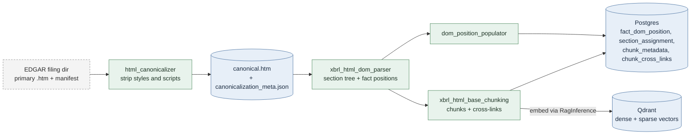

# XbrlRag — iXBRL HTML as the Canonical Source of Structure

How the XBRL flow addresses a filing, for anyone touching canonicalization, sections, chunking or
citations. **The iXBRL HTML primary document is the single source of truth** for section
structure, prose chunks and fact anchors. Every section, chunk and fact is located by byte offset
in one canonical HTML file, so facts and prose join deterministically, with no fuzzy matching and
no page-number heuristics.

Operating guide: [guide 4 §4.9](../guides/xbrl-flow/04-ingest-and-populate.md) (canonical HTML,
DOM positions, sections) and [guide 5](../guides/xbrl-flow/05-vectordb-load.md) (chunking and
Qdrant). Data model: [fact-store reference](XbrlRag_Materialized_Views.md). Ingest invariants:
[`src/ingest/sec_edgar/CLAUDE.md`](../../src/ingest/sec_edgar/CLAUDE.md).

---

## 1. Decision: HTML-canonical, not PDF

The EDGAR submission's primary document **is** the iXBRL HTML; XBRL fact anchors point into it.
A PDF, where one exists, is a derivative rendering whose pagination depends on the renderer. A
PDF page number and an HTML anchor have no canonical mapping, and fuzzy-matching thousands of
facts per filing against PDF pages produces false positives (the same value appears in the
income statement, MD&A and a segment note).

So the XBRL flow is keyed on the **HTML DOM**: sections are DOM ranges, chunks are byte ranges,
and iXBRL facts carry their own DOM position. The PDF/VLM pipeline survives only as the legacy
flow (maintenance-only).

---

## 2. Pipeline

*Green: deterministic code · Blue: data store · Grey: external source.*

- **Canonicalization** removes `<style>`, `<script>`, `<link>`, inline styles and event handlers;
  it keeps headings, ids, links, `ix:*` tags, tables and all text, and normalises whitespace
  (never inside `ix:` fact elements). The meta file records paths, sizes, SHA-256 and removal
  counts.
- **All byte offsets are relative to `canonical.htm`**; nothing downstream reads the raw download.
  Canonical HTML is written through the `normalized` storage role (`XBRLRAG_NORMALIZED_ROOT`, or
  its S3 prefix).
- The modules live in `src/ingest/sec_edgar/xbrl/` (canonicalizer, DOM parser, position
  populator) and `src/chunking/xbrl_html_base_chunking.py`; the Qdrant load is
  `src/pipelines/xbrl/load_to_vectordb_pipeline.py`.

---

## 3. The section tree

`build_section_tree` produces one tree per filing covering **every byte** of the document. Each
node has a stable `section_path` (e.g. `Part II > Item 7. MD&A > Results of Operations`),
start/end anchors and character offsets, and its parent and children. Content outside the table
of contents (cover, forward-looking statements, signatures, exhibits) still gets a real node and
path.

The parser handles the anchor patterns found in the corpus:

| Pattern | Shape |
|---|---|
| Workiva (most filers) | flat sibling `
`s; an empty anchor `
_<n>">`; heading text in the next sibling |
| Simple anchor | `
ITEM 1A…
`: the anchor's own text is the heading; `<td>` anchors fall back to the ToC link label |
| Page-number ToC | ToC link text is a page number, so the label comes from another cell of the row; a back-of-filing cross-reference index adds no sections ([toc-page-number-links](../specs/toc-page-number-links.md)) |
| Amendment / partial | no ToC links (for example a Part III-only 10-K/A) → a root-only tree |

Early iXBRL filings may put an `id=` on only some facts; only those can be position-linked, and
the parser logs a warning.

---

## 4. How facts and prose join

- **Fact → citation anchor.** Arelle stores the iXBRL element's HTML `id` as `fact.xml_id`;
  `fact_dom_position` records its byte range, page and `#xml_id` anchor, for statement and
  narrative facts alike.
- **Fact → section.** Statement facts take their section from the XBRL presentation linkbase
  (`mv_fact_section_assignment`); narrative facts take it from the HTML tree (`section_assignment`).
- **Chunk → section.** Each chunk's `section_path` comes from the same tree, so narrative facts
  and prose chunks share one vocabulary.
- **Fact ↔ chunk.** A **strong** link (`chunk_cross_links`) exists when a tagged element sits
  inside a chunk's byte range; **soft** links (same filing, same narrative section) come from
  `mv_fact_prose_links`. Together they let the HYBRID branch cite prose for a fact and surface the
  facts behind a matched chunk.
- **Retrieval by section.** Qdrant payloads carry `section_path` and `section_path_ancestors`
  (an array), so a narrative step can filter to a section subtree in one query.

---

## 5. Chunking invariants

- The chunker walks the canonical DOM in document order. Each prose element is atomic; a chunk
  accumulates whole elements up to `CHUNK_SIZE_IN_CHARS` and flushes early when the
  `section_path` changes. Every `<table>` is its own chunk.
- **Chunk byte ranges are contiguous and non-overlapping**: each recorded range is widened to end
  where the next begins, and the first starts at byte 0. Every byte belongs to exactly one chunk,
  which the interval-overlap cross-linker relies on.
- **`chunk_id` is deterministic**: `uuid5(namespace, "<accession>:<char_start>:<char_end>")`.
  Anything that changes chunk boundaries or canonical-HTML bytes changes ids and needs a
  re-index plan (re-chunk, re-link, re-load Qdrant).
- Table summarization is not part of the XBRL chunker; tagged table values are answered from the
  fact store.

---

## 6. Requirements and edge cases

- **`fact.xml_id` must match an element id in `canonical.htm`.** A single-document filing loads
  its iXBRL `.htm`; a multi-document filing loads EDGAR's extracted instance, which keeps the ids
  ([ingest-multidoc-ixbrl](../specs/ingest-multidoc-ixbrl.md)). The publish gate's
  anchor-coverage check (GATE-A) holds back a filing whose facts lack them.
- **Exhibits** are separate documents in the same accession and are not merged into the primary
  document's tree.
- **Not built:** a deterministic HTML → PDF renderer with a character-offset → page-coordinate map
  for highlighted citations. Citations carry the filing, `section_path`, the `#xml_id` anchor and
  the page from inline page markers.

---

## Key decisions

- **One canonical HTML, not PDF + HTML** — a dual scheme with a reconciliation layer was rejected
  as more failure modes for no benefit.
- **Byte offsets into the canonical file are the address space** — joins between facts, sections
  and chunks become interval overlaps, not text matching.
- **Deterministic chunk ids from offsets** — re-runs are idempotent; a boundary change is an
  explicit re-index.
- **Tables are answered from facts, not summarized** — the fact store already holds the tagged
  values exactly.

## Related

[Architecture](XbrlRag_Architecture.md) · [Fact-store data model](XbrlRag_Materialized_Views.md) ·
[guide 4](../guides/xbrl-flow/04-ingest-and-populate.md) · [guide 5](../guides/xbrl-flow/05-vectordb-load.md)
