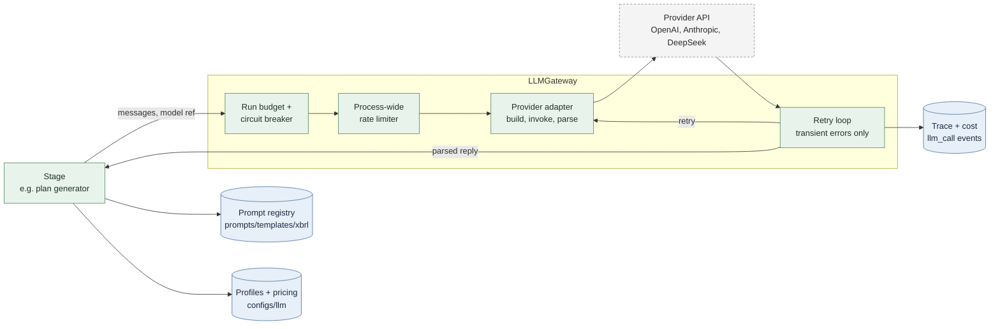

# XbrlRag — LLM Harness: Gateway, Prompt Registry, Escalation & Cost Controls

How the XBRL flow calls LLMs, for anyone adding a stage, a provider, a prompt version or an eval
arm. Every query-time LLM call (query decomposer, intent router, plan generator, synthesizer,
faithfulness verifier) and every eval arm's call goes through one provider-neutral gateway that
owns retry, cost, tracing, prompt resolution, escalation and budget enforcement. The PDF-legacy
wrappers (`openai_wrapper.py`, `anthropic_wrapper.py`, …) are outside this design.

**In this doc:** [Overview](#1-overview) · [Gateway](#2-gateway) · [Prompt registry](#3-prompt-registry) ·
[Escalation](#4-model-escalation) · [Cost controls](#5-cost-controls) · [Key decisions](#key-decisions)

Module reference: [`src/llm/README.md`](../../src/llm/README.md). Events and views:
[observability & tracing](XbrlRag_Observability_Tracing.md).

---

## 1. Overview



*Green: deterministic code · Blue: config / data store · Grey: external provider.*

The harness exists so that:

1. a provider can be swapped or added for any stage without touching pipeline code;
2. every prompt is tied to a provider, model series and version, with versions side by side;
3. an earlier prompt can be regression-tested against a newer model, measured;
4. a cheaper model that fails on a detectable signal escalates to a stronger one, and the
   escalation is recorded;
5. no run can overspend: spend is capped per run and throttled across the process.

---

## 2. Gateway

| Piece | File | Role |
|---|---|---|
| `build_xbrl_gateway` | `src/llm/xbrl_gateway.py` | The one injection point for the stages: shared rate limiter + run budget. |
| `LLMGateway` | `src/llm/gateway/gateway.py` | `complete` (and `complete_tools`, §2.2) run one loop: budget check, rate limit, adapter call, retry, cost and the `llm_call` trace event (provider, series, tier, requested `model`, `served_model`, `prompt_version`). |
| Adapters | `src/llm/gateway/adapters/` | `OpenAIAdapter`, `OpenAICompatAdapter` (`base_url` override for vLLM / OpenRouter / local), `DeepSeekAdapter`, `AnthropicAdapter`: translate the neutral request and parse the reply. Every SDK client has `max_retries=0`, so the gateway loop is the only retry layer and every attempt is traced. |
| `ModelRef` | `src/llm/gateway/model_ref.py` | Resolves a model id or tier alias to (provider, series, tier) plus the model's per-call config (output-token budget, temperature support, effort). |
| Profiles + pricing | `src/llm/profiles.py`, `configs/llm/` | Loads and validates `llm.yaml` and `pricing.yaml`; picks the active profile; prices a call. |
| `extract_json` | `src/llm/gateway/json_utils.py` | Strips fences and recovers the outermost balanced JSON from prose, so a chatty model degrades gracefully. |

**Model choice.** Models are committed config in [`configs/llm/llm.yaml`](../../configs/llm/llm.yaml);
never hardcode a model name in a stage or a doc. Each stage has a tier (`XBRL_STAGE_TIERS` in
`src/llm/profiles.py`: small / medium / frontier) and a **profile** maps the three tiers to
models. The file defines one profile per provider family (`openai` is the default; see the file
for the rest, including `anthropic` and the development-only `deepseek`). The active profile,
first match wins: `run_suite.py --llm-profile <name>` (recorded in the run's config), then
`XBRLRAG_LLM_PROFILE`, then the legacy switch `XBRLRAG_USE_REPLACEMENT_MODELS` (meaning
`openai-5.6`), then `openai`. An unknown name fails loud. Stages read the profile **when they are
constructed** ([`src/llm/stage_models.py`](../../src/llm/stage_models.py)); an explicit `model=`
still wins. Spec: [llm-provider-profiles](../specs/llm-provider-profiles.md).

**Structured output.** All five stages request `response_format="json"`, a neutral sentinel the
OpenAI adapter maps to JSON mode and the Anthropic adapter drops; `extract_json` covers the
difference.

**Failure behaviour per stage.** A refusal (`LLMRefusalError`) is never retried or escalated.

| Stage | On LLM / parse failure | On a refusal |
|---|---|---|
| Query decomposer | Passthrough: the query runs as one sub-query. | Passthrough. |
| Intent router | Falls back to the narrative branch. | Propagates: declined answer. |
| Plan generator | One validator retry, then escalation (§4), else an `{"error": …}` plan. | Propagates: declined answer. |
| Synthesizer | Escalation; if the top rung fails, a structured degraded answer. It never raises, so computed facts are kept. | Degraded answer with `synthesis_error.type="refusal"`. |
| Faithfulness verifier | Escalates the failed batch; if that fails, its statements are marked unverified. | Batch marked unverified. |

`XbrlRetrievalPipeline.generate` turns an escaped refusal into a declined answer
(`fully_answered=False`, `metadata.refused=True`, never cached). A `RunHalt` is different: the
run deciding to stop, so the pipeline re-raises it (§5).

### 2.1 Provider behaviour, cache points and retries

Spec: [llm-anthropic-and-caching](../specs/llm-anthropic-and-caching.md).

- **Cache points.** A neutral message may carry `"cache_point": True` ("cache the prompt up to
  here"); more than three in one request is a `ValueError` before any call. Anthropic turns it into
  a `cache_control` block (the system prompt is always one); OpenAI sends a request with a cache
  point through the Responses API with an explicit breakpoint, and one without through Chat
  Completions. The long-context eval arm marks the filing so cases on one filing share the prefix.
- **Anthropic requests** always stream; `max_tokens` is the model's `max_output_tokens` (adaptive
  thinking shares it), `output_config.effort` comes from the model row, and `temperature` is never
  sent for a model marked `temperature: false`. A reply with `stop_reason == "refusal"` raises
  `LLMRefusalError`, is recorded with `outcome: "refusal"` and does not advance the circuit breaker.
- **Transient errors** retry for every provider: HTTP 408, 409, 425, 429 and 5xx, or connection
  and timeout errors without a status, plus overload errors inside a streamed 200. Three attempts
  with capped exponential backoff, honouring `Retry-After`.
- **Flex 429s** (OpenAI's flex service tier, or a "resource unavailable" 429) retry under a
  separate, much longer policy (`XBRLRAG_FLEX_RETRY_*`), are not billed and never touch the circuit
  breaker ([llm-flex-retry](../specs/llm-flex-retry.md)).
- **Service tier per call**: requested vs served tier per provider and stage is counted on the
  trace (`src/observability/service_tiers.py`) and summed into an eval run's config.

### 2.2 Tool calling

Spec: [frontier-sec-tools](../specs/frontier-sec-tools.md); used by the `frontier_sec_tools` eval
arm. `LLMGateway.complete_tools` runs on the **same loop** as `complete` (budget, limiter,
retries, cost, trace), with neutral tool calls and results defined in `src/llm/gateway/tools.py`.
Each adapter keeps the provider's own continuation state (OpenAI Responses output items, Anthropic
content blocks with thinking signatures, DeepSeek `reasoning_content`) so reasoning is not redone
each turn; an adapter without tool support raises `ToolsUnsupportedError` before any call. Tool
output is untrusted: it reaches the model only as tool-role content encoded by `json.dumps`.

---

## 3. Prompt registry

Prompts are versioned files, never inline strings:

```
prompts/templates/xbrl/
  _base/<stage>/vN/{system.txt, user.txt}   # provider-neutral canonical prompts
  <provider>/<series>/<stage>/vN/…          # override only where a model needs different phrasing
  registry.yaml                             # per-stage default {provider, series, version}
```

[`prompts/prompt_registry.py`](../../prompts/prompt_registry.py) resolves
`(stage, provider, series, version)` by trying `{provider}/{series}` then `_base`. No provider
overrides exist today, so every model resolves to `_base`. The live versions are in
[`registry.yaml`](../../prompts/templates/xbrl/registry.yaml), each with a comment on what changed.

- **Two version stamps.** The semantic `vN` selects the files; the `llm_call` event's
  `prompt_version` is a **content hash** of the resolved text, which changes if a file is edited
  without a version bump.
- **Older versions stay on disk**: the regression matrix pins them and historical traces
  reference them. Every stage accepts `prompt_version` / `prompt_provider` / `prompt_series`
  overrides.
- **A template change bumps the version**: copy `vN` → `vN+1`, update `registry.yaml` and
  `DEFAULT_VERSIONS` in `test/unit/test_prompt_registry.py`, and validate on an eval slice
  ([evaluation](XbrlRag_Evaluation.md#8-how-changes-are-validated)).
- Untrusted text (filing text, chunks, user questions) reaches a prompt through `json.dumps(...)`
  in the user message, never the system prompt or `str.format`.

**Regression matrix.** [`src/eval/regression/prompt_matrix.py`](../../src/eval/regression/prompt_matrix.py)
runs `{prompt version} × {model}` arms; `scripts/eval/run_regression_matrix.py` scores them with
the golden-set grader and fails below `--min-accuracy`. `audit.v_llm_calls` groups by stage,
provider, series, tier, model and `prompt_version`, so comparing versions in production is a query.

---

## 4. Model escalation

`ESCALATION_POLICY` in `src/llm/config.py` names, per stage, a ladder of tiers and the triggers
that justify climbing:

| Stage | Ladder | Triggers |
|---|---|---|
| `synthesizer` | medium → frontier | `parse_error`, `empty_content` |
| `plan_generator` | medium → frontier | `plan_validation_failed` (after the local validate-retry) |
| `faithfulness_verifier` | small → medium | `parse_error` |

[`src/llm/escalation.py`](../../src/llm/escalation.py) climbs the ladder within the active profile
the stage was built with and emits a `model_escalation` event. A non-trigger failure degrades in
place. `audit.v_escalations` aggregates escalations; the rate over time is the signal for
re-tuning profiles or relaxing the ladder (listed as capability scaffolding in the
[re-audit register](../harness/REAUDIT.md)).

---

## 5. Cost controls

The budget, limiter and cache are **off by default** and change nothing until their env vars are
set.

| Control | Env | Behaviour |
|---|---|---|
| **Per-run budget + circuit breaker** (`src/llm/run_budget.py`) | `XBRLRAG_RUN_MAX_COST_USD`, `_LLM_CALLS`, `_TOKENS`, `_CONSECUTIVE_FAILURES` | Checked **before** each provider call. A trip raises a typed `RunHalt` (`RunBudgetExceeded` / `CircuitBreakerOpen`) and logs `budget_halt`; the pipeline marks the trace halted and re-raises with no partial answer. The eval runner ends the run `ABORTED` and resumable; serving surfaces return a "not answered: run halted" body ([xbrlrag-run-halt](../specs/xbrlrag-run-halt.md)). **Never swallow `RunHalt` in a broad `except`.** |
| **Process-wide rate limiter** | `XBRLRAG_LLM_RPM`, `XBRLRAG_LLM_TPM` | One limiter shared by every stage and concurrent query, so fan-out throttles instead of hitting 429s. |
| **Semantic query cache** ([`query_cache.py`](../../src/pipelines/xbrl/query_cache.py)) | `XBRLRAG_QUERY_CACHE=1` (`_L2=1` for the vector tier) | Wraps `pipeline.generate` for every surface: exact match on the normalized query, plus opt-in embedding similarity for paraphrases. Invalidated cross-process by the Postgres `query_cache_epoch`, which every publish bumps. |
| **Prompt caching** | always on | Cached and cache-write tokens are captured on each `llm_call` and priced at their own rates; explicit cache points are §2.1. |
| **Complete pricing** | always on | [`configs/llm/pricing.yaml`](../../configs/llm/pricing.yaml) is the rate card. Every model a profile uses must have a row or loading fails, and `CostTracker` **raises on an unpriced model** rather than recording $0. |

Every new loop or fan-out that makes LLM calls needs a bound and must let `RunHalt` propagate
([`.claude/rules/rag.md`](../../.claude/rules/rag.md)).

---

## Key decisions

- **One gateway, no direct SDK calls** — retry, cost, budget and tracing are enforced once, for
  every stage, escalation and batch.
- **Tiers in code, models in config** — stages name a tier; profiles in `llm.yaml` bind tiers to
  models, so a provider switch is a config change and runs record which profile they used.
- **Routing and decomposition on the medium tier** — they are the accuracy-critical triage steps;
  a misroute sends the whole query down the wrong branch (an earlier smallest-tier design was
  reversed).
- **Verifier on the small tier in bounded batches** — cheap, and cannot exhaust its budget on
  reasoning.
- **SDK retries disabled** — the gateway is the only retry layer, so every attempt is visible.
- **Refusals are final** — retrying a refusal wastes spend and hides the signal.
- **Unpriced models fail loud** — a $0 record would make the run budget blind.

## Related

[Observability & tracing](XbrlRag_Observability_Tracing.md) · [Evaluation](XbrlRag_Evaluation.md) ·
[`src/llm/README.md`](../../src/llm/README.md) · [`src/retriever/xbrl/CLAUDE.md`](../../src/retriever/xbrl/CLAUDE.md)
