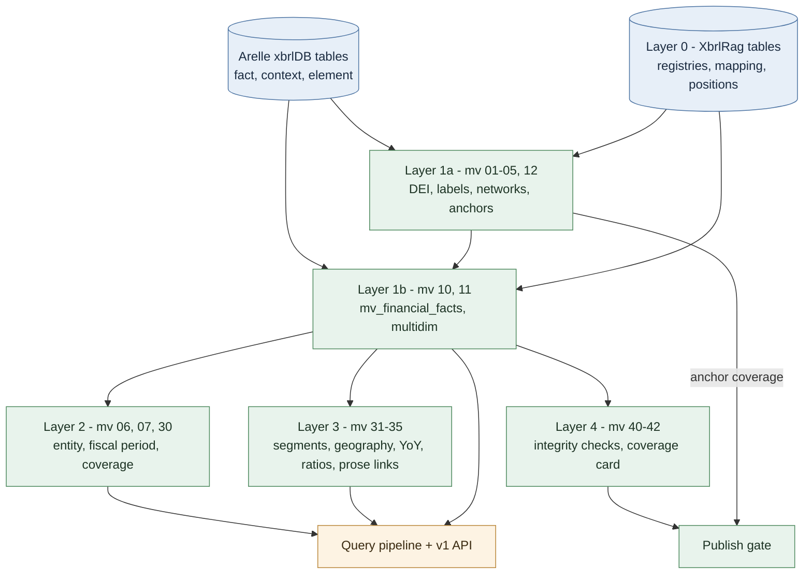

# XbrlRag — Fact-Store Data Model (Arelle xbrlDB + Layer 0 + Materialized Views)

The data-model reference for the XBRL fact store in Postgres `xbrl_db`: what the Arelle loader
actually populates, the tables XbrlRag owns ("Layer 0"), and the 19 managed materialized views
the query pipeline reads. Read it before writing SQL against the fact store or changing a view.
**The SQL in [`scripts/ddl/`](../../scripts/ddl/) is the canonical definition**; this document
explains purpose, invariants and dependencies.

Setup and rebuild commands: [guide 2](../guides/xbrl-flow/02-postgres-setup.md) (schema) and
[guide 4](../guides/xbrl-flow/04-ingest-and-populate.md) (populate, view rebuild). Analyst
question → canonical SQL per view: [`scripts/xbrl/analyst_queries.sql`](../../scripts/xbrl/analyst_queries.sql).
Ingest-side invariants: [`src/ingest/sec_edgar/CLAUDE.md`](../../src/ingest/sec_edgar/CLAUDE.md).

**In this doc:** [Arelle traps](#1-what-the-arelle-loader-really-gives-you) · [Layers](#2-layers) ·
[Layer 0](#3-layer-0--xbrlrag-owned-tables) · [Views](#4-materialized-views) ·
[Invariants](#5-invariants) · [Publish gate](#6-publish-gate) · [IFRS](#7-ifrs--20-f) ·
[Known defects](#8-known-defects-and-not-built) · [Key decisions](#key-decisions)

---

## 1. What the Arelle loader really gives you

XbrlRag loads iXBRL with `arelleCmdLine` and the **public-schema xbrlDB plugin**
([`scripts/ddl/base/`](../../scripts/ddl/base/README.md)). Its schema has traps; every view is
written against what the plugin actually populates, not what the DDL suggests.

| Expected | Real |
|---|---|
| `data_point`, `concept`, `filing`, `aspect_value` | `fact`, `element`, `accession`, `context_dimension` |
| a `period` table | inline on `context`: `period_start`, `period_end`, `period_instant` |
| `fact.value`, `.decimals`, `.filing_id` | `fact.effective_value` (numeric; `fact_value` is the raw string), `decimals_value`, `accession_id` |
| `accession.accession_no` | `accession.filing_accession_number` |
| `qname.qname` | none: build `namespace \|\| ':' \|\| local_name` (a **versioned** namespace URI, e.g. `http://fasb.org/us-gaap/2025:Revenues`) |
| `unit.measure` | `unit_measure → qname` (`location_id` 1 measure, 2 numerator, 3 denominator) |
| a ticker column | none anywhere in xbrlDB; XbrlRag's `entity_master` holds it |

- **Left NULL by the plugin** (XbrlRag derives them): fiscal year/period, `is_extended` and
  `uom` on `fact`; document type, entity name, `is_most_current` and restatement index on `accession`; all of
  `context_aug` / `fact_aug`. Fiscal focus and form type come from DEI cover-page facts
  (`mv_dei_metadata`) and `filing_registry`; the canonical version is
  `filing_registry.superseded_by IS NULL`.
- **Never written:** `entity` (so `accession.entity_id` is `0`), `context_aug`, `fact_aug`,
  `reference_part*`.
- **`relationship` holds only concept-to-concept arcs.** Label, reference and footnote arcs are
  dropped, so `concept_labels` is filled by walking the label linkbase in Arelle at ingest.
- **Fact → CIK** is always `LPAD(context.entity_identifier, 10, '0')` with
  `entity_scheme = 'http://www.sec.gov/CIK'`.
- **`fact.xml_id` is the fact's element id in `canonical.htm`**, the citation anchor. A
  single-document filing loads its iXBRL `.htm`; a multi-document filing loads EDGAR's extracted
  instance, which keeps the ids ([ingest-multidoc-ixbrl](../specs/ingest-multidoc-ixbrl.md)).
  `mv_anchor_coverage` catches a filing with too many facts lacking one.

---

## 2. Layers

*Green: deterministic SQL view · Blue: base tables · Amber: consumers.*

Layers 2–4 read `mv_financial_facts`, so one rebuild of it cascades. Layer 1a exists because
`mv_financial_facts` needs inputs the plugin does not compute: fiscal focus and form type,
section paths and calculation arcs. (`mv_financial_facts_multidim`, 11, is built from raw
tables, independent of 10.)

---

## 3. Layer 0 — XbrlRag-owned tables

| Table | Holds | Written by |
|---|---|---|
| `entity_master` | CIK → name, symbol, exchange, filer category, FYE month/day, latest FY/accession; trigram index on name | `scripts/ddl/populate/entity_master.sql` + `entity_identity.py` |
| `filing_registry` | canonical-filing tracker: form, FY/period, filed date, `is_amendment`, `superseded_by` (NULL = canonical); a Part III-only 10-K/A never supersedes the 10-K | ingest registries step |
| `fiscal_calendar` | (CIK, FY, period) → exact date bounds | ingest registries step |
| `concept_mapping` | concept family ("Revenue") → ranked QName list, with per-filer overrides | `generate_concept_mapping.py` + override pass + `populate/concept_mapping_ns_expand.sql`; `ns_expanded` rows re-derived by `Layer0Populator` (§5.1) |
| `concept_labels` | concept → label per role / language; `cik_override` for extension concepts | `export_concept_labels.py` (Arelle plugin) |
| `dimension_catalog` | per-filer explicit axis/member QNames + labels | `populate/dimension_catalog.sql`, labels patched by `DimensionMembersPopulator` |
| `member_aliases` | old → new member per (CIK, axis) for true renames between years | `member_alias_detector.py` |
| `geography_normalization` | country/region member → ISO code, name, type | `generate_geography_normalization.py` |
| `fact_dom_position` | per fact: `xml_id`, character range, page, `#xml_id` anchor | `dom_position_populator.py` |
| `section_assignment` | HTML section path for tagged facts outside the statements | `dom_position_populator.py` |
| `chunk_metadata` | SQL mirror of every Qdrant prose chunk: filing, section, offsets, page, prev/next | XBRL chunker |
| `chunk_cross_links` | **strong** fact ↔ chunk links (DOM range overlap) | XBRL chunker |
| `publish_manifest` | per-filing publish-gate record (§6) | `promotion.py` |
| `query_cache_epoch` | single-row cross-process cache-invalidation marker | `promotion.py` bumps it on publish |

The `scripts/ddl/populate/` files run in `scripts/bootstrap_db.py`'s `layer0-populate` step.
They avoid `;` inside comments, because `scripts/dbq.py` splits on every semicolon.

---

## 4. Materialized views

Applied by [`scripts/rebuild_mvs.py`](../../scripts/rebuild_mvs.py) in filename order. Each file
drops its own view first, so a rebuild is idempotent, and a guard fails the run if any
materialized view outside the managed set was dropped by a `CASCADE` and not recreated. Run it
**after every load**: skipping it silently serves stale numbers.

| # | View | Purpose |
|---|---|---|
| 01 | `mv_dei_metadata` | DEI cover-page facts per accession (document type, fiscal focus, period end, registrant, symbol, float, shares); replaces the NULL `accession` columns. |
| 02 | `mv_label_index` | Best English label per concept (standard over terse/verbose; filer over taxonomy). |
| 03 | `mv_presentation_network` | Presentation linkbase, with SEC role definitions parsed into section label and order. |
| 04 | `mv_fact_section_assignment` | Statement fact → presentation section path, depth, order (narrative facts use `section_assignment`). |
| 05 | `mv_anchor_coverage` | Share of facts per accession carrying an `xml_id`; the GATE-A input (§6). |
| 06 | `mv_entity_registry` | Ticker / name → CIK without an LLM (trigram index), plus FYE month. |
| 07 | `mv_fiscal_period_bounds` | (company, FY) → exact bounds; flags non-calendar fiscal years. |
| 10 | `mv_financial_facts` | **The primary retrieval surface**; every `lookup`, `screen` and `breakdown` reads it (§4.1). |
| 11 | `mv_financial_facts_multidim` | Facts with two or more dimensions, as JSONB. |
| 12 | `mv_calculation_network` | The calculation linkbase (both `summation-item` arcroles): parent, child, weight. |
| 30 | `mv_concept_coverage` | Which QNames a filer actually tags per family and period. |
| 31 | `mv_segment_matrix` | Segment members × periods with `pct_of_axis_total` (share of the consolidated total, not a sum over the axis) and `segment_rank`. |
| 32 | `mv_geographic_facts` | Geographic facts with normalized `geo_code` / `geo_name` / `geo_type` and `pct_of_total` ([segment-geo-views](../specs/segment-geo-views.md)). |
| 33 | `mv_yoy_comparison` | Year-over-year pairs with both `fact_id`s; the prior is the filing's own comparative, else the prior filing's column; period lengths expose 53-week years. |
| 34 | `mv_derived_metrics` | The ratio library, one row per (CIK, FY, period, metric) with `component_fact_ids`; its names are the planner's `derived:<Name>` vocabulary. |
| 35 | `mv_fact_prose_links` | Strong plus **soft** (same filing and section) fact ↔ chunk links; the HYBRID branch's surface. |
| 40 | `mv_sum_of_parts_checks` | XBRL Calculations 1.1 checks per filing, status `pass` / `fail` / `partial` / `inapplicable` ([calc-check-c11](../specs/calc-check-c11.md)). |
| 41 | `mv_filing_completeness` | Share of expected rank-1 concept families present per filing; the GATE-B input. |
| 42 | `mv_coverage_card` | Per (filer, FY, metric) for ten committed card metrics: tagged with a standard, extension or component-only concept, or absent ([coverage-card](../specs/coverage-card.md)). |

### 4.1 `mv_financial_facts`

One row per numeric fact in a canonical 10-K, 10-Q or 20-F filing, flat on at most one
dimension, carrying identity (`fact_id`, CIK, ticker, accession, fiscal year/period), concept
(versioned QName, label, `concept_family`, `concept_pref_rank`), value and unit, period and
dimension, and provenance (section path, linked chunk ids). Columns readers most often get wrong:

- **`is_current_period`** marks the filing's own column, not a prior-year comparative.
  `document_period_end` is inclusive: the own column ends exactly at `document_period_end + 1`.
- **`duration_kind`** (`instant`, `quarter`, `half`, `nine_month`, `annual`, `other`) separates
  a 10-Q's discrete quarter from its year-to-date figure at the same `period_end`. The day bands
  mirror `period_disclosure.duration_class` ([period-disclosure](../specs/period-disclosure.md));
  an `other` row never answers a quarter or a year.

The full column list is the `SELECT` in [`10_mv_financial_facts.sql`](../../scripts/ddl/mv/10_mv_financial_facts.sql).

---

## 5. Invariants

These rules came from real failures on the live corpus. Any new query over these views must
respect them.

### 5.1 Concept mapping

- **Join keys are versioned namespace URIs.** `concept_mapping` carries a full-namespace
  `ns_expanded` row per (family, namespace version, override). They are derived, never edited:
  after every mapping write `Layer0Populator._sync_ns_expanded` re-derives them and fails on any
  copy whose rank or deprecation differs from its base row
  ([ns-expand-rank-sync](../specs/ns-expand-rank-sync.md)). Without them every lookup is
  NOT_FOUND.
- **Winner-takes-one.** The view picks one family per fact by `preference_rank`, so a (QName,
  override) pair never has two families at the same rank; `Revenue` wins over
  `ProductRevenue` / `ServiceRevenue`.
- **Rank bands.** A family's primaries rank 1…n; **components** (parts of the measure or
  neighbouring measures) rank from **50** and are never rank 1. A filer's rank-1 concept is the
  eligible one it reports in the most years ([concept-rank-integrity](../specs/concept-rank-integrity.md)).
- **A family's primaries are its own measure.** A larger or neighbouring measure is only ever a
  component (for example `Debt` is `LongTermDebt`; current portions, borrowings and leases are
  components or excluded). A filer that tags only a component gets a refusal, not another measure
  ([concept-key-integrity](../specs/concept-key-integrity.md),
  [family-measure-equivalence](../specs/family-measure-equivalence.md)).
- **Anything that collapses to one row per filer orders by `concept_pref_rank` and skips the
  component band**, never by `fact_id` ([evaluation](XbrlRag_Evaluation.md#7-what-the-eval-taught-us)).

### 5.2 Dimensions and namespaces

- `segment_axis` / `segment_member` use a short prefix for standard taxonomies (`us-gaap`, `srt`,
  `dei`, `ecd`, `country`, `ifrs-full`); **filer extensions keep the full URI**, so match them by
  local name (`LIKE '%:DataCenterMember'`) or label.
- **Year-over-year joins match on local name**, because each annual filing declares a new
  date-stamped namespace. True member renames go through `member_aliases`.
- **YoY joins stay within one unit** and the same `fiscal_period` and `duration_kind` (a 20-F
  reports TWD plus a USD convenience translation).
- **Geography:** `srt:StatementGeographicalAxis` (US GAAP) or `ifrs-full:GeographicalAreasAxis`
  (IFRS). Normalization maps some distinct members to one name and `geo_code` is unreliable for
  URL-style filer namespaces, so breakdowns use the filer's own member label.
- **Analytical views filter `is_current_period`** and partition by `fiscal_period` and
  `duration_kind`, so comparative columns never inflate a sum or rank.
- **`ConsolidationItemsAxis = OperatingSegmentsMember`** is neutral to the lookup.

### 5.3 Values

- **Units are explicit.** Lookups resolve in one unit, the reporting currency by default. Never
  add, compare or divide across units.
- **Rounded duplicates are one value**, answered from the most precise fact (`decimals_value`).
- Nil facts and `INF` decimals never become 0.

---

## 6. Publish gate

[`src/ingest/sec_edgar/xbrl/promotion.py`](../../src/ingest/sec_edgar/xbrl/promotion.py) writes
one `publish_manifest` row per filing after its facts load and the gate views rebuild:

| Gate | Checks | Effect |
|---|---|---|
| **GATE-A** (structural) | `mv_anchor_coverage.xmlid_coverage_pct ≥ 0.95` and no fact holding `(ixTransformValueError)` ([ixt-sec-transforms](../specs/ixt-sec-transforms.md)) | Always blocks: a low value breaks citation anchors |
| **GATE-B** (semantic) | `mv_filing_completeness.coverage_pct ≥ 0.65` and no *new* strict calculation failure (per accession, not on the shrink-only list `configs/ingest/calc_c11_exceptions.csv`) | Recorded; blocks only with `XBRLRAG_PUBLISH_GATE_B_ENFORCE=1` |

- Held-back filings stay in the tables; the fact-store read paths exclude them through a
  **read-time deny-list** (`publish_gate_clause`). Every publish bumps `query_cache_epoch`.
- **Caveat:** the views themselves do not read the gate, and the eval corpus fingerprint is
  built from `publish_manifest`, so a load can change the queryable corpus without changing the
  fingerprint.

---

## 7. IFRS / 20-F

A 20-F filer under IFRS (`ifrs-full:*`, e.g. TSMC) parses like a 10-K. Form filters accept
`20-F%`, the IFRS namespace counts as standard for `is_extended`, and `concept_mapping` carries
IFRS rows so a family such as `Revenue` resolves for US-GAAP and IFRS filers in one query. Some
families have no clean IFRS equivalent (IFRS mandates no operating-income subtotal; there is no
standard concept for concentration-risk percentage or segment count); those questions fall to the
narrative branch. The 20-F's own currency is the reporting currency; USD figures in it are
convenience translations.

---

## 8. Known defects and not built

- **Segment shares overlap by design; duplicate members remain** (feature `WS1-A4`).
  `pct_of_axis_total` and `pct_of_total` divide by the consolidated total, so an aggregate and
  its children each show their true share and one axis's shares do **not** sum to 1.00. Never sum
  them across members; pick a partition first (the `breakdown` op's `choose_partition`). A member
  tagged twice in one filing still appears twice: the dedupe half of `WS1-A4` is open.
- **Not built:** a member-label trigram view (hints match `segment_label` and
  `dimension_catalog`), a restatement log (point-in-time answers come from `as_of` /
  `as_originally_reported` on the v1 API), online `REFRESH … CONCURRENTLY` (rebuilds drop and
  recreate), and capture of Arelle validation messages (the public schema has no `message` table).

---

## Key decisions

- **Write views against what the plugin populates**, not the DDL — the xbrlDB schema promises
  columns it never fills (§1).
- **Views are drop-and-recreate SQL files, rebuilt after every load** — idempotent and
  reviewable; the orphan guard protects views outside the managed set.
- **Concept resolution is data, not prompt** — ranked `concept_mapping` rows with a component
  band keep "one number per filer" deterministic and refusable (§5.1).
- **GATE-A blocks, GATE-B advises** — a missing anchor breaks citations for certain; the
  completeness signal is not calibrated enough for a binary gate.
- **Shares divide by the consolidated total** — an honest share per member; partitions are
  chosen explicitly rather than assumed ([segment-geo-views](../specs/segment-geo-views.md)).

## Related

[Architecture](XbrlRag_Architecture.md) · [HTML canonical source](XbrlRag_HTML_Canonical_Source.md) ·
[`scripts/ddl/`](../../scripts/ddl/) · [guide 2](../guides/xbrl-flow/02-postgres-setup.md) ·
[guide 4](../guides/xbrl-flow/04-ingest-and-populate.md)
