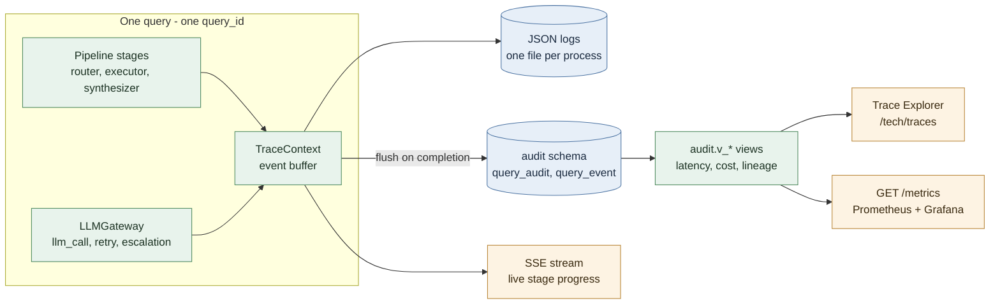

# XbrlRag — Observability & Tracing (XBRL flow)

The design of the XBRL flow's tracing: the trace model, the event kinds, the `audit` schema and
the Prometheus export. Read it before adding a stage, an event or a dashboard. Operator view (UI
routes, example queries, dashboards): [guide 7](../guides/xbrl-flow/07-api-ui-observability.md).

**In this doc:** [Overview](#1-what-it-must-answer) · [Trace model](#2-trace-model) ·
[Event kinds](#3-event-kinds) · [Persistence](#4-persistence-audit-schema) ·
[Metrics](#5-metrics-and-alerting) · [Reproducibility](#6-reproducibility) · [Key decisions](#key-decisions)

---

## 1. What it must answer

For **any** historical query, after the fact: how long it took and where the time went; what it
cost per stage and model; which branch the router took and why; which retries, escalations or
fallbacks happened; **what exactly produced each displayed number** (which `fact_id`s, which SQL,
which arithmetic); and whether the run can be reproduced.

*Green: deterministic code · Blue: data store · Amber: user-facing surface.*

The principle: **one trace per query, one instrumented gateway for every LLM call, structured
events persisted to a queryable store, and an explicit numeric-lineage record.** It is
self-contained (JSON logs + Postgres) and needs no external tracing backend.

---

## 2. Trace model

[`src/observability/trace_context.py`](../../src/observability/trace_context.py):

- **`trace_query(query, user_id)`** opens a `TraceContext` at the top of
  `XbrlRetrievalPipeline.generate()` with a `query_id` (uuid4), the correlation key carried by
  every event, log line, audit row and eval case result. It lives in a `contextvars` variable, so
  deep callees need no signature change.
- **`traced_stage(name)`** times a stage and tags every log line inside it with `stage`.
- **`log_event(kind, **fields)`** appends a structured event to the trace and to the
  `xbrlrag.events` logger, which the SSE stream (`src/api/streaming.py`) taps for live progress.
- On completion the trace emits `query_summary` and is flushed to an `AuditSink`
  (`PostgresAuditStore`), **fail-soft**: an audit-store outage never fails a query. Every payload
  is NUL-scrubbed first ([`src/db/scrub.py`](../../src/db/scrub.py)): Postgres rejects U+0000 and
  the trace is written in one transaction, so one stray byte would lose all of it.
- **Usage without a query row.** `src/observability/usage_meter.py` opens a private trace so a
  `/api/v1` call can report its own LLM spend without writing an `audit.query_audit` row
  ([usage-cost](../specs/usage-cost.md)).

**Logging.** [`configs/logging.yaml`](../../configs/logging.yaml) +
[`src/logging_config.py`](../../src/logging_config.py): JSON formatter, a filter that stamps
`query_id` and `stage` on every record, one file per process at `logs/xbrlrag_<process>_<pid>.log`,
pruned after 7 days.

---

## 3. Event kinds

| Kind | Emitted by | Carries |
|---|---|---|
| `query_start` / `query_summary` | `trace_query` | query text, user id / total and per-stage latency, cost, LLM-call count, branch, `degraded`, `fully_answered`, error |
| `subquery` | retrieval pipeline | decomposed sub-query id, `depends_on` |
| `intent_extraction` | intent router | intent, mentions, resolved entities |
| `decision` | pipeline, router, executor, citation check | a routing branch and reason, or a fallback / rule firing (e.g. `derived_family_fallback`, `citation_integrity`) with its outcome |
| `llm_call` | `LLMGateway` | stage, provider, series, tier, requested and served model, `prompt_version` (content hash), latency, tokens incl. cached, USD cost, outcome; prompt and response bodies when enabled |
| `retry`, `model_escalation`, `budget_halt` | gateway, `src/llm/escalation.py` | attempt and error class; from/to model and reason; which budget cap tripped |
| `sql_query` | fact-store lookup / screen | the exact parameterized SQL and parameters |
| `numeric_lineage` | plan executor | lookup: `fact_id`, confidence, notes; compute: expression, bindings, result, source `fact_id`s. Emitted on success **and** failure. |
| `verifier_error` | faithfulness verifier | the verifier did not run cleanly (`LLM_ERROR` / `PARSE_ERROR`) |
| `query_cache` | retrieval pipeline | cache hit and stats |
| `tool_call` | `frontier_sec_tools` eval arm | one tool invocation |
| `publish_gate`, `drift_alert` | ingest promotion, eval drift check | gate report; drift report |

`audit.query_event.payload` is JSONB with a GIN index, so a new event kind or field needs no
migration. The full field list of each event is in the emitting code.

- **LLM bodies.** `llm_call` carries the system prompt, user prompt and response (each truncated
  to 24,000 characters) unless `XBRLRAG_TRACE_LLM_BODIES=0`. Nothing else in a trace or log may
  carry secrets or PII.
- **Verifier honesty.** A verifier that never ran is distinguishable from a clean pass: its
  status lands in `metadata.faithfulness.status`, `fully_answered` is forced false, and a caveat
  and `verifier_error` are added.
- **Numeric lineage is the audit artifact.** A join on `query_id` recovers fact → filing → SQL →
  arithmetic → displayed value; `audit.queries_for_fact(fact_id)` answers the reverse question.

---

## 4. Persistence (`audit` schema)

DDL in [`scripts/ddl/audit/`](../../scripts/ddl/audit/) (`query_audit.sql`, `ingestion_runs.sql`,
`analyst_views.sql`), applied by `scripts/ddl/audit/_apply.py` (also a step of
`scripts/bootstrap_db.py`).

| Object | Holds |
|---|---|
| `audit.query_audit` | One row per query: latency, cost, branch, flags, and **`answer`** (the full final response the Ask page and Trace Explorer render). |
| `audit.query_event` | One row per event (`kind`, `payload` JSONB). |
| `audit.ingestion_run` / `_item` | One row per ingest run and per filing: scope, timings, status, attempts, and failures classified **retryable vs permanent** (`src/observability/ingestion_audit.py`). |
| `audit.v_*` views | Query side: recent queries, daily rollup, latency percentiles, stage latency, branch mix, LLM calls by stage / model / prompt version, model cost, escalations, numeric lineage, verifier failures. Ingest side: runs, daily, failures, retries. |

There are no foreign keys from `audit` into the fact tables, or from `eval` into `audit`:
retention differs, and a dangling id should degrade a link, not break a record. Ingest retries
only the `timeout` class with bounded backoff ([`src/ingest/util/retry.py`](../../src/ingest/util/retry.py)),
recording attempts per item.

---

## 5. Metrics and alerting

- **Exporter:** [`src/observability/metrics_exporter.py`](../../src/observability/metrics_exporter.py)
  renders the `audit.v_*` views as Prometheus text, with no client library. It always emits
  `arag_audit_db_up` (1/0) and derives `arag_query_error_rate` and `arag_query_degradation_rate`
  for alerting.
- **Scrape target:** `GET /metrics` on the BFF (`src/api/routes/metrics_prom.py`). It degrades to
  `arag_audit_db_up 0` with a parseable body and never returns 500. A CLI
  (`python -m src.observability.metrics_exporter`) serves textfile collection.
- **Dashboards + alerts:** [`configs/monitoring/`](../../configs/monitoring/README.md)
  (`prometheus.yml`, `alerts.yml`, `grafana_dashboard.json`).
- Metric names keep the `arag_*` prefix and alerts `Arag*` on purpose (naming note in the root
  [`CLAUDE.md`](../../CLAUDE.md)).

**Not built:** OpenTelemetry (OTLP) push, an easy swap once a collector exists, and per-user
dimensions, which need authentication first.

---

## 6. Reproducibility

Each query records the model id, the resolved prompt refs and their content-hash
`prompt_version`, the plan, every SQL statement, the retrieved `fact_id`s and `chunk_id`s, and the
final answer, so a past answer can be re-derived and explained. Prompt versioning:
[LLM harness](XbrlRag_LLM_Harness.md#3-prompt-registry).

---

## Key decisions

- **Self-contained: Postgres + JSON logs, no tracing backend** — one less service; the same store
  feeds the UI, SQL analysis and Prometheus.
- **Fail-soft persistence** — observability must never fail a query.
- **Schemaless event payloads (JSONB)** — new events need no migration.
- **Lineage on failure too** — a refused or errored number is as auditable as an answered one.
- **No cross-schema foreign keys** — audit, eval and fact data have different lifetimes.

## Related

[LLM harness](XbrlRag_LLM_Harness.md) · [UI design](XbrlRag_UI_Design.md) ·
[guide 7](../guides/xbrl-flow/07-api-ui-observability.md) · [`src/api/CLAUDE.md`](../../src/api/CLAUDE.md)
