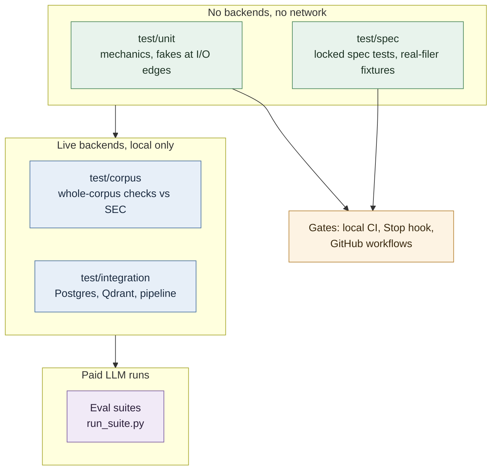

# XbrlRag test strategy: proving the XBRL depth

How XbrlRag's tests are organised and what they must prove: that the system handles the ways
real filers tag their numbers (extensions, restatements, fiscal calendars, dimensions, units,
calculation relationships) better than a frontier model with tools over the SEC's public APIs.
It is for anyone adding a test, a fixture or a corpus check, or deciding which gate a change
must pass. How accuracy is then measured end to end is in the
[evaluation design](XbrlRag_Evaluation.md).

**In this doc:** [Overview](#overview) · [Principles](#principles) ·
[Test layout and gates](#test-layout-and-gates) · [Nuance matrix](#the-nuance-matrix-where-depth-beats-a-frontier-model) ·
[Test types](#test-types) · [SEC reference data](#the-sec-reference-data-and-its-reader) ·
[Areas](#areas) · [Number comparison](#number-comparison) · [Open gaps](#open-gaps) ·
[Key decisions](#key-decisions)

## Overview

A competitor can call the same SEC APIs, so XbrlRag's edge is only as real as the evidence that
it handles filer nuances correctly. Tests therefore check results against **independent
sources** (SEC data, the filed statement, a closed form computed in the test), never against XbrlRag's
own views, mapping or a previous run, and they run in layers from cheap and always-on to
live-backend and paid.

*Green: deterministic, runs anywhere · Blue: needs the live database · Purple: paid LLM calls · Amber: gate.*

## Principles

1. **An independent oracle, always.** An expected value comes from SEC (companyfacts, the
   Financial Statement Data Sets, the filing itself), from a hand check of the filed statement,
   or from a closed form computed in the test.
2. **Two sources before a verdict.** A corpus check flags a stored value only when two independent
   sources agree with each other and disagree with the store. A disagreement between the sources is
   reviewed by a person, never resolved automatically.
3. **Complex cases first.** Coverage is counted in nuance categories covered with real filers,
   not in test count, and each category needs its hardest real examples (a restated, non-USD,
   52/53-week filer in a cross-filer screen), not only the clean lookup.
4. **Test where a frontier model fails.** Each nuance below names why a capable model with SEC
   tools gets it wrong; those cases get the most tests.
5. **Real SQL runs in tests** wherever a backend is available: views and queries execute against
   a database, not a fake that imitates the SQL.
6. **Gaps shrink only.** Every corpus check has a reviewed exceptions list that may only get
   shorter, like `ruff-burndown.toml`.
7. **Held-out data stays out.** No fixture, audit or test reads H-F, H-X, set B or the
   `xbrl_heldout` database.
8. **Locked specs for behaviour.** Fixes where a wrong result could go unnoticed go through the
   tdd-spec route: tests from `docs/specs/<id>.md`, proven red, locked, then implementation.
9. **No tuning on test data.** Rules stay general, never filer-specific; a rule change has to win
   on filers it was not written from, judged once on a sample that is not read again.

## Test layout and gates

| Directory | What it holds | Needs | Runs in |
|---|---|---|---|
| `test/unit/` | Mechanics of every module; fakes only at I/O boundaries behind a `base.py` interface | Nothing | `ci.yml`, local CI (`-n auto`), the Stop hook (`-x`) |
| `test/spec/<id>/` | Locked spec tests, one directory per spec, from committed real-filer SEC excerpts (accession, URL, SHA-256) | Nothing | `tdd-spec.yml` and local CI via `tools/tdd/tdd.py ci` |
| `test/corpus/` | Whole-corpus cross-checks against SEC companyfacts, with a shrink-only exceptions file | `xbrl_db` and the companyfacts cache; skips otherwise | Manually, after an ingest or mapping change |
| `test/integration/` | Live views, the publish gate, MCP and API, the v1 lookup-agreement check, pipeline end to end | Postgres, and for some Qdrant, RagInference and a provider key; skips per backend | Manually (`-m integration`); never in CI |
| `test/eval/` | Committed suites and the golden set (data, not tests) | — | Read by `scripts/eval/` |

Implementing agents never edit locked spec tests; the path guard (`tdd-path-guard.yml`), the
hooks and CI hold that line, and a disputed test goes to the maintainer as a dispute file.

**Gates.**

- **Local CI** ([`scripts/ci/local_ci.py`](../../scripts/ci/local_ci.py)) runs the GitHub gates
  on this machine for a PR head or `main`, in a throwaway worktree outside the repository with
  provider keys and backend settings removed: `tdd manifest-check`, `tdd path-guard` (PRs),
  `tdd ci` (spec tests) and `pytest test/unit` are required; ruff, the standards checks and
  mypy are advisory. `watch` polls open PRs; results land under `data/ci/runs/<sha>/`, and
  `--post` comments them on the PR. It exists because GitHub Actions minutes ran out; the
  workflows below remain the reference definition.
- **GitHub workflows** (`.github/workflows/`): `ci.yml` (standards, advisory; unit tests),
  `tdd-spec.yml` (spec and regression tests with main's tdd tools), `tdd-path-guard.yml` (which
  paths a branch may change), `docker.yml` (images, compose, Helm), and `xbrl-regression.yml`
  (golden-set matrix and drift check, weekly or on dispatch, which needs live backends).
- **Stop hook** (`.claude/hooks/stop_gate.py`): refuses to end an agent turn on a red
  `pytest test/unit` when a test input changed.
- After an implementation lands, run all of `test/spec`, not only the new spec's directory:
  retired spec directories can break silently.

## The nuance matrix: where depth beats a frontier model

| # | Nuance | Why a frontier model with SEC APIs gets it wrong | What XbrlRag must do | How it is tested |
|---|---|---|---|---|
| N1 | Concept choice: one metric, several standard elements, changing across years | It sees one tag and calls the metric missing, or picks a component | Every family covers the elements filers really use, by year | Corpus check that every presented statement line resolves or is a reviewed exception; real-filer fixtures |
| N2 | Custom extensions | companyfacts omits extension facts | Classify an extension by its calculation parent and presentation position | Fixtures from the bulk data sets (`tag`, `pre`), cross-checked with the filing |
| N3 | Totals versus components | It sums or picks a sub-total | Use the filer's calculation tree; never answer a total with a component | Calculation-tree invariants; a sum-of-parts check that agrees with Arelle |
| N4 | Fiscal years: 52/53 weeks, non-December year-ends, the filing's fy versus the period's | companyfacts `fy` is the filing's | Label from DEI and the period | Real-filer table: phrase to (fy, period end), oracle the 10-K cover |
| N5 | Restatements and amendments | It takes the first value it finds | Latest periodic report wins (S1); a Part III-only 10-K/A does not | Hand-checked restatements against both filings |
| N6 | Dimensions and default members | It mixes segment and consolidated values | Consolidated means no dimension or the default member only | Real fixtures: non-dimensional fact equals the consolidated companyfacts value |
| N7 | Units, currency, scale, sign, `decimals`, nil | It mixes TWD and USD, or reads a nil as 0 | Units carried through every view, step and screen; mixed units refused | Property tests plus corpus checks against companyfacts and the data sets |
| N8 | Cross-filer screens over a universe | It drops or double-counts filers, ranks across currencies | Full universe, exclusions named, one currency | SQL tests with more than 50 filers; permutation invariance |
| N9 | Derived metrics | It improvises a definition | One definition per metric (S4), stated in the answer | Hand-recomputed ratios from filed statements |
| N10 | Entity identity | A lookalike name resolves to a real filer | Resolve by SQL with a margin over the runner-up | Real-data table against SEC's ticker list, lookalikes included |
| N11 | Provenance | It can't cite a fact | Every number in the prose matches a cited fact | Recorded-LLM replays with a deterministic number check |

S1–S6 are the [evaluation semantics](XbrlRag_Eval_Semantics.md).

## Test types

1. **Real-data fixtures:** committed SEC excerpts with accession, URL, SHA-256 and retrieval
   date, fetched through a `base.py` interface so tests never touch the network.
2. **Corpus checks:** SQL against the database after every ingest or mapping change, with
   shrink-only exception lists (companyfacts and data-set cross-checks, the calculation check,
   the family-coverage load check, the lookup-agreement check).
3. **Cross-source agreement:** the stored value against companyfacts and the bulk data sets.
4. **Property and metamorphic tests:** scale, permutation, unit refusal, rewording invariance of
   a grade.
5. **Contract tests:** every cited id resolves end to end; step and citation shapes; prompt
   placeholders against call sites; `RunHalt` at each API edge.
6. **Recorded-LLM replays:** the deterministic code after an LLM call, run on recorded responses.
7. **Injection tests:** hostile filing text into the synthesizer and verifier.

The v2 suite builder is a gate of its own: it refuses to write a suite with a key the filer's
statement does not witness, an unreviewed or unused resolution, or evidence naming a line the
filing does not hold ([architecture §4](XbrlRag_Eval_v2_Architecture.md#4-where-the-right-answers-come-from)).

## The SEC reference data and its reader

The bulk Financial Statement Data Sets are SEC's own extraction of every filing: `sub`
(filings), `num` (values), `pre` (statement lines, with the filer's labels and concepts) and
`tag` (concepts, extensions flagged). They are the only SEC-side source for presentation and
extensions, and they are independent of the Arelle ingest. The reader
(`src/eval/sec_reference/`) joins and filters tab-separated tables; it does not parse XBRL.

The risk is misreading a column (period encoding, `negating`, co-registrants, segments). It is
contained by agreement with companyfacts for every standard concept, filings checked by hand
against the rendered statement, the two-sources rule, a locked spec for the reader, and the
fact that the product never depends on it: it runs only when fixtures and keys are built. Only
the quarters the corpus's filings fall in are downloaded.

## Areas

The work is organised in areas; specs cite them by letter.

| Area | Nuances | Scope |
|---|---|---|
| A. Concept coverage and extensions | N1, N2, N3 | Family coverage audit, extension classifier |
| B. Fact values against SEC | N5, N6, N7 | Whole-corpus cross-source check |
| C. Units and currency in compute and screens | N7, N8 | Mixed units refused, currency carried |
| D. Eval fairness | all | Keys' concept from the filer's statement; symmetric grading; precision rules |
| E. Citations end to end | N11 | Every cited id resolves; number-in-prose check |
| F. SQL in CI | N8 | A database-backed test job |
| G. Fiscal periods on real data | N4, N5 | Labels, quarter versus year to date, period lengths |
| H. A trustworthy calculation check | N3 | Sum-of-parts that can gate a load |
| I. Entity resolution | N10 | Runner-up margin, aliases |
| J. Segments, geography, IFRS | N6, N7 | Hints, IFRS families |
| K. Serving | — | Injection, placeholders, NUL in audit, `RunHalt` edges, MCP stdout, deploy-mode typo |

## Number comparison

Applied by the grader and by corpus checks
([grading-precision](../specs/grading-precision.md), semantics S6):

| Kind | Compared at |
|---|---|
| Reported amounts | The fact's own `decimals` (XBRL's stated precision) |
| Per-share amounts | Cents |
| Sums, differences, averages | The coarsest `decimals` among the inputs |
| Ratios | 3 significant figures |
| Percentages and growth | 0.1 percentage point |
| Share counts | The fact's `decimals` |

An answer right only at a coarser precision than its rule is graded `IMPRECISE`: neither correct
nor wrong. Stored runs are re-graded under a new rule at no model cost.

## Open gaps

- **No database-backed tests in CI** (area F). The workflows run no Postgres service, so view
  and fact-store SQL is exercised only by `test/corpus` and `test/integration` on a machine with
  `xbrl_db`; in CI, spec tests use fakes for it.
- **Integration tests are run by hand.** No gate runs `test/integration`, and there is no
  platform (container) test.

Live feature status: `python scripts/harness/check_features.py`.

## Key decisions

- **Expected values from SEC or a hand check, never from the product's own views** — a key or fixture that
  shares the system's mapping cannot catch the mapping's mistakes.
- **Every arm is graded on its stated answer at one precision rule**
  ([arm-neutral-grading](../specs/arm-neutral-grading.md)) — grading XbrlRag on execution
  values and others on text biased the comparison.
- **A paid run is never how a mapping or key defect is found** — the free checks above find
  them; paid runs measure a system already checked ([dev baseline](XbrlRag_Dev_Baseline_2026-11.md)).
- **Local CI mirrors the GitHub gates** while Actions minutes are unavailable, with the same
  required steps and a scrubbed environment.

## Related

[Evaluation design](XbrlRag_Evaluation.md) · [Evaluation semantics](XbrlRag_Eval_Semantics.md) ·
[Evaluation v2 architecture](XbrlRag_Eval_v2_Architecture.md) ·
[Concept decisions](XbrlRag_Concept_Decisions.md) · [Hooks](../../.claude/hooks/README.md) ·
tdd-spec workflow in the [README](../../README.md#test-first-workflow-tdd-spec)
