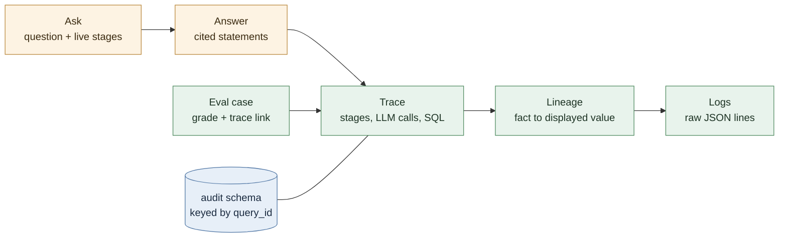

# XbrlRag — UI Design

The design of the React UI (`ui/`): who it serves, how it is organized, and the backend surfaces
it relies on. Read it before adding a page or a panel. The canonical **route → page → data
source** inventory is [guide 7](../guides/xbrl-flow/07-api-ui-observability.md); running and
building the UI is in [`ui/README.md`](../../ui/README.md).

---

## 1. Principles

*Amber: Business console · Green: Technical console · Blue: data store.*

1. **One spine: `query_id`.** Every screen is a deeper view of "a question was asked and
   answered": answer → trace → events → lineage → raw logs. A business answer is one click from
   its technical trace, and an eval case is one click from the trace that produced it.
2. **Two personas, one shell.** A **Business console** (`/business/*`, Analyst Workspace: "what
   is the answer, and why should I trust it?") and a **Technical console** (`/tech/*`, System &
   Observability: "how did the system behave, and what did it cost?").
3. **Glass box, not black box.** Every answer exposes its provenance: resolved entities,
   sub-queries and plan steps, fact lookups, retrieved chunks, prompts, and numbered citations
   back to the filing.
4. **Overview → drill-down on every screen.** Each screen has a scannable overview (KPI tiles,
   trends, ranked or mix charts), and every row, cell, bar or slice opens its detail in a
   `SlideOver` panel or a detail route.
5. **Honest to the data.** Panels map 1:1 to a Postgres view or response field. When a store is
   unreachable, the page says so rather than showing empty numbers.

---

## 2. Information architecture

Routes are declared in [`ui/src/App.tsx`](../../ui/src/App.tsx); pages live in
`ui/src/pages/business/` and `ui/src/pages/technical/`.

**Business (Analyst Workspace)**

| Screen | Overview | Drill-down | Backend |
|---|---|---|---|
| Ask | query box, examples, live stage progress, an "Understood as" chip row (company / period / concept) | glass-box stage stepper | SSE `/api/query/stream` (incl. the `intent_extraction` event) |
| Answer | headline answer, cited statements with numbered sources, confidence banner, unanswered parts | citation → fact or chunk; "view technical trace" | stashed response, or `audit.query_audit.answer` via `/api/traces/:id` (deep-linkable) |
| Company | KPI tiles, multi-year trends, segment and geography mix | metric → cited time series with a point-in-time toggle; segment → Bridge | `/api/v1/coverage`, `/api/v1/metrics`, `/api/v1/facts/lookup` |
| Screen | form → ranked bar chart + table | row → Company | `POST /api/v1/screen` |
| Metrics | metric × period grid, CSV export | cell → formula, component facts, source filing | `/api/v1/metrics(.csv)` |
| Bridge | waterfall: prior → per-child deltas → unexplained → current | bar → cited `fact_id`s | `POST /api/v1/facts/bridge` |
| History / Compare | past queries; side-by-side answers with a numeric-drift table | row → Trace | `/api/traces`, `/api/lineage/:id` |

**Technical (System & Observability)**

| Screen | Overview | Drill-down | Backend |
|---|---|---|---|
| Overview | health, KPI tiles, 30-day cost / volume / p95 trends, branch mix | day or branch → filtered Traces | `/api/health`, `/api/metrics/overview` |
| Architecture | pipeline diagram | trace replay over the diagram | `/api/traces/:id` |
| Traces / Trace detail | filterable trace list | stage waterfall, LLM-call cards (prompts, response, cost), SQL cards, event stream, final answer | `/api/traces`, `/api/traces/:id` |
| LLM economics | spend, tokens, cost per query, trend | by model / stage / branch / prompt version; per-query token split incl. reasoning tokens | `/api/metrics/llm` |
| Lineage | dependency tree per answer | reverse audit: which answers used fact N | `/api/lineage/:id`, `/api/facts/:id/queries` |
| Ingestion | run table, throughput | run → per-filing items; failure triage (retryable vs permanent); retry effectiveness | `/api/ingestion/runs`, `/api/ingestion/analytics` |
| Logs | filtered table of this process's log file | expandable per-line JSON | `/api/logs` |
| Eval | run history and scorecards (partial runs marked) | run → per-case grades with a trace link; run compare; reliability (repeat spread, silent-wrong queue, flaky cases) | `/api/eval/*` ([evaluation design](XbrlRag_Evaluation.md#6-persistence-api-and-ui)) |

The PDF-legacy pipeline is not exposed in the UI.

---

## 3. Shared foundation

- **Charts:** `ui/src/components/charts/` (`TrendChart`, `BarRank`, `Waterfall`, `MixChart`,
  `Sparkline`) wrap recharts; no page imports recharts directly. Series colours come from CSS
  `--series-*` tokens, light/dark aware.
- **Primitives:** `SlideOver`, `Citation`, `KV`, `Card`, `Tile`, `SortTh` and friends in
  `ui/src/components/ui.tsx`; answer rendering in `AnswerView.tsx` and `Sources.tsx`, whose pure
  `sourcesRegistry.ts` joins each cited id to the step or chunk that produced it.
- **Data access:** `ui/src/lib/api.ts` + `types.ts`. The bundle uses relative URLs only; in
  development Vite proxies `/api` to the BFF, and in the container nginx proxies `/api` and
  `/metrics` to `XBRLRAG_API_UPSTREAM`.
- **Storage keys:** `arag:theme`, `arag:answers` (kept from before the rename on purpose).

---

## 4. Not built

- Per-user cost chargeback (the data has `user_id`, but there is no authentication to make it
  meaningful; feature `WS6-B6`, deferred).
- Fact ↔ prose surfacing from `mv_fact_prose_links` (no endpoint).
- Rate-limiter operational metrics.
- Exports beyond the Metrics CSV.

---

## Key decisions

- **`query_id` as the single spine** — every view of an answer, from business to raw logs, is a
  join on one key, so trust is one click away.
- **Two consoles in one shell** — analysts and operators share data and links without sharing a
  cluttered screen.
- **The UI adds no query behaviour** — the endpoints it needed (`POST /api/v1/screen`, ingestion
  analytics, reasoning-token fields, the `intent_extraction` event) are additive views of
  existing data.
- **Panels mirror stored data 1:1** — no client-side recomputation of numbers that could drift
  from the audited values.

## Related

[Observability & tracing](XbrlRag_Observability_Tracing.md) · [`ui/README.md`](../../ui/README.md) ·
[`src/api/CLAUDE.md`](../../src/api/CLAUDE.md) · [guide 7](../guides/xbrl-flow/07-api-ui-observability.md)
