# XbrlRag v2 — plan

The plan for the second version of XbrlRag: what v2 sets out to show, against which
competitor, on which question sets, and where the work stands. Read it to understand why
the evaluation is built the way it is before changing the evaluation or the system. The
binding rules for reading the result are in the
[pre-registration](../eval/heldout_v2/preregistration.md) and its amendments. This plan
gives the reasons, and where the two differ, the pre-registration wins. Scope is fixed in
[`VISION.md`](../../VISION.md). Each change is specified test-first in its own
`docs/specs/<id>.md`.

> **Section numbers in older references.** Specs, code comments and the pre-registration
> cite this plan by section number ("v2 plan §3.4"). Those numbers belong to the earlier,
> numbered version of this doc, at commit `cef399a` of the private development repository
> (not published).

**In this doc:** [Overview](#overview) · [Why v2](#why-v2) ·
[What is compared](#what-is-compared) · [Question sets](#question-sets-and-who-sees-them) ·
[The success bar](#the-success-bar) · [Evaluation design](#evaluation-design) ·
[Company universe](#company-universe) · [Phases](#phases) ·
[Development models](#development-models) · [Rules for development](#rules-for-development) ·
[Key decisions](#key-decisions) · [Superseded](#superseded) · [Risks](#risks) ·
[Related](#related)

## Overview

v2 asks one question: on the questions a fact store is built for (cross-filer,
cross-period and compound), does XbrlRag beat a frontier model with tools over the SEC's
public APIs, at a fraction of its cost, without giving up accuracy on single-filer numbers
or honesty? The evaluation was rebuilt **before** the system was changed, so that every
later change is measured outside the development loop.

```mermaid
flowchart LR
  A["Evaluation rebuilt<br/>suites, keys, splits"]
  B["Universe wave 1<br/>33 dev filers"]
  C["Competitor arms<br/>tools agent frozen"]
  D["Dev baseline<br/>2026-11-10"]
  E["Fixes by<br/>failure class"]
  F["System freeze"]
  G["Final look<br/>H-F and H-X"]
  H["After the look<br/>quarters, wave 2, H-T"]
  A --> B --> C --> D --> E --> F --> G --> H
  class A,B,C,D,E det;
  class F,G out;
  class H ext;
  classDef det fill:#e8f3ec,stroke:#4f8a5f,color:#1d3324;
  classDef llm fill:#f1eaf7,stroke:#7d5ea0,color:#2b1f3a;
  classDef store fill:#e7eff8,stroke:#4d74a3,color:#1b2b40;
  classDef ext fill:#f4f4f4,stroke:#8a8a8a,color:#2a2a2a,stroke-dasharray:4 3;
  classDef out fill:#fdf3e3,stroke:#b9873a,color:#3a2a10;
```

*Green: done · Amber: in progress or next · Grey, dashed: later.*

## Why v2

[External test v1](../eval/external_test_v1/README.md), the first test outside the
development loop, scored XbrlRag at 75.2% on hand-written questions against 97% on its own
suite, and a frontier model handed the right filing scored 93.6%. Each v1 weakness has a v2
fix:

| v1 weakness | v2 fix |
|---|---|
| Answer keys came from the same views and concept mappings as the pipeline | Keys from SEC companyfacts and frames, witnessed against the filer's own statements; our views only as a cross-check |
| One templated phrasing per question | Each intent asked in several phrasing families plus reviewed paraphrases; paraphrase stability is a bar line |
| Tuned on the suite until it scored 96.7% | Dev / validation / held-out splits; tuning only on dev; held-out sets looked at once |
| No held-out wording or filers during development | Held-out filers drawn at random and a hand-written set, both fixed before the look |
| Long-context's closeness was read after the fact | The reading of every comparison is pre-registered |
| Almost no cross-filer, cross-period or compound questions | These kinds are first-class, with a competitor that can attempt them |
| The semantics of restatement, period alignment and universe were never written down | Fixed in [Evaluation semantics](XbrlRag_Eval_Semantics.md) before any key was built |

## What is compared

| Arm | What it is | Role |
|---|---|---|
| `xbrlrag_full` | The product: plan, SQL over the fact store, cited synthesis, faithfulness verifier | The system under test |
| `frontier_sec_tools` | A frontier model with tools over the SEC's public APIs (companyfacts, frames, full-text search, filing fetch) and a step, tool-call and cost budget | **The competitor that decides the bar**; run on two models, so that a cost win is about architecture, not model price |
| `long_context_oracle` | The model handed the one right filing | Ceiling for single-filer questions |
| `closed_book` | The model alone | Floor: what the model knows from memory |
| `naive_rag_filtered` | One hybrid search over the chunks, filtered to filer and year | Measured once on dev ("how bad is basic RAG"); not run on held-out sets |

`frontier_sec_tools` is built earnestly: a fixed, documented tool set and prompt, no
deliberate handicaps, frozen before its dev-sample runs, and published with the results
([spec](../specs/frontier-sec-tools.md), [arm notes](../eval/frontier_sec_tools.md)).
Which arm runs on which set, and on which model, is the matrix of pre-registration
Amendment 1 (D2).

All arms are graded by the same rules ([arm-neutral-grading](../specs/arm-neutral-grading.md)):
the comparison metric is **value accuracy** (the right number, citations aside), because the
baselines cite no `fact_id`.

## Question sets and who sees them

| Set | What it is | Who sees the questions | Used for |
|---|---|---|---|
| **Dev** | Generated intents × phrasings over the development filers | Everyone | Tuning, slices, debugging |
| **Validation** | Same generator, a disjoint hash split of intents | Everyone; no case-level fixes from it | Checking that a fix generalises |
| **H-F** (held-out filers) | The same generator on the 8 drawn held-out filers, in a quarantined database | Nobody; generated blind and sealed | **Decides the success bar** |
| **H-X** (external) | 75 questions written by hand by the maintainer alone, over development filers | Its author only; aggregates shared | Confirms direction on unseen wording |
| **H-T** (temporal) | Filings published after the v2 freeze | Nobody, until they exist | Reported on its own line, later |
| **Set B** | v1's 47 hand-written questions | Its author only | At most one secondary check |

Sets are reported separately and never pooled. H-F carries the statistical power (several
hundred cases); H-X at 75 questions can only confirm direction. The held-out sets are looked
at **once**, at the final milestone. Agents never connect to the held-out database; its
operator reads exit codes and aggregate counts only (quarantine rules: pre-registration §5).

## The success bar

Fixed in [pre-registration §3](../eval/heldout_v2/preregistration.md#3-the-success-bar),
read on H-F at the final look. Every line must hold:

- XbrlRag beats `frontier_sec_tools` on the cross-filer, cross-period and compound kinds
  (pooled, exact McNemar p < 0.05) at **no more than a tenth of its cost per question**;
- XbrlRag is within 5 points of `long_context_oracle` on single-filer lookup + compute;
- confident-wrong ≤ 1%, paraphrase stability ≥ 90%, grounding precision ≥ 95%.

The results also report latency, cost per question, and the cost ratio against the cheaper
tools agent. The original line "XbrlRag beats `html_rag`" was withdrawn
([decision](XbrlRag_HtmlRag_Decision.md)).

## Evaluation design

The mechanics live in [Evaluation v2 architecture](XbrlRag_Eval_v2_Architecture.md) and the
grading semantics in [Evaluation semantics](XbrlRag_Eval_Semantics.md); in short:

- **Intents and phrasings.** Each question is a structured intent (kind, filer, period,
  metrics, operation) rendered in several phrasing families: terse, conversational and
  formal; the metric by label, synonym or analyst shorthand; the company by ticker, short or
  legal name; the period in fiscal, calendar or relative form. Paraphrases come from a model
  family used neither as an arm nor as the development model, reviewed and frozen.
- **Independent keys.** Non-dimensional keys come from SEC companyfacts and frames; every
  key input is witnessed against the filer's primary statements, and a key the statements do
  not support is blocked or resolved by a reviewed entry. Keys carry their provenance, and a
  single-source key is reported apart from a verified one.
- **Written semantics.** Restatement (the latest periodic report answers; the original
  value on request), period alignment across fiscal calendars, universe scope, and one
  stated definition per derived ratio and per composite metric (for example total debt).
- **Question kinds.** Single-filer numeric (lookup, compute, dimensional, breakdown);
  cross-filer (top/bottom screens, count, sum, median, peer rank); cross-period (trend, CAGR,
  point in time); compound (a screen with a dependent compute); honesty (ambiguity, false
  premise, out-of-corpus decline); text. The frozen dev and validation suites are numeric
  plus compound; text questions serve the judge.
- **Grading.** Numbers by deterministic graders (value accuracy, confident-wrong, decline,
  grounding precision). Text by an LLM judge that is never from the generator's model family,
  reported only after calibration against human labels (Cohen's kappa ≥ 0.7). Screens pass
  only when they disclose their universe and the filers they could not rank.
- **Key-free checks.** Metamorphic consistency (breakdown rows sum to the total, a YoY
  compute equals the difference of two lookups) and perturbation (change the ticker or year
  and the plan changes in exactly that slot), at near-zero cost on any filer.

**Out of scope for v2:** multi-turn follow-ups, and anything outside the 10-K / 10-Q /
20-F corpus (proxy statements, earnings releases, non-GAAP measures); such questions should
get a decline, graded as correct.

## Company universe

- **Development filers (33):** the original 15 (tech, semiconductors and AI power, with TSM
  as a 20-F IFRS filer) plus wave 1's 18 across software, consumer staples and retail, health
  care and industrials, chosen for varied fiscal calendars and revenue models. FY2023–FY2025
  annual filings.
- **Held-out filers (8):** drawn at random from the S&P 100 remainder, four from technology
  and communication services and four from other sectors, by a seeded draw anyone can
  recompute ([draw record](../eval/heldout_v2/README.md)). They are ingested only into the
  quarantined database.
- **Wave 2 (8 filers, later):** XOM, V, TMUS, JNJ, PEP, BA, CAT, DIS, each adding a known
  hard case (segments, discontinued operations, negative equity, a financial-products
  segment).
- **Left out:** banks and brokers, insurers, utilities with combined filings, REITs, recent
  spin-offs with recast history, and share-class duplicates. Each needs an accounting model
  v2 does not build, and the held-out draw excludes them too
  (`configs/eval/v2/heldout_exclusions.yaml`).

Widening the universe needed concept families for the new sectors
([concept decisions](XbrlRag_Concept_Decisions.md)), aliases, sector tags on `entity_master`
for peer questions, and a per-filer-year **coverage card** that shows which canonical metrics
each filer tags with a standard element, an extension, or not at all.

## Phases

| Phase | What | State |
|---|---|---|
| Set-up | Scope in `VISION.md`; DeepSeek provider and development profile | Done |
| Evaluation foundation | Intents, phrasings, independent keys and witness, splits, storage columns, key-free checks, semantics policies, held-out draw, pre-registration | Done |
| Universe, wave 1 | 18 filers ingested; concept families, aliases, sector tags, coverage card; held-out filers into quarantine | Done |
| Competitor arms | `frontier_sec_tools` built, smoked, frozen and budgeted; `long_context_oracle` | Done |
| Dev baseline | Every arm on dev and validation before any fix ([record](XbrlRag_Dev_Baseline_2026-11.md)) | Done (2026-11-10) |
| Held-out H-F | Generated blind (with compound cases) and sealed | Done |
| Fixes | XbrlRag fixes chosen by measured failure class, each validated on a slice | Done, apart from the last checks before the freeze |
| System freeze | A confirmation run, then a freeze record that fixes the code for the look | In progress |
| Judge calibration | Human labels on dev text answers, then the judge's agreement measured | In progress (labelling) |
| H-X | The maintainer writes the 75 questions and seals them | Next |
| Amendments | Paraphrase hashes, budgets, cost caps, judge result; then suite hashes, look commit, freeze record, the "a baseline comes close" reading, the served-model rule | Next |
| Final look | One pre-registered run on H-F and H-X, all arms in the matrix, with hard cost caps | Next |
| After the look | Quarterly filings (Q4 reconstruction, trailing twelve months), wave 2, H-T, and publishing the benchmark | Later |

Live task-level status is kept outside the repository; accuracy numbers live in the `eval`
schema (`/tech/eval`).

## Development models

- **Development runs use the `deepseek` profile** (`configs/llm/llm.yaml`): cheap enough to
  run slices freely. Prices come from `configs/llm/pricing.yaml` at peak rates, so the tracked
  cost is an upper bound.
- **Decision runs** use the profile and models recorded in the pre-registration amendments.
  Results are always reported with their profile and never pooled across models.
- **The served model can change behind a fixed id,** so every run records the served model,
  and runs are compared only within one served model.
- **Judges** follow `configs/eval/judge.yaml`: a judge never grades an arm of its own family.
- **Data:** prompts contain public SEC filings and evaluation questions only.

## Rules for development

- **No per-case fixes.** A fix names its failure class (phrasing, entity, period, concept,
  plan, synthesis, key), adds dev cases for that class in several phrasings, and is read on
  validation, not on the cases that prompted it. Rules are general, never filer-specific.
- **Every query-time fallback has a spec**, with tests from dev cases of its class.
- **Validate on slices,** with one full run at the end; a narrowed run is never a baseline.
- **The held-out sets are not looked into.** Only aggregates and failure-class counts leave a
  held-out run, and a person who did not do the tuning classifies its misses.
- **Rebuild and diff the suite** after any template, view, concept-mapping or corpus change.
- **Everything is built to be published:** no private data in suites, prompts or configs.

## Key decisions

- **Evaluation before fixes** — so no change is judged by the loop that produced it.
- **`frontier_sec_tools` is the competitor** — it is what an analyst actually has, and it
  reads the same XBRL facts, so beating it measures what XbrlRag adds (concept mapping,
  dimensions, deterministic plans, verification, `fact_id` provenance)
  ([decision](XbrlRag_HtmlRag_Decision.md)).
- **A second tools agent on a cheaper model** — a cost advantage must hold against the
  cheaper agent, or the claim is about model price (pre-registration Amendment 1, D5).
- **H-F decides, H-X confirms direction** — only a generated set on unseen filers is large
  enough for a test; hand-written wording is the check against overfitting to templates.
- **One look at the held-out sets** — each look leaks; a fresh-filer development check
  replaces the intermediate checkpoints (Amendment 1, §1.1).
- **Keys independent of the pipeline, witnessed by the filer's statements** — v1's keys
  shared the pipeline's mapping, so agreement proved little (Amendment 1, K1–K4).
- **Universe in waves, with sectors needing their own accounting model left out** — the
  concept work stays bounded, and the held-out draw does not measure a model v2 chose not to
  build.
- **Development on DeepSeek, decisions on the pre-registered profile** — cheap iteration,
  with no decision resting on development-model numbers.
- **Annual filings first, quarters after the look** — the annual baseline depends on none of
  the quarter work (Amendment 1, §1.2).
- **H-X kind mix 24 / 15 / 18 / 9 / 9** (cross-filer, cross-period, compound, honesty, text)
  — more human wording on the bar's kinds (Amendment 1.1).
- **Publish the benchmark** — dev and validation suites, keys with provenance, runner and
  arms are published with the results; H-F, H-X and H-T stay sealed. Where it is published
  is decided nearer the look.

## Superseded

- `html_rag` (an HTML 10-K RAG baseline) as the arm to beat on single-filer numbers — dropped
  2026-11-06; the HTML 10-K code stays in the repository but is not an eval arm.
- `long_context_resolved` and `long_context_multi` — dropped 2026-11-05; pasting whole
  filings is not a realistic competitor.
- Three held-out looks (after the baseline, after the fixes, final) — replaced by one look.
- Quarterly filings before the baseline — moved after the look.
- Milestones repeated on every frontier profile — replaced by one cross-provider line that
  decides nothing (Amendment 1, D3).
- The tools agent's budgets fixed at 20 steps / 60 tool calls / $2 — replaced by budgets set
  once from the dev-sample runs (Amendment 1, D6).
- H-X at 15 questions per kind — replaced by the mix above.

## Risks

| Risk | Mitigation |
|---|---|
| Development-model results don't carry over to the decision models | No decision rests on development numbers; the baseline found XbrlRag's accuracy set by its architecture, not its model |
| Paraphrases written by an LLM share a style | Hand-written families mixed in; a fourth model family; H-X fully human |
| The held-out sets leak | One look, logged; agents never touch the held-out database; misses classified by someone outside the tuning |
| A wider universe multiplies concept-mapping work | Waves; label-driven families; hard sectors left out; the coverage card shows gaps per filer-year |
| `frontier_sec_tools` is a strawman | Fixed public tool set, earnest prompt, budgets set by a stated rule, prompts and tools published |
| Keys are wrong where the filer's tagging is wrong | Statement witness, reviewed resolutions, verified versus single-source keys reported apart |

## Related

- [Pre-registration](../eval/heldout_v2/preregistration.md) and
  [measurement plan](../eval/heldout_v2/measurement_plan.md) — the binding rules and the cost
  and power arithmetic
- [Evaluation v2 architecture](XbrlRag_Eval_v2_Architecture.md) ·
  [Evaluation semantics](XbrlRag_Eval_Semantics.md) · [Evaluation](XbrlRag_Evaluation.md)
- [Dev baseline, 2026-11](XbrlRag_Dev_Baseline_2026-11.md) ·
  [Concept decisions](XbrlRag_Concept_Decisions.md) ·
  [`html_rag` decision](XbrlRag_HtmlRag_Decision.md)
- [Evaluation guide](../guides/xbrl-flow/11-evaluation.md)
