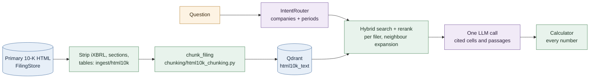

# HTML 10-K flow — Guide

A retrieval pipeline over the filings' HTML with no XBRL in it: parse the primary 10-K document,
chunk and index it in its own Qdrant collection, then answer with cited table cells and passages
and a calculator for every number. It is a **retained, non-evaluated code path**: it is not a
serving path (the API, UI and MCP server don't use it), and since 2026-11-06 it is **not an eval
arm or a baseline** for XbrlRag ([decision](../../design/XbrlRag_HtmlRag_Decision.md)). Read this
only if you work on the code itself; removing it is a separate, open decision.

## Overview



*Green: deterministic code · Purple: LLM call · Blue: data store · Amber: input.*

Code: `src/ingest/html10k/`, `src/chunking/html10k_chunking.py`, `src/retriever/html10k/`,
`src/pipelines/html10k/`, and the eval wrapper `src/eval/systems/html_rag.py` (still selectable
as `run_suite.py --system html_rag`). Exact behaviour: [spec](../../specs/html-rag-arm.md).
Editor invariants: [`src/retriever/html10k/CLAUDE.md`](../../../src/retriever/html10k/CLAUDE.md).

## Settings

[`configs/pipelines/html10k/rag.yaml`](../../../configs/pipelines/html10k/rag.yaml): every key is
required and a mistyped key raises. It sets the RRF fusion weights, prefetch and rerank
candidate counts, `context_top_k`, `reranker_model` (sent to RagInference), neighbour expansion,
`max_filer_searches`, the load's `table_max_chars` (changing it changes chunk ids, so it means a
new load) and `rerank_cache_path` (`XBRLRAG_HTML10K_RERANK_CACHE` overrides it; the default is
under the per-checkout `data/`). The values are provisional, from one in-loop review; each answer
records them in `selection["retrieval_config"]`.

## The load

```powershell
$env:RAGINFER_TIMEOUT_S = "1800"
conda run -n py312 --no-capture-output python -m src.pipelines.html10k.load_to_vectordb_pipeline --ticker AAPL --fiscal-year 2024
conda run -n py312 --no-capture-output python -m src.pipelines.html10k.load_to_vectordb_pipeline --all
```

`--ticker` and `--fiscal-year` repeat; `--all` takes every annual filing in the registry. It needs
Postgres, Qdrant and RagInference, prints `loaded` / `skipped` / `failed` counts and exits 1 if any
filing failed. It restarts at a filing boundary: a filing whose point count already matches is
skipped, and a partial one is replaced only once its new embeddings exist. A full load holds a
CPU-only RagInference for many hours, so agree a window first. Don't load held-out filers.

## Running it

```powershell
conda run -n py312 --no-capture-output python scripts/eval/run_suite.py --system html_rag --suite-path <slice> --max-cost-usd 1
```

Do the pre-run checks in [guide 11](../xbrl-flow/11-evaluation.md#111-before-a-paid-run) first.
The model is the synthesizer's on the active profile (no `--model`). Each answer's `selection`
records `status` / `reason` (`answered`, `no_candidates`, `model_declined`, `unparseable`,
`unsupported`, `error`), `degraded`, the `scopes` searched, every `retrieved` chunk with its byte
range and rerank score, rerank timings (`rerank_ms` is the original time, also on a cache hit),
the `calculations`, `unverified` citations (which make the answer hedged) and the
`retrieval_config`.

## Limits

- The primary document is the only source; a filer that prints its statements in an exhibit has
  none here.
- A screen names no filer, so it runs one year-filtered search and does poorly.
- A quarter question searches that year's annual filing; two live annual filings for one year are
  both searched.
- Retrieval can't be scored yet (text-key spans and chunk offsets live in different documents);
  `selection["retrieved"]` keeps byte ranges so a run can be scored later.
- `jinaai/jina-reranker-v3` is CC BY-NC 4.0, which matters to a public release; `reranker_model`
  with RagInference's `RERANKER=bge` is the way out.
