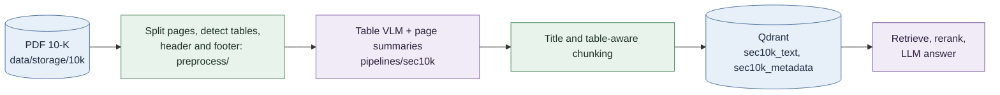

# PDF Legacy Flow — Guide

> **Maintenance-only.** This is XbrlRag's original pipeline. It receives fixes but no new
> features ([`VISION.md`](../../../VISION.md) non-goals); new work targets the
> [XBRL flow](../xbrl-flow/README.md).

It turns **PDF 10-K documents** into a hybrid-search Qdrant index and answers questions over the
prose and vision-model table summaries. Read these pages only to run or fix the legacy path, which
the API still serves under `mode` `basic` / `hyde` / `subquery`.

*Green: deterministic code · Purple: LLM calls · Blue: data store.*

## Pages in this guide

1. [Setup & dependencies](./01-setup-and-dependencies.md): environment, `.env`, Qdrant, models, directory layout, config.
2. [Ingestion & preprocessing](./02-ingestion-and-preprocessing.md): placing PDFs, splitting pages, table detection, header/footer, table and page summaries.
3. [Chunking & vector DB load](./03-chunking-and-vectordb.md): chunking, embeddings, loading both Qdrant collections.
4. [Retrieval & LLM answering](./04-retrieval-and-llm.md): query rewriting and HyDE, hybrid search, rerank, answer; programmatic API.
5. [Troubleshooting](./05-troubleshooting.md): common operational issues.

## The one thing to know

Unlike the XBRL flow, **the legacy `sec10k` modules are not argparse CLIs.** Each has a bare
`if __name__ == "__main__"` that calls a no-argument function with **hardcoded years and folder
lists**. To process a different company or year you edit the module; each page names the line.

## Dependencies at a glance

| Dependency | Required for | Notes |
|------------|--------------|-------|
| **Qdrant** | load + retrieval | `QDRANT_HOST` / `QDRANT_PORT` (default `localhost:6333`), read by the shared [`QdrantVectorDBClient`](../../../src/vectorstores/qdrant_vectordb_client.py) |
| **OpenAI** (`OPENAI_API_KEY`) | table and page summaries, query rewrite, HyDE, final answer | Each module carries its own default model (legacy code, not the `configs/llm/llm.yaml` profiles) |
| **BGE-M3** (`BAAI/bge-m3`) | dense + sparse embeddings | Local, cached in `HF_HOME` |
| **Jina reranker** (`jinaai/jina-reranker-v3`) | rerank | Local, cached; the active reranker |
| **DETR layout model** (`cmarkea/detr-layout-detection`) | table detection | Local, cached |
| **unstructured + yolox** | TOC and subsection partitioning (`hi_res`) | Heavy CPU/GPU step |

There is **no PostgreSQL dependency** in the legacy flow.
