# XBRL Flow — 4. Ingest & Populate (Arelle + Layer-0)

How downloaded filings become a queryable fact store: Arelle loads the numeric facts into
Postgres, the Layer-0 steps add the registries and the semantic layer, the structure steps
build canonical HTML and citation anchors, and the materialized views (MVs) expose it all to
the retriever. Read it before any load, full or incremental, locally or on AWS. Module
invariants are in [`src/ingest/sec_edgar/CLAUDE.md`](../../../src/ingest/sec_edgar/CLAUDE.md);
what each table and view means is in the
[fact-store data model](../../design/XbrlRag_Materialized_Views.md).

**In this doc:** [Overview](#overview) · [Quick path](#quick-path) ·
[4.1 Ingest CLI](#41-the-ingest-cli-reference) · [4.2–4.10a Stages](#42-registries) ·
[4.11 Step order](#411-recommended-full-ingest-order) · [4.12 Programmatic](#412-programmatic-invocation) ·
[4.13 AWS](#413-running-on-aws-the-on-demand-ingest-runner)

## Overview

```mermaid
flowchart LR
    EDGAR["Downloaded filings<br/>manifest.yaml per filing"]
    subgraph Facts["Facts"]
        A["Arelle ingest"] --> P["Patch accession numbers"] --> R["Registries"]
    end
    subgraph Semantic["Semantic layer"]
        CM["Concept mapping"] --> LP["layer0-populate"] --> EC["Extension classify"] --> LB["Labels and members"] --> G["Geography"]
    end
    subgraph Structure["Structure"]
        CH["Canonical HTML"] --> DP["DOM positions"]
    end
    MV["MV rebuild"]
    GATE["Member aliases<br/>publish gate"]
    PG[("Postgres xbrl_db")]
    EDGAR --> A
    R --> CM
    G --> CH
    DP --> MV --> GATE --> PG
    class A,P,R,CM,LP,EC,LB,G,CH,DP,MV,GATE det;
    class EDGAR,PG store;
    classDef det fill:#e8f3ec,stroke:#4f8a5f,color:#1d3324;
    classDef llm fill:#f1eaf7,stroke:#7d5ea0,color:#2b1f3a;
    classDef store fill:#e7eff8,stroke:#4d74a3,color:#1b2b40;
    classDef ext fill:#f4f4f4,stroke:#8a8a8a,color:#2a2a2a,stroke-dasharray:4 3;
    classDef out fill:#fdf3e3,stroke:#b9873a,color:#3a2a10;
```



*Green: deterministic code · Blue: data store.*

The whole path is deterministic and LLM-free. Order matters: Arelle assigns `fact.fact_id`,
and every later step (labels, DOM anchors, chunks, cross-links) bridges back to it. Chunking
and the vector load follow in [guide 5](./05-vectordb-load.md).

## Quick path

[`scripts/bootstrap_db.py`](../../../scripts/bootstrap_db.py) runs the stages in order
(schema → data → MVs); each step is idempotent except the opt-in `base`
([guide 2](./02-postgres-setup.md)). Always look at the plan first:

```powershell
conda run -n py312 python scripts/bootstrap_db.py --all --plan
```

**Full run** (schema already applied):

```powershell
conda run -n py312 python scripts/bootstrap_db.py --phase data --phase mv `
  --concept-mapping-csv data/storage/datasets/hifikpi/concept_mapping_depth0.csv `
  --geography-csv data/storage/datasets/geography_normalization_seed.csv
conda run -n py312 python -m src.ingest.sec_edgar.xbrl.member_alias_detector
conda run -n py312 python -m src.ingest.sec_edgar.xbrl.promotion
```

**Incremental / one ticker** (new filings downloaded per [guide 3](./03-data-download.md)):

```powershell
conda run -n py312 python scripts/bootstrap_db.py --phase data --phase mv --ticker NVDA
conda run -n py312 python -m src.ingest.sec_edgar.xbrl.member_alias_detector
conda run -n py312 python -m src.ingest.sec_edgar.xbrl.promotion
```

`--ticker` (with optional `--year`, `--form`) scopes only the Arelle and canonical-HTML steps;
the Arelle ingest skips already-loaded filings, so an unscoped run is incremental too.

> ⚠️ **A scoped run re-runs global steps.** `layer0-populate` and the MV build cover every
> filer, so a one-ticker load can change answers for other filers. Rebuild and diff the eval
> suite after any load ([§4.6.1](#461-reload-after-a-concept-family-coverage-change) step 8).

**Then check:**

1. Every bootstrap step printed `ok` (a failing step stops the run with its exit code; a step
   with a missing input prints `SKIP` with the reason).
2. The acceptance gate: PASS/FAIL per table and view, with the stage to re-run on a FAIL.
   ```powershell
   conda run -n py312 python scripts/dbq.py -f scripts/checks/post_ingest_acceptance.sql
   ```
3. What each run did: `SELECT run_id, pipeline, status, counts FROM audit.ingestion_run ORDER BY started_at DESC`.
4. Gaps in coverage: `conda run -n py312 python -m src.ingest.sec_edgar.coverage` ([§4.10](#410-materialized-views)).
5. Chunk and load vectors ([guide 5](./05-vectordb-load.md)); restart the API and MCP after a
   concept-mapping change.

## 4.1 The ingest CLI (reference)

Most data steps are flags of one CLI,
[`src/ingest/sec_edgar/ingest/__main__.py`](../../../src/ingest/sec_edgar/ingest/__main__.py)
(`conda run -n py312 python -m src.ingest.sec_edgar.ingest --help`). With no flags it populates
the registries.

| Flag | Does |
|------|------|
| `--arelle-ingest` [`--ticker` [`--year` [`--form-type`]]] \| `--filing-dir DIR` | load facts via Arelle ([§4.3](#43-arelle-fact-ingest)); `--arelle-cmd` overrides `ARELLE_CMD` |
| `--patch-accession-numbers` | fix Arelle's `filing_accession_number` ([§4.5](#45-patch-accession-numbers-always-after-an-arelle-ingest)) |
| `--skip-registries` | skip the registries pass (use with every other flag) |
| `--concept-mapping-csv CSV` `--concept-mapping-mode {upsert,insert_new,replace_source}` | load `concept_mapping` ([§4.6](#46-concept-mapping-the-semantic-layer)) |
| `--concept-mapping-overrides` [`--override-targets CIK:FY ...`] | the facts-count ranking pass per filer |
| `--extension-classifications` [`--fsds-dir`, `--extension-report`] | classify filer extensions into families |
| `--sync-ns-expanded` | re-derive the namespace-expanded mapping rows and check drift |
| `--concept-labels` / `--dimension-members` (each with `--...-accessions ACC ...`) | labels via Arelle ([§4.7](#47-concept-labels--dimension-members)) |
| `--geography-normalization-csv CSV` `--geography-normalization-mode {upsert,insert_new,replace_all}` | load geography ([§4.8](#48-geography-normalization)) |
| `--sec-root`, `--env-file`, `--dry-run`, `--log-level`, `--db-host/-port/-name/-user/-password` | roots, env, no-write mode, DB overrides (default `XBRL_DB_*`) |

**Order when several flags are set** (fixed internally): arelle-ingest → geography →
concept-mapping-overrides → dimension-members → concept-labels → patch-accession-numbers →
registries (unless `--skip-registries`) → concept-mapping → extension-classifications →
sync-ns-expanded. Exit code 1 if any step reports errors.

## 4.2 Registries

```powershell
conda run -n py312 python -m src.ingest.sec_edgar.ingest
```

Fills `filing_registry` and `fiscal_calendar` from each filing's manifest and saved instance.
It labels every 10-Q's fiscal year and quarter from the filer's 10-K calendar
([spec](../../specs/tenq-fiscal-labels.md)) and decides which of an original and its
amendment is canonical: an amendment wins only if its facts carry the primary statements
([spec](../../specs/annual-amendment-handling.md)). Run it after facts are in.

## 4.3 Arelle fact ingest

```powershell
conda run -n py312 python -m src.ingest.sec_edgar.ingest --arelle-ingest             # every manifest under SEC_EDGAR_ROOT
conda run -n py312 python -m src.ingest.sec_edgar.ingest --arelle-ingest --dry-run   # validate, no writes
```

Per filing the ingestor runs, in effect:

```
arelleCmdLine --plugins "<arelle_plugins/xbrl_db_ixbrl_patch.py>|xbrlDB"
  --store-to-XBRL-DB "<host>,<port>,<user>,<password>,<dbname>,<timeout>,postgres"
  -f <entry document>
```

The entry is the primary `.htm`, or the extracted `*_htm.xml` instance for a filing whose
inline XBRL spans several documents ([spec](../../specs/ingest-multidoc-ixbrl.md)). Before
Arelle runs, a filing whose saved documents hold fewer facts than its instance is refused.
Each run is recorded in `audit.ingestion_run` / `audit.ingestion_run_item`.

Sharp edges:

- ⚠️ The trailing `postgres` product type is **required**; without it xbrlDB makes an HTTP
  probe and hangs. The CLI sets it; a direct call must too.
- ⚠️ A filing's whole load is **one transaction**, schema DDL included, so `count(*)` shows
  nothing until commit. Watch `pg_stat_activity` for progress.
- ⚠️ Without Arelle's `EDGAR/transform` plugin, facts are stored as `(ixTransformValueError)`
  and the publish gate holds the filing back; repair in place with `transform_backfill`
  ([§4.10a](#410a-member-aliases-transform-repair-and-the-publish-gate)).
- Failures are classified: a timeout is retried up to `ARELLE_MAX_ATTEMPTS`; validation errors
  and a missing Arelle are permanent.

### 4.4 Incremental and scoped

```powershell
conda run -n py312 python -m src.ingest.sec_edgar.ingest --arelle-ingest --ticker NVDA
conda run -n py312 python -m src.ingest.sec_edgar.ingest --arelle-ingest --ticker NVDA --year 2026 --form-type 10-K
conda run -n py312 python -m src.ingest.sec_edgar.ingest --arelle-ingest --filing-dir data/storage/sec_edgar/NVDA/2026/10-K
```

There is no `--full` / `--incremental` flag: already-ingested filings are skipped. Candidates
are found by the primary document's file stem in `accession.entry_url`, then confirmed by
accession number, because an amendment can reuse its original's file name
([spec](../../specs/ingest-accession-identity.md)).

## 4.5 Patch accession numbers (always after an Arelle ingest)

```powershell
conda run -n py312 python -m src.ingest.sec_edgar.ingest --patch-accession-numbers --skip-registries
```

xbrlDB writes a timestamp into `filing_accession_number`; this sets the real accession number.
The incremental skip's accession check depends on it, so run it after every Arelle ingest.

## 4.6 Concept mapping (the semantic layer)

`concept_mapping` maps a concept family (for example `Revenue`) to ranked XBRL QNames; the
fact-store steps resolve every family through it. Generate the CSV, then load it:

```powershell
conda run -n py312 python -m src.ingest.util.generate_concept_mapping `
  --synonyms data/storage/datasets/hifikpi/concept_synonyms.json `
  --family-table data/storage/datasets/hifikpi/concept_family_table.json `
  --output data/storage/datasets/hifikpi/concept_mapping_depth0.csv --max-depth 0 --top-k 30
conda run -n py312 python -m src.ingest.sec_edgar.ingest `
  --concept-mapping-csv data/storage/datasets/hifikpi/concept_mapping_depth0.csv `
  --concept-mapping-mode replace_source --skip-registries
```

What the CSV holds, and the rules that protect it:

- **Sources.** The generator writes the HiFi-KPI base rows, the reviewed overrides from
  `configs/concept_mapping/concept_family_overrides.yaml` (`reviewed_override` rows), the
  roles, substitutes and cik-scoped members from
  `configs/concept_mapping/concept_family_coverage.yaml` (`family_coverage` rows and the
  `concept_role` / `substitution_*` columns), and the IFRS rows for 20-F filers. A bad override
  entry fails the run. Load with `replace_source` so each source is replaced as a set.
- **Family additions go in the reviewed override file**, never in the generator's hardcoded
  dicts ([spec](../../specs/concept-family-coverage.md)).
- **Rank bands.** A family's declared primaries rank 1…n in declared order; components rank
  from 50 and are never rank 1 ([spec](../../specs/concept-rank-integrity.md)).
- **The facts-count pass** (`--concept-mapping-overrides`) ranks, per filer, the eligible
  concept it reports in the most years first. It never touches a (filer, family) with
  `reviewed_override` or `family_coverage` rows.
- **Extension classification** (`--extension-classifications`) names a filer extension's
  family only from that filer's own filings, reading the cached FSDS data and the raw
  calculation tables (never an MV). Run it after every other mapping write; it writes
  `data/reports/extension_classification.json`
  ([spec](../../specs/extension-classification.md)).
- ⚠️ **Namespace expansion is derived, never edited.** The MVs match facts only through the
  `ns_expanded` copies of each base row; without them every lookup returns NOT_FOUND. Every
  mapping write deletes and re-derives them and fails on drift (`NsExpandedDriftError`) in the
  same transaction ([spec](../../specs/ns-expand-rank-sync.md)). By hand:
  `--sync-ns-expanded --skip-registries` (`--dry-run` reports drift and exits 1).
- ⚠️ **A mapping reload resets the ProductRevenue/ServiceRevenue demotion**, which lives in
  `scripts/ddl/populate/concept_mapping_ns_expand.sql`. Run `layer0-populate` after any reload,
  then rebuild the MVs.

`layer0-populate` (`bootstrap_db.py --only layer0-populate`) fills what no ingest code does:
`entity_master` (then its company name and ticker via
`python -m src.ingest.sec_edgar.ingest.entity_identity`), `dimension_catalog`, the demotion,
and last the namespace re-derivation. It must run before `concept-labels`, or the member-label
patch finds no rows. Sector and industry tags are a separate, idempotent step after it:
`conda run -n py312 python -m src.ingest.sec_edgar.ingest.sector_tags`
([spec](../../specs/sector-tags.md)).

The synonym source can be regenerated with `scripts/run_synonym_mining.py` (writes
`concept_synonyms.json`).

### 4.6.1 Reload after a concept-family-coverage change

PowerShell, repo root, Postgres up; every step is idempotent. Take a "before" build of the eval
suites first (step 8 commands into another output folder), so the diff isolates what the
reload moved.

```powershell
# 1. New concept_mapping columns (CREATE/ADD COLUMN IF NOT EXISTS)
conda run -n py312 python scripts/dbq.py -f scripts/ddl/layer_0/concept_mapping.sql --commit
# 2-3. Regenerate the CSV and load it with replace_source (commands in §4.6)
# 4. Facts-count pass
conda run -n py312 python -m src.ingest.sec_edgar.ingest --concept-mapping-overrides --skip-registries
# 5. Demotion, entity identity and namespace re-derivation
conda run -n py312 python scripts/bootstrap_db.py --only layer0-populate
# 5b. Extension classifier rows (--dry-run first prints what it would write)
conda run -n py312 python -m src.ingest.sec_edgar.ingest --extension-classifications --skip-registries
# 6. Rebuild every MV, then restart the API and MCP
conda run -n py312 python scripts/bootstrap_db.py --phase mv
# 7. Check the load against the coverage config (read-only; exits 1 on a mismatch)
conda run -n py312 python scripts/xbrl/check_family_coverage_load.py
# 8. Rebuild the v1 suite to a scratch file and diff it against the committed one
conda run -n py312 python scripts/eval/build_sql_derived_suite.py --tier standard --out data/eval/sql_derived_v1_reload.json
git diff --no-index --stat test/eval/suites/sql_derived_v1.json data/eval/sql_derived_v1_reload.json
```

For the frozen v2 suites, rerun `scripts/eval/build_v2_suite.py` with the arguments recorded
in `data/eval/v2_frozen/xbrl_v2_manifest.json` into a scratch `--out-dir` and diff the same
way. Every moved case must be one the change's spec expects.

> ⚠️ `build_sql_derived_suite.py` also upserts the suite's metadata row in `eval.eval_suite`.
> Run it from the checkout whose suite you will commit.

## 4.7 Concept labels & dimension members

```powershell
conda run -n py312 python -m src.ingest.sec_edgar.ingest --concept-labels --dimension-members --skip-registries
conda run -n py312 python -m src.ingest.sec_edgar.ingest --concept-labels --concept-labels-accessions 0001045810-26-000021 --skip-registries
```

Both run Arelle with the export plugin: `--concept-labels` upserts `concept_labels`;
`--dimension-members` fills `dimension_catalog.member_label` where it is NULL.

> ⚠️ Against an empty `dimension_catalog`, `--dimension-members` patches nothing **and reports
> success**. Run `layer0-populate` first.

## 4.8 Geography normalization

```powershell
conda run -n py312 python src/ingest/util/generate_geography_normalization.py --from-db
#   or --from-filings <root> (verify members via Arelle); --include-unverified; --years 2024 2025
conda run -n py312 python -m src.ingest.sec_edgar.ingest `
  --geography-normalization-csv data/storage/datasets/geography_normalization_seed.csv --skip-registries
```

Maps each geographic member QName to an ISO code, name and type (country, region, segment);
feeds `mv_geographic_facts`. `PENDING:` rows are skipped on load.

## 4.9 Canonical HTML + DOM positions + sections

```powershell
conda run -n py312 python -m src.ingest.sec_edgar.xbrl.html_canonicalizer
#   scope: --ticker NVDA [--year 2026 [--form 10-K]] | --filing-dir DIR;  --force, --dry-run
conda run -n py312 python -m src.ingest.sec_edgar.xbrl.dom_position_populator
#   --fact-dom-position | --section-assignment (neither = both);  --accessions ACC ...;  --dry-run
```

- `html_canonicalizer` is a pure file transform (no DB): it writes
  `<XBRLRAG_NORMALIZED_ROOT>/<TICKER>/<FY>/<FORM>/canonical.htm`, the byte-stable source that
  citations and chunks reference. A multi-document filing becomes one merged file. It skips an
  existing file unless `--force`.
- `dom_position_populator` maps each fact's `xml_id` to its `fact_id`, records a byte-range
  citation anchor in `fact_dom_position`, and a section path for non-statement facts in
  `section_assignment`. Design: [HTML-canonical source](../../design/XbrlRag_HTML_Canonical_Source.md).

> ⚠️ Anything that changes canonical-HTML bytes changes chunk ids, so it needs a re-chunk and
> full Qdrant reload ([guide 5](./05-vectordb-load.md)).

## 4.10 Materialized views

```powershell
conda run -n py312 python scripts/rebuild_mvs.py                 # or: bootstrap_db.py --phase mv
conda run -n py312 python scripts/bootstrap_db.py --only mv-refresh   # data-only refresh, no DDL change
```

Rebuilds all 19 managed MVs from `scripts/ddl/mv/` with a guard against orphaned views
([guide 2 §2.5](./02-postgres-setup.md#25-materialized-views-after-data-is-loaded)).

> ⚠️ **Run it after every load.** Skipping it silently serves stale numbers.

The last view, `mv_coverage_card`, records per filer-year whether each of ten card metrics is
tagged with a `standard` element, a filer `extension`, only `component_only` concepts, or is
`absent` ([spec](../../specs/coverage-card.md)). List the empty cells:

```powershell
conda run -n py312 python -m src.ingest.sec_edgar.coverage    # [--cik CIK] [--fiscal-year YEAR] [--strict]
```

`--strict` exits 1 on any empty cell; exit 2 means no card matched.

## 4.10a Member aliases, transform repair and the publish gate

Run after the MV rebuild; none of them is part of `bootstrap_db.py`.

```powershell
# Dimension-member renames between years -> member_aliases (read by mv_yoy_comparison)
conda run -n py312 python -m src.ingest.sec_edgar.xbrl.member_alias_detector     # [--accession ACC]
# Only if facts were stored without EDGAR/transform: dry run, then --apply
conda run -n py312 python -m src.ingest.sec_edgar.ingest.transform_backfill      # [--apply] [--accession ACC]
# Publish gate -> publish_manifest; bumps query_cache_epoch
conda run -n py312 python -m src.ingest.sec_edgar.xbrl.promotion                 # [--accession ACC] [--enforce-gate-b]
```

Rebuild the MVs again if the alias detector found new aliases. The gate reads
`mv_anchor_coverage`, `mv_filing_completeness` and `mv_sum_of_parts_checks`:

| Gate | Checks | Effect |
|---|---|---|
| **GATE-A** | anchor coverage ≥ 0.95, no `(ixTransformValueError)` fact, and a canonical filing carries the primary statements | **holds the filing back** |
| **GATE-B** | completeness ≥ 0.65, and no new strict Calculations 1.1 failure outside `configs/ingest/calc_c11_exceptions.csv` | recorded; blocks only with `--enforce-gate-b` / `XBRLRAG_PUBLISH_GATE_B_ENFORCE=1` |

Held-back filings stay in the store but are excluded from answers by a read-time deny-list
keyed per (cik, fiscal year, period), so after re-ingesting an original, re-run the gate on its
amendment too. Run the gate only after any transform repair.

> ⚠️ The calc exception list is **shrink-only**: never add a row to make a filing pass
> ([spec](../../specs/calc-check-c11.md)). Details:
> [fact-store data model §6](../../design/XbrlRag_Materialized_Views.md#6-publish-gate).

## 4.11 Recommended full ingest order

`bootstrap_db.py` encodes this order; select steps with `--only`, `--from` or `--skip`
(for example `--all --from dom-positions` to resume after a failure).

| Step id | Phase | Runs | Scope |
|---|---|---|---|
| `base` | schema | `scripts/ddl/base/` (only with `--with-base`; destructive) | global |
| `extensions` | schema | `CREATE EXTENSION pg_trgm` | global |
| `layer0` | schema | `scripts/ddl/layer_0/*.sql` | global |
| `audit` | schema | `scripts/ddl/audit/_apply.py` | global |
| `arelle-ingest` | data | `--arelle-ingest` | `--ticker/--year/--form` |
| `patch-accessions` | data | `--patch-accession-numbers` | global |
| `registries` | data | ingest CLI, no flags | global |
| `concept-mapping` | data | `--concept-mapping-csv` (SKIP without `--concept-mapping-csv`) | global |
| `layer0-populate` | data | `scripts/ddl/populate/*.sql`, `entity_identity`, `--sync-ns-expanded` | global |
| `extension-classify` | data | `--extension-classifications` (SKIP without an FSDS cache at `--fsds-dir`) | global |
| `concept-labels` | data | `--concept-labels --dimension-members` | global |
| `geography` | data | `--geography-normalization-csv` (SKIP without `--geography-csv`) | global |
| `canonical-html` | data | `html_canonicalizer` | `--ticker/--year/--form` |
| `dom-positions` | data | `dom_position_populator` | global (pending filings) |
| `mv-build` | mv | build every MV from `scripts/ddl/mv/` | global |
| `mv-refresh` | mv | `REFRESH` in dependency order (`--no-refresh` skips) | global |

Not in the bootstrap: the facts-count pass (`--concept-mapping-overrides`, [§4.6](#46-concept-mapping-the-semantic-layer);
optional by design, run it by hand when a filer's ranking needs it),
`sector_tags`, the [§4.10a](#410a-member-aliases-transform-repair-and-the-publish-gate) steps,
the `eval` schema, and chunking plus the vector load ([guide 5](./05-vectordb-load.md)).

## 4.12 Programmatic invocation

```python
from src.ingest.sec_edgar.ingest.arelle_xbrl_ingestor import ArelleXBRLIngestor
from src.ingest.sec_edgar.ingest.layer0_populator import Layer0Populator

ArelleXBRLIngestor.from_env().ingest_all()        # or ingest_ticker(...) / ingest_filing(dir)
pop = Layer0Populator.from_env()                  # XBRL_DB_* + SEC_EDGAR_ROOT
pop.patch_accession_numbers()
pop.populate_registries()
pop.populate_concept_mapping(csv_path, mode="replace_source")
```

## 4.13 Running on AWS (the on-demand ingest runner)

On AWS the same commands run on the **ingest runner**: a private, usually-stopped EC2 instance
(provisioned by the `aws-genai-iac` repo) that reaches RDS, the shared Qdrant and RagInference
over the VPC, driven through SSM Session Manager. Laptop commands below are PowerShell; blocks
marked *on the runner* are POSIX `sh` inside the SSM session or the container. Design:
[local / AWS deployment §5](../../design/XbrlRag_AWS_Deployment.md).

> ⚠️ **Use the hybrid mode (filings on the runner's local disk).** The read-side stages
> (`dom_position_populator`, `xbrl_html_base_chunking`, `load_to_vectordb`) locate
> `canonical.htm` via `Path(accession.entry_url).relative_to(SEC_EDGAR_ROOT)`. In pure S3 mode
> Arelle runs on a localized temp path, so resolution fails and every filing is **silently
> skipped**: empty `fact_dom_position`, empty `chunk_metadata`, an empty Qdrant load, no error.
> Running with `XBRLRAG_STORAGE_BACKEND=local` and the filings on the runner avoids it; S3 is
> only the transfer pipe. The fix (not built) is to persist a stable relative key per filing at
> ingest and resolve canonical HTML through the `normalized` `FilingStore` in those three
> stages.

### 4.13.0 Resolve the live resources

Instance ids change on every reprovision; resolve by tag.

```powershell
$env:AWS_PROFILE = '<your-aws-profile>'
$env:AWS_REGION  = 'us-east-1'
$FILINGS = '<filings-bucket>'
$DB      = 'genai-dev-arag'
$RUNNER = aws ec2 describe-instances `
  --filters "Name=tag:Name,Values=genai-dev-arag-ingest" "Name=instance-state-name,Values=running,stopped,stopping" `
  --query 'Reservations[].Instances[].InstanceId' --output text
$RDS_ENDPOINT = aws rds describe-db-instances --db-instance-identifier $DB `
  --query 'DBInstances[0].Endpoint.Address' --output text
```

Keep `--query` values in single quotes: JMESPath uses backticks, PowerShell's escape character.
The runner's env files already carry the RDS endpoint and DB secret; these variables are only
for laptop-side commands.

### 4.13.1 Upload the downloaded data to S3 (laptop)

```powershell
aws s3 sync data/storage/sec_edgar/ "s3://$FILINGS/sec_edgar/" --exclude "*/out/*"
aws s3 sync data/storage/datasets/  "s3://$FILINGS/datasets/"
```

Each filing needs its documents, schema, linkbases and `manifest.yaml` (discovery reads it).
Don't upload `canonical.htm`; ingest produces it.

### 4.13.2 Ingest into RDS (on the runner, local-storage mode)

Laptop: `aws ec2 start-instances --instance-ids $RUNNER`, `aws ec2 wait instance-running
--instance-ids $RUNNER`, then `aws ssm start-session --target $RUNNER`.

*On the runner:* stage the data and define the `run` helper.

```bash
sudo mkdir -p /var/lib/arag-scratch/sec_edgar      # one mkdir per dir: plain sh has no brace expansion
sudo mkdir -p /var/lib/arag-scratch/normalized
sudo mkdir -p /var/lib/arag-scratch/datasets
sudo mkdir -p /var/lib/arag-arelle-cache
sudo aws s3 sync s3://<filings-bucket>/sec_edgar/ /var/lib/arag-scratch/sec_edgar/
sudo aws s3 sync s3://<filings-bucket>/datasets/  /var/lib/arag-scratch/datasets/
# The image runs as uid 10001; the trees it writes must be owned by it.
sudo chown -R 10001:10001 /var/lib/arag-arelle-cache /var/lib/arag-scratch/normalized

run() { sudo /usr/local/bin/arag-render-secrets \
  && sudo docker run --rm --env-file /opt/app/.env --env-file /opt/arag/.env \
  -e XBRLRAG_STORAGE_BACKEND=local -e ARELLE_INTERNET_CONNECTIVITY=offline \
  -e SEC_EDGAR_ROOT=/data/sec_edgar -e XBRLRAG_NORMALIZED_ROOT=/data/normalized \
  -v /var/lib/arag-scratch:/data \
  -v /var/lib/arag-arelle-cache:/home/arag/.config/arelle \
  "$(sudo /usr/local/bin/arag-resolve-image)" "$@"; }
```

Why it looks like this:

- ⚠️ **`run` is a shell function and dies with the SSM session.** Re-paste it after every
  reconnect; the image's `python` and `arelleCmdLine` exist only inside the container.
- ⚠️ **`arag-render-secrets` comes first** because the RDS master password is a managed secret
  that rotates; `/opt/arag/.env` is written once at boot, so a stale one fails at
  `arelle-ingest` with `password authentication failed`.
- **`arag-resolve-image`** prints the current image URI from an S3 pointer (bumping it never
  reprovisions the box). It doesn't pull; confirm the contents with a probe such as
  `run python -c "import pg8000, platform; print(pg8000.__version__, platform.machine())"`.
- **ECR login lasts 12 hours**; an expired token reads as `pull access denied`. Re-login with
  `sudo docker login` (root's credential store, since `run` uses `sudo docker`):
  `aws ecr get-login-password --region us-east-1 | sudo docker login --username AWS --password-stdin "${IMG%%/*}"`
  with `IMG=$(sudo /usr/local/bin/arag-resolve-image)`.
- `run` mounts the scratch tree at `/data` with the local-storage overrides; the host's
  `arag-ingest` wrapper does neither, so use `run` for this flow. A replaced instance starts
  with an empty scratch tree and cache: re-run the syncs, including §4.13.2a.

Then the schema (once, without base: the first ingest creates the Arelle tables; skip it if
the database is already bootstrapped) and the data phase:

```bash
run python scripts/bootstrap_db.py --phase schema
run python scripts/bootstrap_db.py --phase data \
  --concept-mapping-csv /data/datasets/hifikpi/concept_mapping_depth0.csv \
  --geography-csv       /data/datasets/geography_normalization_seed.csv
run python scripts/bootstrap_db.py --phase data --from geography      # resume after a failure
```

### 4.13.2a Seed the Arelle web cache before the first ingest

Resolving a filing's taxonomy fetches the us-gaap/dei/srt/country taxonomies and the XBRL 2.1
core schemas, which are served over plain HTTP (port 80) from `www.xbrl.org`; the runner allows
only 443 egress, so those fetches stall until the per-filing timeout. Seed the cache from a dev
box that has already ingested these filings:

```powershell
aws s3 sync "$env:LOCALAPPDATA\Arelle\cache" "s3://<filings-bucket>/bootstrap/arelle-cache/"
```

```bash
# on the runner
sudo aws s3 sync s3://<filings-bucket>/bootstrap/arelle-cache/ /var/lib/arag-arelle-cache/cache/
sudo chown -R 10001:10001 /var/lib/arag-arelle-cache
ls /var/lib/arag-arelle-cache/cache/http/www.xbrl.org/2003/   # must list xbrl-instance-2003-12-31.xsd
run env | grep ARELLE                                          # must show ARELLE_INTERNET_CONNECTIVITY=offline
```

> ⚠️ **`ARELLE_INTERNET_CONNECTIVITY=offline` is required on the runner, even with a complete
> cache.** Online, Arelle re-validates every cached entry against `www.xbrl.org:80` before it
> logs anything, which is a silent stall for the full `ARELLE_TIMEOUT` per filing. Offline turns
> a real cache gap into an immediate `FileNotLoadable` naming the URL. Every Arelle invocation
> logs its `CMD:` line, which must end with `--internetConnectivity offline`.

The seed must cover every fiscal year you ingest: each us-gaap edition is a separate download
and a separate taxonomy insert into RDS (expect one slow filing per year).

### 4.13.2c Running SQL against RDS

The image ships `psycopg2` but no `psql`. `scripts/dbq.py` connects through the pipeline's own
`conn_params()`, so a query that works proves the pipeline's connection works; it prints
`user@host:port/dbname sslmode=...` to stderr and rolls back unless `--commit`:

```bash
run python scripts/dbq.py "SELECT count(*) FROM fact; SELECT count(*) FROM accession"
run python scripts/dbq.py --csv "SELECT cik, fiscal_year FROM filing_registry" > /data/reg.csv
```

For a GUI client on the laptop, tunnel through the runner:

```powershell
aws ssm start-session --target $RUNNER --document-name AWS-StartPortForwardingSessionToRemoteHost `
  --parameters "host=$RDS_ENDPOINT,portNumber=5432,localPortNumber=15432"
```

### 4.13.3 Validate — local vs RDS parity

Run the same counts on the local reference database and on RDS and diff them: facts per
accession, `fact`, `accession`, `filing_registry`, `entity_master`, `concept_mapping`,
`geography_normalization`, and `fact_dom_position`.

> ⚠️ `count(*) FROM fact_dom_position` must be > 0; zero means the read-side stages skipped
> every filing (see the hybrid-mode note in §4.13).

### 4.13.4 Refresh the materialized views

```bash
run python scripts/bootstrap_db.py --phase mv      # mv-build, then mv-refresh
run python scripts/bootstrap_db.py --only mv-refresh   # after a later re-ingest, no DDL change
```

Then the alias detector and publish gate ([§4.10a](#410a-member-aliases-transform-repair-and-the-publish-gate)) through `run`.

### 4.13.5 Load Qdrant — chunk, embed, upsert

```bash
run python -m src.chunking.xbrl_html_base_chunking                  # phases 8 + 9
run python -m src.pipelines.xbrl.load_to_vectordb_pipeline --all
```

The remote embedder sends all of a filing's chunks in one HTTP call, so the runner env sets
`RAGINFER_TIMEOUT_S=1800`. RagInference runs on ECS Fargate on a scale-to-zero schedule: run the
load inside its window, and for a bulk embed scale its CPU and memory up in the
`aws-genai-iac` repo first, then revert.

> ⚠️ **Confirm it loaded.** The loader's summary must show `targets_found > 0` and
> `rows_upserted > 0`, and the Qdrant collection `xbrl_sec10k_text` must report
> `points_count > 0`. Zero targets means discovery matched nothing: check `SEC_EDGAR_ROOT`,
> `entry_url` and that chunking ran.

### 4.13.5a Acceptance check before pointing the UI at the DB

Each stage reports its own success while a later table can stay empty, and the result shows in
the UI as a bad answer rather than an error. Run the consolidated gate:

```bash
run python scripts/dbq.py -f /app/scripts/checks/post_ingest_acceptance.sql
```

It prints PASS/FAIL with the stage to re-run for the fact store and registries,
`dimension_catalog.member_label`, every MV (`pg_matviews.ispopulated`), GATE-A/GATE-B, the
`audit` schema and `pg_trgm`.

| Empty | Re-run | UI symptom |
|---|---|---|
| `filing_registry` / `fiscal_calendar` | `registries` | "couldn't resolve the company/period"; numeric queries degrade to narrative |
| `entity_master` | `layer0-populate` | company typeahead returns nothing |
| `concept_mapping` (or its `ns_expanded` rows) | `concept-mapping`, `layer0-populate` | every lookup NOT_FOUND / low confidence |
| `concept_labels` | `concept-labels` | raw `us-gaap:*` QNames instead of labels |
| `dimension_catalog.member_label` | `layer0-populate`, then `concept-labels` | segment/geography rows show raw member QNames |
| `geography_normalization` | `geography` | geographic screens return nothing |
| `fact_dom_position` | `dom-positions` | citations don't anchor in the source view |
| `chunk_metadata` | `xbrl_html_base_chunking` | vector load processes 0 filings |
| Qdrant collections | `load_to_vectordb_pipeline` | narrative answers are empty |
| `mv_*` | `--phase mv` | `relation "mv_..." does not exist` |
| `audit.query_*` | `--phase schema` | Trace Explorer errors or is empty |

The SQL cannot see RagInference or Qdrant: check `GET <RAGINFER_URL>/healthz` and
`GET http://<QDRANT_HOST>:<QDRANT_PORT>/collections` from inside `run`. GATE-B (advisory) fails
for many filings on the local reference database too; compare with local before treating a
GATE-B failure as AWS-specific.

### 4.13.6 Cleanup

`aws ec2 stop-instances --instance-ids $RUNNER` (it bills only while running). Serving reads
only RDS and Qdrant, so the runner's scratch tree is disposable.

## Related

- [Guide 3: data download](./03-data-download.md) · [Guide 5: vector load](./05-vectordb-load.md) ·
  [Guide 8: troubleshooting](./08-troubleshooting.md)
- [`src/ingest/sec_edgar/CLAUDE.md`](../../../src/ingest/sec_edgar/CLAUDE.md): ingest invariants
- [Fact-store data model](../../design/XbrlRag_Materialized_Views.md) ·
  [Local / AWS deployment](../../design/XbrlRag_AWS_Deployment.md)

Next: [5. Vector DB load](./05-vectordb-load.md).
