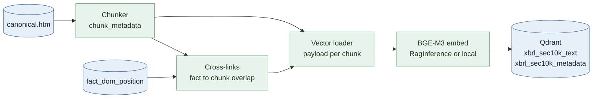

# XBRL Flow — 5. Vector DB Load (Canonical HTML → Qdrant)

How the narrative side of the corpus is built: the canonical HTML of each filing is cut into
chunks, each chunk is linked to the XBRL facts it overlaps, and the chunks are embedded and
loaded into Qdrant for the retriever's narrative step. Run it after
[guide 4](./04-ingest-and-populate.md) (facts, Layer-0, `canonical.htm`, DOM positions) with
Qdrant up.

## Overview



*Green: deterministic code · Blue: data store.*

## 5.1 Chunk metadata and cross-links (Postgres)

Module: [`src/chunking/xbrl_html_base_chunking.py`](../../../src/chunking/xbrl_html_base_chunking.py)

```powershell
conda run -n py312 python -m src.chunking.xbrl_html_base_chunking                    # both phases, in order
conda run -n py312 python -m src.chunking.xbrl_html_base_chunking --chunk-metadata   # chunking + chunk_metadata only
conda run -n py312 python -m src.chunking.xbrl_html_base_chunking --cross-links      # chunk_cross_links only
#   also: --accessions ACC ...  --dry-run  --sec-root DIR  --normalized-root DIR
```

`--chunk-metadata` and `--cross-links` are mutually exclusive; with neither, one run does
both. Cross-links need `fact_dom_position` and `chunk_metadata` for the target filings.

- The chunker walks the canonical-HTML DOM by byte offset, emitting contiguous,
  non-overlapping chunks of up to `CHUNK_SIZE_IN_CHARS` (1000). Each gets a `section_path`;
  a table becomes its own chunk (`contains_table`); `<ix:header>` is skipped.
- The cross-link sweep compares fact byte ranges with chunk byte ranges and records each
  overlap, with a confidence, in `chunk_cross_links`.

> ⚠️ **`chunk_id` is deterministic:** `uuid5(accession_no, char_start, char_end)`, so a re-run
> is idempotent. Anything that changes chunk boundaries or canonical-HTML bytes changes the ids
> and needs a re-chunk, re-link and a full Qdrant reload.

## 5.2 Load into Qdrant

Pipeline: [`src/pipelines/xbrl/load_to_vectordb_pipeline.py`](../../../src/pipelines/xbrl/load_to_vectordb_pipeline.py) ·
Config: [`configs/pipelines/xbrl/load_to_vectordb.yaml`](../../../configs/pipelines/xbrl/load_to_vectordb.yaml)

```powershell
conda run -n py312 python -m src.pipelines.xbrl.load_to_vectordb_pipeline                 # the config's scope
conda run -n py312 python -m src.pipelines.xbrl.load_to_vectordb_pipeline --all           # every eligible filing
conda run -n py312 python -m src.pipelines.xbrl.load_to_vectordb_pipeline --ticker NVDA --fiscal-year 2026 --form-type 10-K
conda run -n py312 python -m src.pipelines.xbrl.load_to_vectordb_pipeline --accessions 0001045810-26-000021
conda run -n py312 python -m src.pipelines.xbrl.load_to_vectordb_pipeline --ticker NVDA --dry-run   # no embedding, no writes
```

| Flag | Default | Meaning |
|------|---------|---------|
| `--config NAME` | `load_to_vectordb` | config under `configs/pipelines/xbrl/` (no `.yaml`) |
| `--all` \| `--accessions ACC ...` | — | every eligible filing, or these (mutually exclusive) |
| `--ticker T ...` `--fiscal-year Y ...` `--form-type F ...` | — | filter; the years and forms narrow `--ticker` |
| `--dry-run` | off | parse, chunk and report only |
| `--env-file`, `--log-level` | `.env`, `INFO` | |

CLI scope flags override the config's `scope:`. Exit code 1 if any filing errors.

Per filing the loader chunks `canonical.htm`, joins the cross-links to fact ids, concepts and
labels, builds one payload per chunk, embeds the text (dense + sparse) and the metadata
(dense) with BGE-M3, and upserts both collections. The run ends with a summary line including
`targets_found` and `rows_upserted`.

> ⚠️ **Discovery requires the chunk metadata first.** A filing is a target only if it is not
> superseded, has a valid accession number, and **has `chunk_metadata` rows**. Skip §5.1 and
> nothing loads, without an error.

> ⚠️ **Embedding through RagInference** (`RAGINFER_URL` set) sends all of a filing's chunks in
> one HTTP call: raise `RAGINFER_TIMEOUT_S` (for example to `1800`) for a large load.
> In-process, `embedding.batch_size` in the config applies; keep it modest, since a large CPU
> batch has crashed the process without a traceback.

The config's other keys: `qdrant:` (host, port, timeout; `QDRANT_*` env wins),
`collections:` (names, `toggle_hnsw` to speed bulk loads, `ensure_payload_indexes`), the
`paths:` keys (blank on purpose: roots come from `SEC_EDGAR_ROOT` / `XBRLRAG_NORMALIZED_ROOT`),
and `scope:` with its `tickers:` / `accessions:` lists. The DB connection comes from
`XBRL_DB_*`, not this file.

## 5.3 Collections

| Collection | Vectors | Payload |
|------------|---------|---------|
| `xbrl_sec10k_text` | dense (BGE-M3, 1024) + sparse | chunk text and the full payload |
| `xbrl_sec10k_metadata` | dense | company / year / section / concept-label metadata |

Payload indexes (with `ensure_payload_indexes: true`): `cik`, `ticker`, `accession_no`,
`fiscal_year`, `fiscal_period`, `form_type`, `section_path`, `section_path_ancestors`,
`contains_table`, `has_xbrl_facts`, `is_financial_statement`, `xbrl_fact_ids`,
`xbrl_concepts`. `section_path_ancestors` (every prefix of the path) lets the retriever filter
to a section subtree, for example MD&A and everything under it.

## 5.4 Verify

```powershell
curl.exe http://localhost:6333/collections/xbrl_sec10k_text
curl.exe http://localhost:6333/collections/xbrl_sec10k_metadata
```

Both must report a non-zero `points_count`. On AWS, follow
[guide 4 §4.13.5](./04-ingest-and-populate.md#4135-load-qdrant--chunk-embed-upsert).

Next: [6. Retrieval pipeline](./06-retrieval-pipeline.md).
