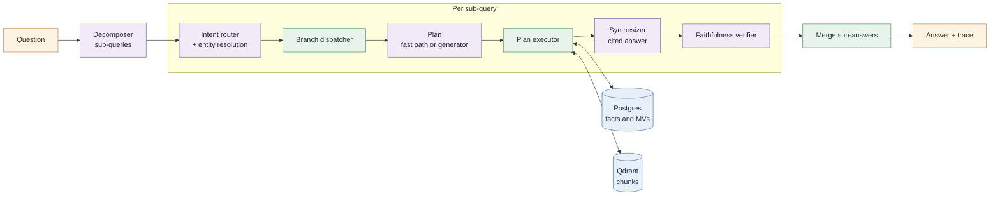

# XBRL Flow — 6. Retrieval Pipeline (Plan-Based)

The query side, from an operator's point of view: how to run a question through the XBRL
pipeline and what each stage leaves in the trace. The pipeline routes the question, builds a
typed plan, executes it deterministically (numbers from audited Postgres facts, arithmetic in
a sandboxed calculator, prose from Qdrant), lets an LLM write the cited answer, and has a
second LLM pass drop any statement its citations don't support. The invariants an editor must
keep are in [`src/retriever/xbrl/CLAUDE.md`](../../../src/retriever/xbrl/CLAUDE.md); the
design rationale is in [architecture §3](../../design/XbrlRag_Architecture.md#3-query).

- Pipeline: [`src/pipelines/xbrl/retrieval_pipeline.py`](../../../src/pipelines/xbrl/retrieval_pipeline.py) (`XbrlRetrievalPipeline.generate`)
- Stages: [`src/retriever/xbrl/`](../../../src/retriever/xbrl/)

## Overview



*Green: deterministic code · Purple: LLM call (the router and plan step also resolve entities
and fast-path plans in code) · Blue: data store · Amber: input/output.*

Most questions decompose to one passthrough sub-query; the decomposer splits only a bundled
ask (for example a screen plus a narrative follow-up about "the top 3"), and any decomposer
error falls back to a single passthrough. Companies and periods resolve **by SQL**, never by
the LLM; an ambiguous or unresolved company gets a "did you mean ..." answer instead of a
plan. With `XBRLRAG_QUERY_CACHE` set, a semantic cache can answer a repeated question before
any stage runs.

When a compound question states exactly one fiscal year and a dependent sub-query comes back
without a period, a deterministic step appends " for fiscal year Y" to that sub-query, so the
router resolves the year the user asked for; the trace logs it as a `decision` event
`inherit_period` ([spec](../../specs/dependent-subquery-period.md)). A year written right
after "latest" or "current fiscal year" counts as that year. A dependent sub-query that asks
for growth or change "from FY24" with no end year is rewritten to "from fiscal year 2024 to
fiscal year E", where E is the question's one later year (else 2025), and the trace logs a
`decision` event `from_end_year` with the base and end years
([spec](../../specs/subquery-period-phrases.md)).

## 6.1 Run a query

**Prerequisites:** Postgres loaded (facts, Layer-0, MVs; [guide 4](./04-ingest-and-populate.md)),
Qdrant loaded ([guide 5](./05-vectordb-load.md)), the active LLM profile's provider key, and
RagInference or local models for the narrative step.

```powershell
# Demo harness: prints answers for three built-in sample questions (no CLI flags)
conda run -n py312 python -m src.pipelines.xbrl.retrieval_pipeline
```

Through the API ([guide 7](./07-api-ui-observability.md)); `mode` `auto` or `xbrl` both run
this pipeline:

```powershell
curl.exe -s http://localhost:8000/api/query -H "Content-Type: application/json" `
  -d '{\"query\":\"NVIDIA fiscal 2026 gross margin?\",\"mode\":\"auto\"}'
```

The response carries `query_id`, the key of the whole trace (`/tech/traces/<query_id>` in the
UI). Programmatically:

```python
from src.pipelines.xbrl.retrieval_pipeline import XbrlRetrievalPipeline

pipeline = XbrlRetrievalPipeline(persist_audit=True)     # True is the default: writes audit.*
resp = pipeline.generate("What was NVIDIA's gross margin in fiscal 2026?", user_id="analyst-1")
print(resp.answer_summary)
for detail in resp.answer_details:                         # each statement with its citations
    print(detail)
```

`generate()` takes no mode argument: the branch is decided inside. It returns an
`XbrlRagResponse` (`query`, `answer_summary`, `answer_details[]`, `unanswered_parts[]`,
`metadata{}`, `plan{}`, `execution_result{}`, `narrative_chunks[]`). Every stage is injectable
through the constructor (each defaults to `from_env`). Serving callers go through
`src/api/pipelines.py::run_xbrl`, which also turns a run halt (budget, circuit breaker) into a
"not answered" body.

## 6.2 Stages and what they leave in the trace

Each query runs inside `trace_query` (events `query_start`, `query_summary`) and each stage
inside a named trace stage, persisted to `audit.query_event`. Every LLM call through the
gateway emits `llm_call` (model, tokens, cost, latency; prompt and response bodies unless
`XBRLRAG_TRACE_LLM_BODIES=0`), plus `retry` and `model_escalation` when they happen.

| Trace stage | Modules | Does | Notable events |
|---|---|---|---|
| — | `query_cache.py` | semantic answer cache (off by default) | `query_cache` |
| `decomposer` | `query_decomposer.py` | split a compound question into ordered sub-queries; a dependent one gets an earlier screen's top-N via a `<<TOP:id:n>>` token, injected with ranks ("AMZN (#1), MSFT (#2)"; a bare ticker for n = 1) | `subquery`, `decision` |
| `intent_router` | `intent_router.py`, `entity_extractor.py`, `entity_resolution.py`, `branch_dispatcher.py` | classify intent (`NUMERIC_LOOKUP` / `_COMPUTE` / `_SCREEN`, `NARRATIVE`, `HYBRID`); resolve companies and periods by SQL; pick `FACT_BRANCH_DIRECT`, `NARRATIVE_BRANCH` or `PLAN_GENERATOR` | `intent_extraction`, `decision` |
| `plan_generator` | `plan_generator.py`, `plan_validator.py` | a fast-path one-step plan, or an LLM-generated typed `{"steps": [...]}` plan, checked structurally and retried with feedback (one model tier up on a validation failure) | `llm_call`, `model_escalation` |
| `plan_exec` | `plan_executor.py` and the step tools | run each step: `lookup`, `compute`, `cagr`, `screen`, `aggregate`, `breakdown`, `narrative` | `sql_query` (exact fact-store SQL), `numeric_lineage` (every number's inputs), `decision` (each fallback taken) |
| `synthesizer` | `llm_xbrl_synthesizer.py` | write the answer with per-statement citations; the LLM never does arithmetic | `llm_call` |
| `verifier` | `llm_xbrl_faithfulness_verifier.py`, `citation_integrity.py` | drop statements whose own citations don't support them (a citation to nothing, or a number matching no cited value, is dropped without the LLM) | `llm_call`, `verifier_error` |

The step tools: `xbrl_factstore_lookup.py` (one fact with its citation),
`xbrl_calculator_tool.py` (sandboxed arithmetic over earlier steps), `xbrl_factstore_screen.py`
(cross-filer ranked rows, each with its own `fact_id`), `xbrl_factstore_breakdown.py` (one
filer's segment / product / geography partition of a total), `xbrl_narrative_retriever.py`
(Qdrant hybrid search, rerank, neighbour expansion). Lookups are strict: an ambiguous match
returns `AMBIGUOUS`, not a guess, and the few safe fallbacks are each logged as a `decision`
event ([architecture §3.2](../../design/XbrlRag_Architecture.md#32-why-lookups-are-strict-and-where-they-relax)).

**Models.** Each stage uses the active profile's model for its tier
([`configs/llm/llm.yaml`](../../../configs/llm/llm.yaml); pick with `XBRLRAG_LLM_PROFILE`,
default `openai`). The decomposer, router, plan generator and synthesizer use the medium tier;
the verifier the small tier. Gateway, prompts and escalation:
[LLM harness](../../design/XbrlRag_LLM_Harness.md).

## 6.3 Dependencies

| Step | Needs |
|---|---|
| entity resolution, `lookup`, `compute`, `screen`, `breakdown` | Postgres (`entity_master`, `fiscal_calendar`, `concept_mapping`, the `mv_*` views) |
| `narrative` | Qdrant (`xbrl_sec10k_text`) and the reranker (RagInference or in-process) |
| decomposer, router, plan generator, synthesizer, verifier | the active profile's LLM provider |
| trace persistence | Postgres `audit` schema (best-effort: the query still answers if it is down) |

A pure `NUMERIC_LOOKUP` touches only Postgres, a pure `NARRATIVE` only Qdrant, and a `HYBRID`
plan both.

## Related

- [`src/retriever/xbrl/CLAUDE.md`](../../../src/retriever/xbrl/CLAUDE.md): stage invariants (periods, units, screens, breakdowns, fallbacks)
- [Guide 7: API, UI and observability](./07-api-ui-observability.md) · [Guide 9: REST and MCP](./09-programmatic-access-rest-and-mcp.md) · [Guide 8: troubleshooting](./08-troubleshooting.md)
- [Architecture](../../design/XbrlRag_Architecture.md) · [LLM harness](../../design/XbrlRag_LLM_Harness.md)

Next: [7. API, UI & observability](./07-api-ui-observability.md).
