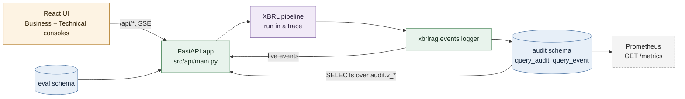

# XBRL Flow — 7. API, UI & Observability

How to run and use the human-facing side of XbrlRag: the FastAPI **BFF** (backend-for-frontend)
and the React **UI**, plus the tracing and audit layer behind the UI's technical pages. Read it
when you start the app locally, add a page or endpoint, or need to find where a query's trace,
cost or lineage is recorded. The programmatic `/api/v1` surface and the MCP server live on the
same app but have their own guide, [9](./09-programmatic-access-rest-and-mcp.md).

**In this doc:** [Overview](#overview) · [7.1 Run the API](#71-run-the-api-bff) ·
[7.2 Endpoints](#72-endpoints) · [7.3 Run the UI](#73-run-the-ui) ·
[7.4 Pages](#74-the-two-consoles-pages) · [7.5 Observability](#75-observability-internals) ·
[7.6 LLM economics](#76-llm-economics--prompts) · [7.7 Prometheus](#77-prometheus--grafana-metrics-export--alerting)

## Overview



*Green: deterministic code · Purple: LLM pipeline · Blue: data store · Grey: external · Amber: user-facing.*

One event stream (`xbrlrag.events`) feeds three consumers: the live SSE progress on the Ask page,
the persisted trace in the `audit` schema, and from there the dashboards and `/metrics`.
`query_id` is the correlation key linking an answer to its trace, events, lineage, logs and audit
rows, including a graded eval case run with `--persist-audit`.

The API serves **both flows**: `mode` `auto`/`xbrl` runs the XBRL pipeline, `basic`/`hyde`/
`subquery` the [PDF-legacy](../pdf-legacy-flow/README.md) retriever (no trace, `query_id: null`).

> **Before you judge the UI, verify the database behind it.** An empty `concept_labels` renders
> raw QNames, an empty `fact_dom_position` breaks citation anchoring, and empty Qdrant
> collections make the narrative branch silent; all look like retrieval bugs. Run the
> acceptance gate first; it reports PASS/FAIL per gate with the stage to re-run
> ([guide 4](04-ingest-and-populate.md) maps each empty table to its UI symptom):
>
> ```powershell
> conda run -n py312 python scripts/dbq.py -f scripts/checks/post_ingest_acceptance.sql
> ```
>
> The UI also needs `RAGINFER_URL` and Qdrant reachable, which that SQL cannot see.

References: [`src/api/README.md`](../../../src/api/README.md) and its
[`CLAUDE.md`](../../../src/api/CLAUDE.md), [`ui/README.md`](../../../ui/README.md),
[UI design](../../design/XbrlRag_UI_Design.md),
[observability & tracing design](../../design/XbrlRag_Observability_Tracing.md).

## 7.1 Run the API (BFF)

```powershell
conda run -n py312 --no-capture-output python -m uvicorn src.api.main:app --reload --port 8000
```

OpenAPI explorer: `http://localhost:8000/docs`. The app boots without a DB or models:
`GET /api/health` reports DB reachability and per-pipeline importability, and the observability
endpoints return empty results (not 500s) when the audit DB is unreachable.

| Env var | Default | Purpose |
|-----|---------|---------|
| `XBRL_DB_HOST/PORT/NAME/USER/PASSWORD` (+ `XBRL_DB_SSLMODE`) | `localhost`/`5432`/`xbrl_db`/`postgres`/`postgres` | Fact-store and audit DB, via the shared `src/db/conn.py` |
| `XBRLRAG_UI_ORIGINS` | `http://localhost:5173,http://127.0.0.1:5173` | CORS origins |
| `XBRLRAG_LOG_FILE` | this process's own `logs/xbrlrag_<process>_<pid>.log` | File tailed by `GET /api/logs` |

## 7.2 Endpoints

| Method | Path | Purpose |
|--------|------|---------|
| GET | `/api/health` | DB reachability + per-pipeline import status |
| POST | `/api/query` | Run a query → answer dict + `query_id` |
| GET | `/api/query/stream` | **SSE** live pipeline events + terminal result |
| GET | `/api/companies?q=&limit=` | Entity typeahead (`entity_master`) |
| GET | `/api/traces?limit=&offset=` · `/api/traces/{query_id}` | Recent query headers · full trace (rollup + ordered events) |
| GET | `/api/lineage/{query_id}` | Numeric lineage event payloads |
| GET | `/api/facts/{fact_id}/queries` | Reverse audit: which answers used fact N |
| GET | `/api/metrics/overview` · `/api/metrics/llm` | KPIs, latency, branch and stage mix · LLM call and model cost (JSON, for the UI) |
| GET | `/metrics` | **Prometheus** text exposition (root-mounted, not under `/api`), see §7.7 |
| GET | `/api/ingestion/runs` · `/runs/{run_id}/items` · `/analytics` | Ingestion history, per-filing items, failure-triage rollups |
| GET | `/api/prompts` | Prompt registry with version hashes |
| GET | `/api/logs?limit=&query_id=&level=` | Structured JSON log tail, newest first |
| GET | `/api/eval/suites` · `/runs` · `/runs/{run_id}` · `/runs/{run_id}/cases[/{case_id}]` | Eval suites, run history, one run, per-case grades ([guide 11](./11-evaluation.md)) |
| GET | `/api/eval/compare?a=&b=` · `/silent-wrong` · `/flaky` | Run diff · the silent-wrong release-gate queue · cases whose grade flips |

### POST `/api/query`

Request ([`schemas.py`](../../../src/api/schemas.py)): `query` (required), `mode`
(`auto` default | `xbrl` | `basic` | `hyde` | `subquery`), optional `user_id`, and `top_k`
(legacy retriever only). Response: `query_id` (null on the legacy path), `mode`, `answer` (the
raw `XbrlRagResponse` / `RagResponse`) and `error`. Exceptions are returned in `error`, never as
a 500.

### SSE streaming (`/api/query/stream`)

`EventSource` is GET-only, so `query` is a query parameter. The endpoint attaches a handler to the
`xbrlrag.events` logger, runs the pipeline in a daemon thread, and forwards that thread's events
as `data: {json}\n\n`: `stream_open`, then live events (`query_start`, `decision`, `llm_call`,
`numeric_lineage`, `retry`, …), 15 s keepalives, and a terminal `{"kind":"result", …}` carrying
the answer or an `error`. The terminal event is always sent.

## 7.3 Run the UI

Source: [`ui/`](../../../ui/) (React 18, Vite 5, react-router, react-query, recharts).

```powershell
# Terminal 1: the API (§7.1). Terminal 2, from ui/:
$env:Path = "<node-v24.14.0 folder>;$env:Path"
npm install
npm run dev
```

Open `http://localhost:5173`. Vite proxies `/api` to `http://localhost:8000` (override with
`VITE_BFF_TARGET`). Other scripts: `npm run build`, `npm run preview`, `npm run typecheck`.

## 7.4 The two consoles (pages)

Routes are defined in [`ui/src/App.tsx`](../../../ui/src/App.tsx).

**Business (analyst workspace)**

| Route | What it does |
|-------|--------------|
| `/business/ask` | Ask a question; streams live progress; shows the answer, citations and the glass-box explanation (understanding → plan → fact lookups → computation → retrieval → synthesis). |
| `/business/answer/:queryId` | A saved answer (falls back to the persisted trace, so it deep-links). |
| `/business/company[/:ticker]` | Company dashboard: trends and statement lines over `/api/v1`. |
| `/business/screen` | Cross-filer ranking over `POST /api/v1/screen`. |
| `/business/metrics` | Cited metric × period grid (`POST /api/v1/metrics`), CSV export. |
| `/business/bridge` | Variance waterfall over `POST /api/v1/facts/bridge`. |
| `/business/history` · `/business/compare` | Recent queries · two answers side by side. |

**Technical (system and observability)**

| Route | What it does |
|-------|--------------|
| `/tech/overview` · `/tech/architecture` | Health and KPI tiles · architecture map. |
| `/tech/traces` · `/tech/traces/:queryId` | Trace Explorer list · stage waterfall and event stream. |
| `/tech/llm` | Cost and LLM economics (per call, per model, escalations). |
| `/tech/lineage` | Numeric lineage and the reverse-audit pivot. |
| `/tech/ingestion` | Ingestion runs → per-filing drill-down, triage and retry panels. |
| `/tech/logs` | Structured log tail with level and `query_id` filters. |
| `/tech/eval` · `/tech/eval/:runId` · `/tech/eval/compare/:a/:b` · `/tech/eval/reliability` | Eval scorecards, one run, a run diff, repeat spread and the silent-wrong queue ([guide 11](./11-evaluation.md)). |

## 7.5 Observability internals

Source: [`src/observability/`](../../../src/observability/).

| Module | Role |
|---|---|
| `trace_context.py` | `trace_query(query, user_id)` opens a `TraceContext` (16-hex `query_id`) propagated via `contextvars`; `traced_stage(stage)` times a stage; `log_event(kind, **fields)` writes one JSON line to `xbrlrag.events` and appends it to the trace. |
| `audit_store.py` | `PostgresAuditStore` persists a finished trace: one `audit.query_audit` rollup row (cost, latency, branch, intent, answer, `stage_latency_ms`) plus one `audit.query_event` row per event. |
| `ingestion_audit.py` | `record_ingestion_run(...)` writes `audit.ingestion_run` + `ingestion_run_item`, classifying each filing's failure (timeout, arelle_not_found, subprocess_error, validation_error). |
| `usage_meter.py` | Measures the LLM spend of one `/api/v1` response without creating a query trace ([spec](../../specs/usage-cost.md)). |
| `service_tiers.py` | Counts LLM calls by requested and served provider service tier per stage (recorded on eval runs). |
| `metrics_exporter.py` | Renders `audit.v_*` as Prometheus text (§7.7). |

LLM prompt and response bodies enter `llm_call` events only under `XBRLRAG_TRACE_LLM_BODIES`. The
observability routes are thin SELECTs over the `audit` schema and its `audit.v_*` views; the
`/api/eval/*` routes are the same over the `eval` schema ([guide 2](./02-postgres-setup.md)).

## 7.6 LLM economics & prompts

- `/api/metrics/llm` reports per-call and per-model cost from the audit events, priced by
  [`configs/llm/pricing.yaml`](../../../configs/llm/pricing.yaml) (loaded as `MODEL_PRICING` in
  `src/llm/config.py`).
- `/api/prompts` lists the prompt registry with SHA-256 version hashes, over
  [`prompts/templates/xbrl/`](../../../prompts/templates/xbrl/) and the legacy `sec10k/`.
- Background: [LLM harness](../../design/XbrlRag_LLM_Harness.md),
  [`src/llm/README.md`](../../../src/llm/README.md).

## 7.7 Prometheus / Grafana (metrics export + alerting)

`GET /metrics` ([`metrics_prom.py`](../../../src/api/routes/metrics_prom.py) →
[`metrics_exporter.py`](../../../src/observability/metrics_exporter.py)) exports the same
`audit.v_*` views as dependency-free Prometheus text: latency percentiles, cost, error and
degradation rates, LLM economics, ingestion health. It degrades to `arag_audit_db_up 0` when the
DB is down. Scrape config, alert rules and a Grafana dashboard are in
[`configs/monitoring/`](../../../configs/monitoring/README.md); the packaged stack wires them via
the compose `monitoring` profile ([`deploy/README.md`](../../../deploy/README.md)).

## Related

[8. Troubleshooting](./08-troubleshooting.md#api--ui) ·
[9. Programmatic access](./09-programmatic-access-rest-and-mcp.md) ·
[11. Evaluation](./11-evaluation.md)
