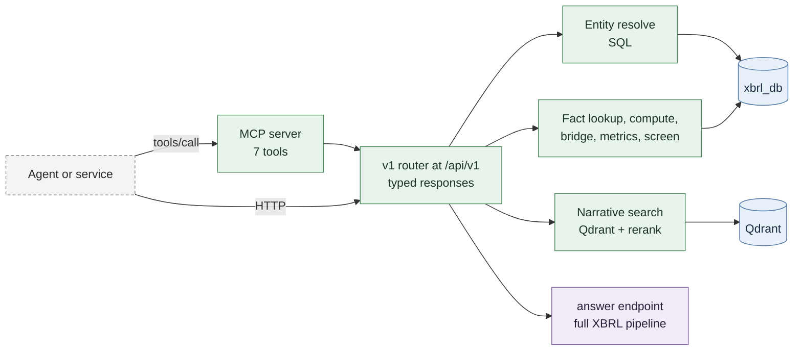

# XBRL Flow — 9. Programmatic Access (v1 REST + MCP)

How a program or an LLM agent calls XbrlRag: the **v1 Analyst REST API** (`/api/v1`) and the
**MCP server** that exposes its core as discoverable tools. Read it when you integrate another
service (for example faultline's `scenariogen`) or add an endpoint or tool. The human-facing BFF
and UI are in [guide 7](./07-api-ui-observability.md).

**In this doc:** [Overview](#overview) · [9.2 v1 REST API](#92-the-v1-analyst-rest-api-apiv1) ·
[9.3 MCP server](#93-the-mcp-server-srcmcp_server) · [9.4 Concurrency](#94-concurrency) ·
[9.5 Tests](#95-tests)

References: [`src/api/README.md`](../../../src/api/README.md#v1-analyst-api-apiv1),
[`src/api/v1/`](../../../src/api/v1/), [`src/mcp_server/README.md`](../../../src/mcp_server/README.md)
and its [`CLAUDE.md`](../../../src/mcp_server/CLAUDE.md).

## Overview



*Green: deterministic code · Purple: LLM pipeline · Blue: data store · Grey: external caller.*

**Why a separate surface.** The BFF's `POST /api/query` always runs the full pipeline (route →
plan → execute → synthesize → verify, several LLM calls) and returns prose. An agent usually
wants the opposite: a deterministic fact series with units and citations, no LLM, no chance of
being misrouted, plus discovery of what is queryable. So the pipeline's building blocks (entity
resolution, fact lookup, narrative retrieval, calculation) are exposed individually, and **the
caller's LLM** decides what to call. XbrlRag's own router runs only inside `/answer`.

## 9.2 The v1 Analyst REST API (`/api/v1`)

Package [`src/api/v1/`](../../../src/api/v1/) (`router.py`, `schemas.py`, `service.py`), mounted on
the same FastAPI app as the BFF, so the same `uvicorn src.api.main:app` process serves it. Every
endpoint except `/answer` makes no synthesis LLM call; each wraps an existing pipeline component
(`EntityExtractor`, `XbrlFactstoreLookup`, `XbrlNarrativeRetriever`, `XbrlCalculatorTool`,
`XbrlRetrievalPipeline`), so resolution and citation logic has one source of truth.

| Method | Path | Purpose |
|--------|------|---------|
| GET  | `/api/v1/coverage?ticker=` | Ingested companies × fiscal years × form types |
| GET  | `/api/v1/concepts` | The `concept_family` vocabulary the fact endpoints accept |
| GET  | `/api/v1/companies/{ticker_or_cik}` | Resolve an entity; `404` if unresolved |
| POST | `/api/v1/facts/lookup` | Deterministic fact **time series** with citations and a status per point |
| POST | `/api/v1/facts/compute` | Citation-traced arithmetic over named facts (sandboxed, `+ - * /` and parentheses) |
| POST | `/api/v1/facts/bridge` | Decompose a total's year-on-year change into its segment or geography children, with an `unexplained` residual |
| GET  | `/api/v1/metrics/catalog` | The derived-ratio library (`mv_derived_metrics`) |
| POST | `/api/v1/metrics` · `/api/v1/metrics.csv` | Cited metric × period grid for N companies · the same as CSV |
| POST | `/api/v1/screen` | Cross-filer ranking by a metric; each row carries a citation anchor |
| POST | `/api/v1/narrative/search` | Risk-factor / MD&A chunks with provenance, no synthesis |
| POST | `/api/v1/answer` | Full synthesized answer through the XBRL pipeline, with a `query_id` |

**Periods and point-in-time.** `facts/lookup`, `facts/bridge` and `metrics` take `fiscal_period`
(`FY` default, or `Q1`–`Q4`) and, for quarters, `ytd` (year-to-date vs the discrete quarter).
`facts/lookup` also takes `as_of` (the value as of the latest filing available on that date) and
`as_originally_reported` (ignore later restatements). The default is the latest annual figure.
Derived ratios cover margins, returns, leverage, liquidity, efficiency, per-share, growth and
filing-derivable non-GAAP proxies (EBITDA, SBC-adjusted operating margin), each with
`component_fact_ids`. Adjusted figures that exist only in earnings 8-K exhibits are out of scope.

**Discovery first.** An agent grounds its arguments with `GET /api/v1/coverage?ticker=NVDA` and
`GET /api/v1/concepts` before asking for data.

**Fact lookup.** Request `{"company": "NVDA", "concept": "Revenue", "fiscal_years": [2025, 2026],
"dimension": {"product": "data center"}}` (`dimension` optional). The response carries the resolved
company, `unresolved`, and one `FactPoint` per year with `status` (`OK | AMBIGUOUS | NOT_FOUND |
UNRESOLVED_DIMENSION | ERROR`), `value`, `unit`, `confidence`, `citation` (`fact_id`, accession,
…) and `notes`. **Check `status` before trusting `value`.**

**Compute.** `{"expr": "(rev26 - rev25) / rev25", "bindings": [{"name": "rev26", "company":
"NVDA", "concept": "Revenue", "fiscal_year": 2026}, …]}` returns `value`, `ok` and the
`resolved_bindings` with their citations. No LLM does the arithmetic.

**Narrative search.** `section_hint` (for example `"Risk Factors"`) is a soft signal folded into
the query, not a hard `section_path` filter: section paths can be non-ASCII table-of-contents
labels, so an exact prefix could return nothing.

**Contract.**

- **Typed responses**: concrete pydantic models, so a tool layer can pin the schema from
  `/openapi.json`.
- **Real status codes**: `404` unresolved company, `422` validation, `500` typed error (the BFF
  instead returns 200 with an `error` field).
- **Usage**: `facts/lookup` and `narrative/search` responses carry a `usage` block
  (`cost_usd`, `llm_calls`), metered from the gateway; `0.0` today, since both are SQL or
  self-hosted models ([spec](../../specs/usage-cost.md)).
- **No auth**: for a trusted private network or localhost, like the BFF. Put a gateway in front
  before any public exposure.

## 9.3 The MCP server (`src/mcp_server/`)

[MCP](https://modelcontextprotocol.io) (Model Context Protocol) lets the host discover tools
itself: it calls `tools/list` for the catalog and JSON-Schema arguments, then `tools/call`, so no
tool definition is hand-written on the caller's side. [`server.py`](../../../src/mcp_server/server.py)
is a FastMCP server whose **7 tools** wrap the in-process v1 router functions: `coverage`,
`concepts`, `resolve_company`, `facts_lookup`, `facts_compute`, `narrative_search`, `answer`.
`bridge`, `metrics*` and `screen` are REST-only. Input schemas are provider-neutral JSON Schema;
client errors (unresolved company, malformed compute input) come back as a readable
`{"error", "status_code"}` payload instead of raising.

```powershell
# stdio: the host spawns the server
conda run -n py312 python -m src.mcp_server.server

# streamable-http: a networked host connects to http://<host>:8765/mcp
$env:XBRLRAG_MCP_TRANSPORT = "streamable-http"; $env:XBRLRAG_MCP_HOST = "0.0.0.0"
conda run -n py312 python -m src.mcp_server.server
```

| Env var | Default | Purpose |
|---|---|---|
| `XBRLRAG_MCP_TRANSPORT` | `stdio` | `stdio` \| `streamable-http` (alias `http`) \| `sse` |
| `XBRLRAG_MCP_HOST` / `XBRLRAG_MCP_PORT` | `127.0.0.1` / `8765` | Bind address for the network transports |
| `XBRLRAG_MCP_WARMUP` | `1` | Preload fact, entity and narrative components in a background thread so the first tool call is warm; `0` disables |

It also reads the same `XBRL_DB_*`, `QDRANT_*`, `RAGINFER_URL` and provider-key settings as the
rest of the system. A stdio host config:

```jsonc
{ "mcpServers": { "arag-analyst": {
    "command": "conda",
    "args": ["run","-n","py312","python","-m","src.mcp_server.server"],
    "cwd": "/path/to/XbrlRag" } } }
```

**Dependency pin.** `mcp` is pinned `>=1.30,<2` with `fastapi==0.162.0`, `starlette>=1.3.1,<2`
and `pydantic<2.12` in `requirements.txt` and `requirements-serve.txt`; they move together
(pydantic 2.12+ breaks FastMCP's tool inspector). The server never writes to stdout (stdio is the protocol
channel).

## 9.4 Concurrency

Both surfaces share cached singletons (DB and LLM clients, and the embedder and reranker when run
in-process) behind a process-wide lock, so concurrent callers serialize on first construction and
on the models. With `RAGINFER_URL` set, embedding and reranking move to the shared inference
service ([guide 1](./01-setup-and-dependencies.md)). Load-test before a portfolio-wide fan-out.

## 9.5 Tests

| Suite | Covers |
|-------|--------|
| [`test/unit/test_api_v1.py`](../../../test/unit/test_api_v1.py) | v1 wiring, validation, mapping (service faked) |
| [`test/unit/test_mcp_server.py`](../../../test/unit/test_mcp_server.py) | MCP catalog, schemas, delegation (router faked) |
| [`test/integration/test_api_v1_live.py`](../../../test/integration/test_api_v1_live.py) | v1 endpoints against live `xbrl_db` ground truth |
| [`test/integration/test_mcp_live.py`](../../../test/integration/test_mcp_live.py) | `tools/call` end to end against live `xbrl_db` |

```powershell
conda run -n py312 python -m pytest test/unit/test_api_v1.py test/unit/test_mcp_server.py -q
# live (needs xbrl_db; narrative and answer also need RUN_NARRATIVE_E2E=1)
conda run -n py312 python -m pytest test/integration/test_api_v1_live.py test/integration/test_mcp_live.py -v -m integration
```

## Related

[7. API, UI & observability](./07-api-ui-observability.md) ·
[8. Troubleshooting](./08-troubleshooting.md#v1-analyst-api--mcp) ·
[10. Packaging](./10-packaging-images.md)
