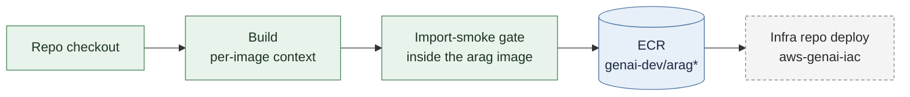

# XBRL Flow — 10. Packaging (building the images)

How to build, check and push XbrlRag's three container images, locally or as arm64 images for
AWS (Graviton). Read it before building an image or changing a Dockerfile. The compose stack,
Helm chart and CI are in [`deploy/README.md`](../../../deploy/README.md); the local/AWS design is
[local / AWS deployment](../../design/XbrlRag_AWS_Deployment.md).

## Overview



*Green: this repo's build steps · Blue: registry · Grey: the infra repo, which deploys.*

The boundary: this repo **builds, gates and pushes**; the infra repo `aws-genai-iac` **deploys**
(`deploy_arag_bundle.py` for the app tier, `deploy_arag_ingest_image.py` for the ingest pointer).

## 10.1 The three images (and their build contexts)

| Image | Dockerfile | Context | Contents |
|-------|-----------|---------|----------|
| **`arag`** | `infra/docker/Dockerfile` | **`.`** (repo root) | BFF (`src.api.main`) + MCP server; torch-free, embeds and reranks via `RAGINFER_URL` |
| **`arag-ingest`** | `infra/docker/Dockerfile.ingest` | **`.`** (repo root) | On-demand ingest runner: edgartools, `arelle-release==2.41.0`, lxml, boto3; torch-free |
| **`arag-ui`** | `ui/Dockerfile` | **`ui/`**, not `.` | The Vite-built React SPA served by nginx, which reverse-proxies `/api` |

The most common build error is building the UI from the repo root: `ui/Dockerfile` copies
`package.json` and `nginx.conf` relative to its context, so context `.` fails with
`"/nginx.conf": not found`. The other two copy `src/`, `configs/` and `scripts/` from the root.

## 10.2 Build locally

```bash
docker build -f infra/docker/Dockerfile -t arag:local .
docker build -f infra/docker/Dockerfile.ingest -t arag-ingest:local .
docker build -t arag-ui:local ui/
```

## 10.3 Build + push arm64 images to ECR (AWS / Graviton)

### One command: `scripts/build_push_images.py`

[`scripts/build_push_images.py`](../../../scripts/build_push_images.py) builds each image for
`--platform` (default `linux/arm64`), tags it `<registry>/<namespace>/<repo>:<arch>-<git sha>`
(namespace default `genai-dev`), runs the import-smoke gate (§10.5) inside the built `arag`
image, and pushes, resolving the registry from STS unless `--registry` is given. The default set
is the app-tier pair `arag` + `arag-ui`; `--component arag-ingest` adds the ingest image (it ships
on its own cadence).

```powershell
conda run --no-capture-output -n py312 python scripts/build_push_images.py --dry-run    # print the plan
conda run --no-capture-output -n py312 python scripts/build_push_images.py --no-push    # build + gate only
conda run --no-capture-output -n py312 python scripts/build_push_images.py --profile <aws-profile> --tag arm64-<sha>
```

Other flags: `--component NAME` (repeatable), `--region` (default `us-east-1`), `--namespace`,
`--no-gate` (a push without the gate is not accepted). On an x86 host the arm64 build and gate
run under QEMU emulation, several times slower.

### Longhand `buildx` (one-off or non-default builds)

```bash
export REGION=<region>
export REGISTRY=<acct>.dkr.ecr.$REGION.amazonaws.com
export TAG=$(git rev-parse --short HEAD)

# a builder that can cross-build arm64 (once; on x86 without binfmt:
#   docker run --privileged --rm tonistiigi/binfmt --install arm64)
docker buildx create --name arag-builder --driver docker-container --use --bootstrap

aws ecr get-login-password --region $REGION | docker login --username AWS --password-stdin $REGISTRY

docker buildx build --platform linux/arm64 --push -f infra/docker/Dockerfile        -t "$REGISTRY/genai-dev/arag:$TAG" .
docker buildx build --platform linux/arm64 --push -f infra/docker/Dockerfile.ingest -t "$REGISTRY/genai-dev/arag-ingest:$TAG" .
docker buildx build --platform linux/arm64 --push -f ui/Dockerfile                  -t "$REGISTRY/genai-dev/arag-ui:$TAG" ui/
```

The `genai-dev/arag*` repositories are provisioned by the infra repo. If ECR rejects buildx's OCI
attestation manifest, add `--provenance=false`. For Helm, set `image.repository`,
`ui.image.repository` and the shared `image.tag`.

## 10.4 Runtime requirements

Set at container start, never baked in:

- **`arag`**: `RAGINFER_URL` (**required**; the image has no models), `XBRL_DB_*` (on RDS with
  `XBRL_DB_SSLMODE=require`), `QDRANT_HOST`/`QDRANT_PORT` (+ `QDRANT_API_KEY`, `QDRANT_HTTPS`).
- **`arag-ingest`**: the same, plus `XBRLRAG_DEPLOY_MODE=aws` and
  `XBRLRAG_S3_BUCKET`/`XBRLRAG_S3_PREFIX`. Operator-run over SSM; the supported hybrid mode sets
  `XBRLRAG_STORAGE_BACKEND=local` on the runner ([guide 4](./04-ingest-and-populate.md)).
- **`arag-ui`**: `XBRLRAG_API_UPSTREAM` (default `api:8000`), substituted into nginx at start.
  nginx uses a static upstream, so **that host must resolve when the container starts** or nginx
  won't boot.

## 10.5 Quick validation

```bash
# arag: the gate build_push_images.py runs (API + MCP import, no heavy ML libs)
docker run --rm arag:local python -c "import src.api.main, src.mcp_server.server; print('ok')"

# arag-ingest: a working Arelle and no torch
docker run --rm arag-ingest:local arelleCmdLine --version
docker run --rm arag-ingest:local python -c "import importlib.util as u; print('torch:', u.find_spec('torch'))"   # -> None

# arag-ui: serves the SPA (make the api host resolvable in isolation)
docker run -d --name ui --add-host api:127.0.0.1 -e XBRLRAG_API_UPSTREAM=api:8000 -p 8080:80 arag-ui:local
curl -s -o /dev/null -w "%{http_code}\n" http://localhost:8080/   # -> 200
docker rm -f ui
```

## Key decisions

- **Serving and ingest images are torch-free**; models are reached over `RAGINFER_URL`, which keeps
  the images small and lets one inference service serve every process. The
  `test/unit/test_torch_free_contract.py` test and the in-image gate enforce it.
- **Build and gate live in this repo, deploy in the infra repo**; the two meet at ECR.

## Related

[9. Programmatic access](./09-programmatic-access-rest-and-mcp.md) ·
[`deploy/README.md`](../../../deploy/README.md) ·
[local / AWS deployment](../../design/XbrlRag_AWS_Deployment.md)
