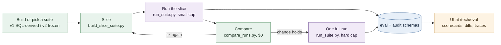

# XBRL Flow — 11. Evaluation (measuring accuracy)

This guide is for the operator who measures XbrlRag's accuracy: build a question suite, run
it against the live pipeline on a cheap slice, compare with a reference run, take one full
run, and read the result at `/tech/eval`. It covers the v1 suite (SQL-derived, still the
regression benchmark) and the v2 evaluation (XbrlRag against other systems on frozen and
held-out sets). Read it before any run that spends money.

How accuracy is measured and why: [evaluation design](../../design/XbrlRag_Evaluation.md),
[v2 architecture](../../design/XbrlRag_Eval_v2_Architecture.md), grading semantics
[S1–S6](../../design/XbrlRag_Eval_Semantics.md). Code: [`src/eval/`](../../../src/eval/);
entry points: [`scripts/eval/`](../../../scripts/eval/).

**In this doc:** [Overview](#overview) · [Before a paid run](#111-before-a-paid-run) ·
[Suites](#112-suites-v1-and-v2) · [Systems](#113-systems-under-test) ·
[The loop](#114-the-operator-loop) · [Flags](#115-run_suitepy-flags) ·
[Reading results](#116-reading-results) · [Analysis tools](#117-analysis-tools-0) ·
[Text judge](#118-calibrating-the-text-judge) · [Held-out sets](#119-held-out-sets) ·
[CI loops](#1110-golden-set-ci-loops) · [Gotchas](#1111-gotchas) ·
[Key decisions](#key-decisions)

> **Where the numbers live.** Results are written to the **`eval` schema** and rendered at
> **`/tech/eval`**. That store is the record of measured accuracy; quote a `run_id`, never a
> bare figure.

## Overview



*Green: deterministic, $0 · Purple: paid LLM runs · Blue: data store · Amber: output.*

Validate on slices ($0.30–0.50 each); take a full run only at the end of a body of work. A
single full run cannot resolve a change under about 2 points (full-suite sd ≈ 0.9).

## 11.1 Before a paid run

One-time setup:

- Postgres populated (facts, Layer-0, MVs) and Qdrant loaded. The suite queries the **live**
  pipeline, so a partly loaded corpus scores as refusals, not as a bug.
- The **`eval` schema** applied; `bootstrap_db.py` does not create it
  ([guide 2](./02-postgres-setup.md)):
  `conda run -n py312 python scripts/ddl/eval/_apply.py`. Re-apply after a DDL change (for
  example the `result_payload` column that checkpointing needs).
- Provider keys for the LLM profile you will use (`configs/llm/llm.yaml`, `--llm-profile`).

Before **every** paid run (slice, smoke, pilot or full), check the environment it will use
and see each check pass. Checking a repo's git commit is not checking that its service is
running.

1. **Postgres:** print `current_database()` and the corpus fingerprint; both must be the
   intended ones.
2. **Qdrant:** `GET /` answers on the intended port, and the `xbrl_sec10k_*` collections
   exist with the expected point counts.
3. **RagInference:** `GET /healthz` at `RAGINFER_URL` answers and names the expected
   embedder and reranker. `naive_rag_*` needs it for every question and `xbrlrag_full` for
   narrative steps; only the long-context arms and `closed_book` run without it.
4. **Keys and paths:** provider keys present (check presence only, never print them); in a
   worktree, the filing roots resolve to existing directories (`XBRLRAG_NORMALIZED_ROOT`
   unset points inside the worktree).
5. **One-case smoke** of each system before its full run; start the full run only after the
   smoke answered without an error.
6. **Code under test:** print the branch and grep for the change right before the run. Never
   `git stash` in a checkout a live run is using: prompt files are read from the working tree.

`--max-cost-usd` is checked **between** cases, so a case already running can overshoot it;
size small-slice caps per case.

## 11.2 Suites: v1 and v2

| Generation | Suite | What it is | Build |
|---|---|---|---|
| **v1** | `sql_derived` (default `--suite`) | 501 cases generated from [`analyst_queries.sql`](../../../scripts/xbrl/analyst_queries.sql) via [`sql_derived_templates.yaml`](../../../configs/eval/sql_derived_templates.yaml); committed at `test/eval/suites/sql_derived_v1.json`. Kinds: `lookup`, `compute`, `dimensional`, `breakdown`, `screen`. | `build_sql_derived_suite.py --tier standard` (also upserts the `eval.eval_suite` row) |
| v1 | `golden` | 13 hand-built cases (`test/eval/golden/xbrl_golden_v1.json`); the CI drift spine ([§11.10](#1110-golden-set-ci-loops)). | `build_golden_set.py` |
| **v2** | dev / validation | Intents × phrasings with SEC-sourced answer keys ([v2 architecture](../../design/XbrlRag_Eval_v2_Architecture.md)); frozen under `data/eval/v2_frozen/` (local, gitignored), with `_compound` variants. A run never mixes splits. | `build_v2_suite.py`; the frozen suites' arguments are in `xbrl_v2_manifest.json` beside them |
| v2 | dev sample | A seeded 100-case sample of dev for cheaper development runs. | `build_dev_sample.py --suite … --size 100 --seed … --out …` |
| v2 | paraphrased | A split's template cases plus its kept paraphrases, so `paraphrase_stability` spans both phrasings ([spec](../../specs/paraphrase-suite-wiring.md)). | `build_paraphrase_suite.py` |
| v2 held-out | H-F, H-X, set B | Sealed sets, never read or tuned on by an agent; only aggregates are shared. | [§11.9](#119-held-out-sets), [guide 12](./12-heldout-set-b.md) |

Run any suite file with `run_suite.py --suite-path <file>`. Example builds:

```powershell
conda run -n py312 python scripts/eval/build_sql_derived_suite.py --tier standard
conda run -n py312 python scripts/eval/build_paraphrase_suite.py --split dev `
    --suite data/eval/v2_frozen/xbrl_v2_dev.json --suite data/eval/v2_frozen/xbrl_v2_validation.json `
    --paraphrases data/eval/v2_frozen/paraphrases_dev_frozen.json `
    --paraphrases data/eval/v2_frozen/paraphrases_validation_frozen.json `
    --out data/eval/v2_frozen/xbrl_v2_dev_paraphrased.json
```

**Rebuild and diff a suite after any template, view, concept-mapping or corpus change**, and
commit the v1 JSON with the change. With stable selection, moved cases should stay inside the
templates or filers you touched. Don't rely on the corpus fingerprint: it is built from
`publish_manifest`, which the views don't read, so a load can change answers without changing it.

> **`screen` ≠ `breakdown`.** A screen is cross-filer ("top 5 companies by operating
> margin"): one `screen` step with ranked rows. A breakdown is a single-filer split ("Apple's
> revenue by product"): one `breakdown` step whose rows partition the total, graded as a set.
> Its ground truth uses the step's own partition rule ([spec](../../specs/breakdown-op.md)).
> Grading a breakdown as a screen scores correct answers as refusals.

## 11.3 Systems under test

| `--system` | What it is | Needs |
|---|---|---|
| `xbrlrag_full` (default) | The production plan-based pipeline. | Postgres, Qdrant, RagInference (narrative) |
| `frontier_sec_tools` | A frontier model with a fixed tool set over the public SEC APIs ([tools and prompt](../../eval/frontier_sec_tools.md)); the v2 comparator. Reads none of XbrlRag's data and cites no `fact_id`, so compare it on value accuracy. | `--sec-as-of`, `SEC_EDGAR_IDENTITY`; no Postgres, Qdrant or RagInference |
| `long_context_oracle` | The case's own annual filing, whole, in one call: the single-filer ceiling. Formerly `long_context`; old runs keep that name. | Filing files only |
| `closed_book` | The model alone, no documents: the floor. | Nothing |
| `naive_rag_filtered` | Top-10 hybrid Qdrant search scoped to the case's ticker and year, then one LLM call. | Qdrant, RagInference |

Arms that take `--model` default to the active profile's frontier model. `--system` also
accepts systems kept in code but no longer part of the evaluation (`naive_rag_plain`,
`long_context_resolved`, `long_context_multi`, `html_rag`; see the
[`html_rag` decision](../../design/XbrlRag_HtmlRag_Decision.md)); `run_suite.py --help` lists
them.

A `frontier_sec_tools` run keeps in `config.frontier` the model, prompt version, tool
fingerprint, budgets, the SEC snapshot it read and an `agent_summary` (budget hits, tool
errors, snapshot misses, unresolved citations). Responses are cached under
`<XBRLRAG_SEC_SNAPSHOT_DIR>/<as_of>/` (default `data/frontier_sec_snapshots/`); set
`XBRLRAG_SEC_FROZEN=1` for a strict rerun on one snapshot.

## 11.4 The operator loop

```powershell
# 1. A slice: named cases / id prefixes, the working set, plus a seeded regression sample
conda run -n py312 python scripts/eval/build_slice_suite.py --out slice.json `
    --prefix aq-3d --stable 60 --seed 1730

# 2. Run it (small hard cap; --persist-audit makes every loss traceable)
conda run -n py312 python scripts/eval/run_suite.py --suite-path slice.json `
    --no-store --persist-audit --max-cost-usd 1 --out slice_out.json

# 3. Compare with a reference run, re-grading both with today's graders ($0)
conda run -n py312 python scripts/eval/compare_runs.py --baseline <run_id> --candidate slice_out.json

# 4. Once the change holds: one full run
conda run -n py312 python scripts/eval/run_suite.py --max-cost-usd 5 --persist-audit
```

Other common runs: `--rerun-failed last` (only what did not pass last time; add
`--rerun-grade REFUSED` to narrow), `--kind dimensional --ticker MSFT --ticker TSM` (repeatable
flags, not comma lists), `--suite golden`.

Blame a slice loss on your change only after its trace shows the changed code path: read
`audit.query_event` (the `numeric_lineage` events and their `resolution_notes`). Most slice
losses are planner variance the old code also had.

**Prompt-only changes:** copy `vN` → `vN+1`, bump `prompts/templates/xbrl/registry.yaml`,
update `DEFAULT_VERSIONS` in `test/unit/test_prompt_registry.py`, and validate with a slice
plus a regression sample of the other kinds.

> **A narrowed run is not a baseline.** A `--kind` / `--rerun-failed` / `--sample` run is
> stored with `tier='partial'` and a note of the selection. Its accuracy is over a
> deliberately biased subset, and it cannot detect a regression outside the cases it ran.

**Checkpoint and resume** ([spec](../../specs/eval-run-checkpoint.md)). A stored run writes its
`RUNNING` row before the first answer and each case row as soon as it is graded, so a crash
loses only the cases in flight; a budget or circuit-breaker halt ends the run `ABORTED` with
everything graded so far. `--resume <run_id>` answers only the cases with no row, and refuses
unless suite hash, git sha, system, model, profile and settings match; `--max-cost-usd`
(which covers restored spend too) and `--workers` may change.

## 11.5 `run_suite.py` flags

The authoritative list is `run_suite.py --help`; this table groups them.

| Group | Flags |
|---|---|
| What to run | `--suite {sql_derived,golden}` · `--suite-path FILE` · `--system NAME` · `--model ID` · `--llm-profile NAME` (wins over `XBRLRAG_LLM_PROFILE`) |
| Slice selection | `--kind` · `--tag` · `--ticker` (all repeatable) · `--sample N` with `--seed` (default 1729; prefer over `--limit N`, which biases toward one template) · `--rerun-failed RUN_ID\|last` with `--rerun-grade GRADE` |
| Cost and concurrency | `--max-cost-usd N` (hard run cap, between cases) · `--workers N` (default 6; narrative cases always run one at a time) · `--service-tier TIER` (OpenAI tier, e.g. `flex`; recorded with per-stage served tiers in `config.service_tier_calls`) |
| Long-context arms | `--with-system NAME` (another long-context arm on the same filing prefix, sharing the prompt cache; stored as its own run) · `--cache-groups {filing,none}` |
| `frontier_sec_tools` only | `--sec-as-of YYYY-MM-DD` (required) · `--sec-universes YAML` · per-case budgets `--max-steps` (20), `--max-tool-calls` (60), `--max-case-cost-usd` (2.00), `--max-input-tokens` (250,000, the maximum) ([spec](../../specs/frontier-sec-tools.md)); recorded in `config.frontier`, so a resume with other budgets is refused |
| Grading extras | `--judge` with `--judge-model`, `--judge-calibration PATH` ([§11.8](#118-calibrating-the-text-judge)) · `--keyfree` (metamorphic checks over the run's own answers, no extra calls) · `--perturb-twins N` (ticker/year twins; needs `--max-cost-usd`) |
| Storage and output | `--persist-audit` (also write `audit.*`; off by default so eval traffic stays off production dashboards, but needed for trace links) · `--no-store` · `--out PATH` (full report JSON) · `--top-failures N` |
| Resume | `--resume RUN_ID` · `--retry-errors transport` (with `--resume`: re-answer restored transport errors such as 429/5xx, timeouts, connection loss). `--resume` does not combine with `--no-store`, `--rerun-failed`, `--keyfree` or `--perturb-twins`. |

## 11.6 Reading results

**Grades per case:** `CORRECT` · `PARTIAL` (right number unaudited, or partly right rows) ·
`INCORRECT` · `REFUSED` (declined; not a wrong answer) · `HEDGED_MISS` (said it could not
determine the value and showed the nearest facts) · `IMPRECISE` (v2: stated less precisely
than the key, but correctly rounded at its own precision; excluded from accuracy and
confident-wrong) · `ERROR` (the system raised).

Every arm is graded on the numbers its answer states. A v2 case compares at the key's
precision (the fact's `decimals`, cents per share, 3 significant figures for a ratio, 0.1 point
for a growth rate) and reads direction and loss words as signs; v1 cases use `rel_tol`
([spec](../../specs/grading-precision.md)). A shares-outstanding key also accepts the cover-page
count, recorded in `matched_readings` ([spec](../../specs/shares-outstanding-reading.md)).

| Metric | Means |
|---|---|
| **Accuracy** | `CORRECT` / n. Read it with the decline rate: declining is the designed behaviour when a fact can't be resolved. |
| **Silent-wrong rate** | Confident + cited + wrong; the **release gate**. Hedged and `incomplete` answers don't count. |
| **Needs review** | Failing, unhedged breakdowns that asserted an amount no expected component (or sum) accounts for; surfaced, not counted as silent-wrong. |
| **Refusal / decline rate** | `REFUSED` / n; (`REFUSED` + `HEDGED_MISS`) / n. |
| **Citation rate** | Answers carrying any `fact_id`. |
| **Grounding precision / recall** | Whether the answer cited **the right** facts, against a fact-identity equivalence class (one number is often tagged on several rows). |
| **By kind** | The same per case kind; a low headline usually localizes to one or two kinds. |

Every run records `grader_version` (`eval.eval_run.grader_version`). A grading-rule change
moves numbers without the system changing, so compare runs across grader versions only by
re-grading them (`compare_runs.py`, `regrade_run.py`).

**In the UI** (`/tech/eval`, [guide 7](./07-api-ui-observability.md)):

| Route | Shows |
|---|---|
| `/tech/eval` | Run history and scorecards; `tier` marks partial runs. |
| `/tech/eval/:runId` | Per-case grades, failure buckets, by-kind breakdown, a trace link per case (needs `--persist-audit`). |
| `/tech/eval/compare/:a/:b` | Which cases flipped between two runs, in which direction. |
| `/tech/eval/reliability` | Repeat spread over runs you pick, the silent-wrong queue, cases that flip across history. |

Or query the store directly:

```powershell
conda run -n py312 python scripts/dbq.py "SELECT run_id, git_sha, n_cases, accuracy, silent_wrong_rate, refusal_rate FROM eval.eval_run WHERE tier IS DISTINCT FROM 'partial' ORDER BY started_at DESC LIMIT 10"
```

## 11.7 Analysis tools ($0)

None of these makes an LLM call. Each takes run ids or `run_suite.py --out` reports; tools that
print per-case detail refuse held-out runs (only aggregates may be shared).

| Script | Use it to |
|---|---|
| `compare_runs.py --baseline A --candidate B [--show TEXT]` | Re-grade two runs with today's graders and suite, and diff them case by case. |
| `summarize_repeats.py --runs … [--stable N]` | Noise band over repeats: mean ± sd, floor, ceiling, flaky cases; `--stable N` gives a full-suite equivalent ([spec](../../specs/repeat-spread.md)). |
| `regrade_run.py --source RUN --suite FILE --out FILE` | Re-grade a stored run against a rebuilt suite into a new stored run, with provenance in `config["regrade"]` ([spec](../../specs/eval-regrade.md)). |
| `run_report.py RUN… --out FILE.html [--only-failed] [--case ID] [--logs DIR]` | One self-contained HTML report per run: every case's plan, SQL, lineage, citations and LLM calls, with cost recomputed from `configs/llm/pricing.yaml`. |
| `key_consensus_audit.py --suite DEV --runs …` | Find suspect dev answer keys: scalar cases where two or more arms agree with each other and not with the key. Dev runs only. |
| `r1_report.py --arm label=RUN … --reference …` | The pre-registered comparison table across arms: per-kind value accuracy, confident-wrong, cost, latency, McNemar tests ([spec](../../specs/r1-report.md)). |
| `check_against_sec.py [--suite FILE]` | Check v1 expected values against the SEC's companyfacts API (needs `SEC_EDGAR_IDENTITY` for uncached filers; cache under `data/sec_companyfacts/` is never refreshed) ([spec](../../specs/sec-companyfacts-check.md)). |

## 11.8 Calibrating the text judge

`run_suite.py --judge` grades text cases with a claim judge from a different model family than
the generator (`configs/eval/judge.yaml`), and withholds the judge's means until its version
passes calibration against **human** labels on each of `correct`, `supported` and `covered`
([spec](../../specs/judge-calibration.md)). Each dimension gates on Cohen's kappa ≥ 0.7, or,
when ≥ 99% of its human labels are one class, on observed agreement ≥ 0.95
([spec](../../specs/judge-calibration-one-class.md)).

`scripts/eval/judge_calibration.py` builds the record in `docs/eval/judge_calibration/` (dev
material only) in five steps: `export` (paid: answer the dev text cases, write a blank
`labels.csv`) → a person fills the labels → `judge` (paid: each candidate judge labels the same
answers) → `calibrate` ($0: gates, cheapest passing judge, `calibration.json`) → `show`
(print and verify the hash). `run_suite.py --judge` refuses an edited record. Agents never
fill or pre-fill the human labels.

## 11.9 Held-out sets

Held-out sets are never read, run or tuned on outside their pre-registered run, and only their
aggregates are shared. The pre-registration is
[`docs/eval/heldout_v2/`](../../eval/heldout_v2/README.md).

- **Set B and H-X** (hand-written by the maintainer): authoring, key checking and sealing are in
  [guide 12](./12-heldout-set-b.md).
- **The held-out filer draw** (`aprime_draw.py pool-v2` / `draw-v2`): ranks eligible S&P 100
  filers by a hash of a public NIST beacon pulse, so anyone can recheck the draw
  ([spec](../../specs/heldout-draw-v2.md)). The original `pool` / `draw` subcommands remain for
  reference ([spec](../../specs/aprime-draw.md)).
- **H-F** (held-out filers) is built blind by `build_v2_suite.py --split heldout_filers`
  ([spec](../../specs/hf-suite-build.md)). Every input and output lives outside the repository
  (the build refuses otherwise), and every step prints counts and hashes only. The steps:
  `build_heldout_overlay.py` (lexicon overlay of the drawn filers) → `cut_fsds.py` (FSDS
  quarters for the held-out database's filers) → `build_v2_suite.py --split heldout_filers
  --share 0 --sec-cache-only --lexicon-overlay … --heldout-tags … --fsds-dir … --out-dir …
  --log-dir …`, all run with the held-out profile loaded. Agents never connect to the
  `xbrl_heldout` database; the maintainer runs these scripts.

Every witnessed build (dev or held-out) prints an `fsds:` line: quarters read and keys excluded
as `fsds_not_published`. A growing count means the FSDS cache is behind the filings
([spec](../../specs/key-fallback-witness.md)).

## 11.10 Golden-set CI loops

| Script | Role |
|---|---|
| [`run_golden_eval.py`](../../../scripts/eval/run_golden_eval.py) | Score the golden set against the live pipeline. |
| [`run_drift_check.py`](../../../scripts/eval/run_drift_check.py) | Re-score against `test/eval/golden/baseline_v1.json`; exits non-zero on drift. |
| [`run_regression_matrix.py`](../../../scripts/eval/run_regression_matrix.py) | `{prompt version} × {model}` arms; fails below `--min-accuracy`. |
| [`build_golden_set.py`](../../../scripts/eval/build_golden_set.py) / [`build_baseline.py`](../../../scripts/eval/build_baseline.py) | Re-snapshot the set / the baseline from the fact store. |

`.github/workflows/ci.yml` runs the unit suite on every push; `xbrl-regression.yml` runs the
live matrix and drift check on a schedule.

## 11.11 Gotchas

- **Everything persisted is NUL-scrubbed** (`src/db/scrub.py` `scrub_nul`). Postgres rejects
  U+0000 in `text` and `jsonb`, and the write is atomic, so one stray byte discards a whole
  run. Route any new persisted field through it.
- **Suspect the measurement first.** When a `PARTIAL` says "value matched but grounding is
  wrong", or a `REFUSED` case has OK lookup steps in its trace, check the key and the grader
  before the system.
- **A high `n_error` in one kind is infrastructure**, not quality: transient LLM or DB
  failures. Re-run the slice (or `--resume … --retry-errors transport`) before reading the
  numbers.
- **PowerShell:** `conda run` passes arguments through `cmd`, which expands `%…%`, so put SQL
  containing `LIKE 'x%'` in a file and use `scripts/dbq.py -f <file>`. Write that file with
  `Set-Content -Encoding ascii` (PowerShell 5.1's `utf8` adds a BOM Postgres rejects).
  `dbq.py` splits a file at every `;`, even inside a string literal.
- **CI-equivalent unit run.** CI installs only `requirements-test.txt` (torch-free) and has no
  Postgres. Reproduce it with a throwaway venv at a short path and the DB pointed at a closed
  port so live-DB tests skip:

  ```powershell
  conda run -n py312 python -m venv $env:TEMP\xs
  & "$env:TEMP\xs\Scripts\python.exe" -m pip install -r requirements-test.txt
  $env:XBRL_DB_HOST='127.0.0.1'; $env:XBRL_DB_PORT='1'; $env:HF_HUB_OFFLINE='1'
  & "$env:TEMP\xs\Scripts\python.exe" -m pytest test/unit -q
  Remove-Item Env:XBRL_DB_HOST, Env:XBRL_DB_PORT
  ```
- **Doer ≠ judge.** After changing a pipeline stage, have the
  [`xbrl-answer-evaluator`](../../harness/SUBAGENTS.md) subagent check a generated answer
  independently.

## Key decisions

- **An internal SQL-derived suite is the v1 benchmark**, not FinanceBench or FinLoRA: ground
  truth comes from the same fact store, and external sets didn't fit the corpus
  ([design](../../design/XbrlRag_Evaluation.md)).
- **v2 compares XbrlRag with `frontier_sec_tools`**, with `long_context_oracle` as the ceiling
  and `closed_book` as the floor; `html_rag` left the comparison on 2026-11-06
  ([decision](../../design/XbrlRag_HtmlRag_Decision.md)).
- **Silent-wrong is the release gate**, because a confident, cited, wrong number is the worst
  failure for a financial product.
- **The judge is never the generator's model family**, and its means count only after
  calibration against human labels.

## Related

[7. API, UI & observability](./07-api-ui-observability.md) ·
[8. Troubleshooting](./08-troubleshooting.md#evaluation-guide-11) ·
[12. Held-out set B and H-X](./12-heldout-set-b.md) ·
[LLM harness](../../design/XbrlRag_LLM_Harness.md) (budgets, Flex retries)
