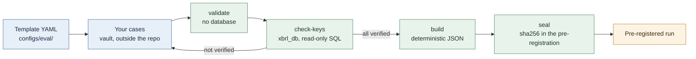

# XBRL Flow — 12. Held-out sets B and H-X (author, check, build, seal)

The procedure for the maintainer who writes XbrlRag's hand-written held-out question sets:
**set B** (wording on the development filers) and **H-X** (the v2 external set). It covers the
rules that keep them held out, then how to check every answer key by SQL, build the suite and
seal it before its pre-registered run. Agents working on the system never see these questions;
this guide describes the procedure only.

**In this doc:** [12.1 Rules](#121-rules) · [12.2 Set B workflow](#122-workflow) ·
[12.3 SEC cross-check](#123-optional-cross-check-against-the-sec) ·
[12.4 H-X](#124-external-set-h-x-v2)

## Overview



*Green: deterministic tooling, no LLM, no network · Blue: files · Amber: the one run that uses them.*

Both tools ([`set_b.py`](../../../scripts/eval/set_b.py), [`hx.py`](../../../scripts/eval/hx.py))
check keys with **SQL only**: no pipeline, no LLM, no network. Their output never contains a
question, a note or an expected amount (H-X output also omits passages, accessions and tickers),
so errors and reports, which name cases by `id`, can be shared. Specs:
[`set-b-tooling`](../../specs/set-b-tooling.md), [`hx-authoring`](../../specs/hx-authoring.md).
Results of past runs: [first out-of-loop test](../../eval/external_test_v1/README.md) and the
[v2 pre-registration](../../eval/heldout_v2/README.md).

## 12.1 Rules

- **Keep the files outside the repo**, for example under `<vault>\`. `build`
  refuses to write inside the working tree unless you pass `--force-in-repo`, which is for the
  unseal step only.
- **Don't run a held-out question through XbrlRag** (UI, API, MCP, `run_suite.py`) outside its
  pre-registered run, and never tune the system on one.
- **Don't share questions with an agent** or paste them into a session. Share case ids, statuses
  and aggregates only.
- **Set B scope:** the v1 suite's filers and fiscal years, and never a (ticker, year) pair in the
  prospective set P, not even as a compute input. `validate` enforces both (`SUITE_TICKERS` and
  `P_SET` in [`src/eval/set_b/core.py`](../../../src/eval/set_b/core.py)).

## 12.2 Workflow

Start from [`configs/eval/set_b_template.yaml`](../../../configs/eval/set_b_template.yaml): one
example of each kind (`lookup`, `dimensional`, `compute`, `breakdown`) with every field. Its
ticker `EXAMPLE` fails validation on purpose.

```powershell
$B = "<vault>\set_b"
Copy-Item configs\eval\set_b_template.yaml "$B\set_b.yaml"   # then write your cases

# 1. Structure and scope (no database): errors, warnings, the kind/ticker/fy mix
conda run -n py312 python scripts/eval/set_b.py validate "$B\set_b.yaml"
# 2. Answer keys against xbrl_db (read-only): one line per case, then counts per status
conda run -n py312 python scripts/eval/set_b.py check-keys "$B\set_b.yaml"
# 3. Build the EvalCase suite (canonical JSON) and print its sha256
conda run -n py312 python scripts/eval/set_b.py build "$B\set_b.yaml" --out "$B\heldout_b_v1.json"
# 4. Seal: print "<sha256>  heldout_b_v1.json" and record it in the pre-registration
conda run -n py312 python scripts/eval/set_b.py seal "$B\heldout_b_v1.json"
# Later: confirm the file is unchanged (exit 1 on a mismatch)
conda run -n py312 python scripts/eval/set_b.py verify "$B\heldout_b_v1.json" <sha256>
```

**How `check-keys` decides.** Each written amount must match exactly one class of facts of that
filer-year (the FY filing's annual durations and FY-end balances) within half its last written
digit: `"391,035"` in millions matches ±0.5 million. Which filing's value counts follows the S1
rule ([eval semantics](../../design/XbrlRag_Eval_Semantics.md)), the latest periodic report that
states the fact:

- **`lookup`, `dimensional`, `compute`:** each fact of the year's own 10-K or 20-F, as the latest
  later filing restates it (same concept, unit, period and dimensions), else as first filed.
- **`breakdown`:** the members of the latest filing that splits the year, per concept family and
  axis; a parent member of that filing is a candidate too.

So key a restated value from the latest filing, not from the year's own 10-K.

| Status | Meaning | Fix |
|---|---|---|
| `verified` | Exactly one class of facts carries the amount | — |
| `ambiguous` | Several concepts or members carry it; the report lists them | Add a `concept` hint (a concept family such as `Revenue`, or part of the local name) or a sharper `member` |
| `not_found` | No fact carries it | Check the year, `scale`, `unit`, sign, rounding or `member` text |
| `arith_mismatch` | The inputs verify, but the formula doesn't give `expected` (beyond half a digit or 0.1%) | Fix the formula, the inputs or the expected value |

Repeat steps 1 and 2 until every case is `verified`; `build` refuses otherwise.
`--allow-unverified` leaves those cases out and lists their ids under `excluded`. The same YAML
and fact store always give the same bytes and hash.

## 12.3 Optional: cross-check against the SEC

The flat (non-dimensional) keys can also be checked against the SEC's companyfacts data, with the
report written outside the repo:

```powershell
conda run -n py312 python scripts/eval/check_against_sec.py --suite "$B\heldout_b_v1.json" --out-dir "$B\sec_check"
```

It needs `data.sec.gov` (or a warm cache) and an SEC identity. Its `hand_check.md` **contains
question text**: read it yourself and don't share it.

## 12.4 External set H-X (v2)

H-X is written by hand like set B, over development filers only (a held-out filer is always an
error), with the kind mix fixed in the pre-registration (cross-filer, cross-period, compound,
honesty and text questions). The rules in 12.1 apply unchanged.

To find values, see where each sits in the filing and check a draft case before you write it,
use the local [H-X filing locator](../../../tools/hx_locator/README.md)
(`conda run -n py312 --no-capture-output python -m tools.hx_locator`). It reads the filings
themselves, applies S1, refuses held-out filers, and runs the same `validate` and `check-keys`
code as below.

Start from [`configs/eval/hx_template.yaml`](../../../configs/eval/hx_template.yaml) (one fictional
example per kind and sub-type; its `EXAMPLE*` tickers fail validation on purpose) and a small
filer-sets YAML:

```yaml
dev_filers: [AAPL, MSFT, ...]      # the filers H-X may name
heldout_filers: [...]              # the drawn held-out filers (always an error)
```

```powershell
$X = "<vault>\h_x"
Copy-Item configs\eval\hx_template.yaml "$X\hx.yaml"   # then write your cases

conda run -n py312 python scripts/eval/hx.py validate   "$X\hx.yaml" --filers "$X\filers.yaml"
conda run -n py312 python scripts/eval/hx.py check-keys "$X\hx.yaml" --filers "$X\filers.yaml"   # honesty and text cases skipped
conda run -n py312 python scripts/eval/hx.py build      "$X\hx.yaml" --filers "$X\filers.yaml" --out "$X\heldout_x_v1.json"
conda run -n py312 python scripts/eval/hx.py seal   "$X\heldout_x_v1.json"
conda run -n py312 python scripts/eval/hx.py verify "$X\heldout_x_v1.json" <sha256>
```

`check-keys` works as for set B, with three additions: a cross-filer row reads its own filer's
year, a trend or CAGR row its own year, and an item with an `accession` reads that filing only
(how a point-in-time pair compares *as originally reported* with *latest*). `arith_mismatch` also
covers a written sum, median, count, rank or CAGR that doesn't follow from the verified items
(count and rank must be exact). An unreadable input exits 2, naming only the key or YAML position.

## Related

[11. Evaluation](./11-evaluation.md) (held-out filer draw, H-F build, running a suite) ·
[v2 architecture](../../design/XbrlRag_Eval_v2_Architecture.md) ("Who sees which questions")
