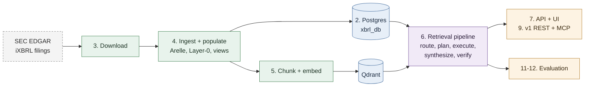

# XBRL Flow — Guide

The operating guides for XbrlRag's product flow. It downloads iXBRL filings from SEC EDGAR, loads
their tagged facts into PostgreSQL, indexes the filings' prose in Qdrant, and answers analyst
questions with a plan-based pipeline that takes every number from an audited fact by SQL and
verifies every statement. Read these guides in order to stand the system up; dip into a single
guide to operate one stage.

## Overview



*Numbers are guide numbers. Green: deterministic code · Purple: LLM stages · Blue: data store ·
Grey: external source · Amber: user-facing surfaces.*

## Reading order

| # | Guide | Read it to |
|---|---|---|
| 1 | [Setup & dependencies](./01-setup-and-dependencies.md) | Set up the environment, `.env`, Qdrant, Arelle, RagInference |
| 2 | [PostgreSQL setup](./02-postgres-setup.md) | Create `xbrl_db` and apply the Layer-0, audit and eval DDL |
| 3 | [Data download](./03-data-download.md) | Download filings from EDGAR, full or incremental |
| 4 | [Ingest & populate](./04-ingest-and-populate.md) | Load facts with Arelle, populate Layer-0, build canonical HTML and the materialized views; run ingest on AWS |
| 5 | [Vector DB load](./05-vectordb-load.md) | Chunk the canonical HTML, cross-link facts, embed, load Qdrant |
| 6 | [Retrieval pipeline](./06-retrieval-pipeline.md) | Run and call the query pipeline |
| 7 | [API, UI & observability](./07-api-ui-observability.md) | Run the BFF and React UI; read traces, lineage and cost |
| 8 | [Troubleshooting](./08-troubleshooting.md) | Diagnose a failure by component |
| 9 | [Programmatic access (v1 REST + MCP)](./09-programmatic-access-rest-and-mcp.md) | Call XbrlRag from a program or an LLM agent |
| 10 | [Packaging](./10-packaging-images.md) | Build and push the `arag`, `arag-ui` and `arag-ingest` images |
| 11 | [Evaluation](./11-evaluation.md) | Build a suite, run slices and full runs, read results at `/tech/eval` |
| 12 | [Held-out sets B and H-X](./12-heldout-set-b.md) | Author, key-check and seal the hand-written held-out sets (maintainer) |

## Quick path

`scripts/bootstrap_db.py --all` runs the database half (schema, ingest, populators, views) in
one command; [guide 4](./04-ingest-and-populate.md) gives the step-by-step order and what each
step needs. Then:

```powershell
conda run -n py312 python -m src.chunking.xbrl_html_base_chunking --chunk-metadata
conda run -n py312 python -m src.chunking.xbrl_html_base_chunking --cross-links
conda run -n py312 --no-capture-output python -m src.pipelines.xbrl.load_to_vectordb_pipeline --all
conda run -n py312 --no-capture-output python -m uvicorn src.api.main:app --port 8000
```

The packaged stack (`docker compose -f infra/docker/docker-compose.yml up -d`) brings up Postgres,
Qdrant, the API, MCP and UI, with a `monitoring` profile for Prometheus and Grafana
([`deploy/README.md`](../../../deploy/README.md)); data loading still runs separately. The same
code runs on AWS with `XBRLRAG_DEPLOY_MODE=aws`
([local / AWS deployment](../../design/XbrlRag_AWS_Deployment.md)).

## Design background

- [Architecture](../../design/XbrlRag_Architecture.md): iXBRL for tagged numbers, RAG for prose.
- [HTML canonical source](../../design/XbrlRag_HTML_Canonical_Source.md): one address space for
  sections, chunks and fact anchors.
- [Fact-store data model](../../design/XbrlRag_Materialized_Views.md): Layer-0 tables, the
  materialized views and their invariants.
- [LLM harness](../../design/XbrlRag_LLM_Harness.md) and
  [observability](../../design/XbrlRag_Observability_Tracing.md).
- [Evaluation](../../design/XbrlRag_Evaluation.md) and
  [v2 architecture](../../design/XbrlRag_Eval_v2_Architecture.md).
