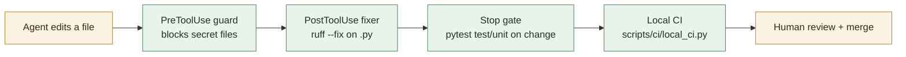

# Dev-time harness

The harness is the set of checks and tools that keep AI-assisted development of XbrlRag on
scope and on a green build: a machine-checked feature list, deterministic Claude Code hooks,
dev-time subagents, a runaway-process watchdog, a dated re-audit and a local CI runner. Read
this page to find the right piece; each linked doc or script owns its detail. It covers
development only: the product's runtime guards (budgets, the faithfulness verifier,
Prometheus alerts) are in [`docs/design/`](../design/README.md).

## Overview



*Green: deterministic code · Amber: the agent's action and the human step.*

The hooks run inside every Claude Code session, including subagents in their own worktrees.
Local CI runs the GitHub gates on this machine for a PR head or `main`, because the hosted
Actions minutes ran out; the workflows in `.github/workflows/` remain the definition of the
gates.

## Components

| Piece | What it does | Where |
|---|---|---|
| Scope doc | Mission, principles and explicit non-goals that out-of-scope work is declined against | [`VISION.md`](../../VISION.md) |
| Feature manifest + gate | Every material feature as an entry with an executable check; the authoritative implementation status | [`feature_manifest.yaml`](feature_manifest.yaml), [`check_features.py`](../../scripts/harness/check_features.py), [`test_feature_manifest.py`](../../test/unit/test_feature_manifest.py) |
| Hooks | Secret-path guard, ruff fixer, red-build Stop gate | [`.claude/hooks/README.md`](../../.claude/hooks/README.md) |
| Subagents | Read-only explorer, doer-not-judge answer evaluator, worktree-isolated refactor worker | [SUBAGENTS.md](SUBAGENTS.md) |
| Unattended runs + watchdog | What may run headless, required caps, alert routing, rollback, kill switches; the runaway-process watchdog | [UNATTENDED_RUNS.md](UNATTENDED_RUNS.md), [`watchdog.py`](../../scripts/harness/watchdog.py) |
| Re-audit | Dated review of each harness assumption against the current models; `check_reaudit.py` fails once it is overdue | [REAUDIT.md](REAUDIT.md), [`check_reaudit.py`](../../scripts/harness/check_reaudit.py) |
| Local CI | Runs the tdd checks, `pytest test/unit`, ruff, the standards checks and mypy in a throwaway worktree; can post the result on the PR | [`scripts/ci/local_ci.py`](../../scripts/ci/local_ci.py) (`--help`) |

## The feature manifest

Each manifest entry carries a `status` (`done`, `partial`, `todo`, `deferred`) and a `checks:`
block that fails until the artifact exists. `--gate` turns that into a contract:

| Status | Check | Result |
|---|---|---|
| `done` | fails | gate fails: the claimed feature regressed or was never built |
| `todo` / `deferred` | passes | warning: reality is ahead, flip it to `done` |

Check types: `path: <relpath>` (exists), `absent: <relpath>` (must not exist),
`contains: {file, pattern}` (regex match), `cmd: <shell>` (exits 0). Prefer `path` and
`contains` for `done` items so the gate stays fast and hermetic. `manual: <note>` marks an
item with no automated check; it is reported but excluded from the gate. Entries are grouped
by workstream id (`workstream:` field, for example `WS-8` for the harness itself).

```powershell
conda run -n py312 python scripts/harness/check_features.py                # full report
conda run -n py312 python scripts/harness/check_features.py --gate         # exit != 0 on drift
conda run -n py312 python scripts/harness/check_features.py --status done   # filter by status
conda run -n py312 python scripts/harness/check_features.py --workstream WS-8
conda run -n py312 python scripts/harness/check_features.py --json         # machine-readable
```

**Adding or finishing a feature.** New scope gets an entry with `status: todo` and a check
naming the artifact that will prove it; if the scope is outside `VISION.md`, update
`VISION.md` first, deliberately. When the feature lands, flip it to `done`; from then on the
gate catches any regression.

## Key decisions

- **"Done" is a command, not a judgment.** A feature is done only when its check passes, so
  status written into a design doc or README never overrides the manifest.
- **Built versus correct are separate signals.** The manifest answers "is the feature
  built?"; whether the system gives right answers is the evaluation suite, whose results live
  in the `eval` schema and `/tech/eval` ([guide 11](../guides/xbrl-flow/11-evaluation.md)).
  A feature can pass its check and still score badly.
- **Process and security guards stay regardless of model;** capability scaffolding is
  re-examined at each re-audit ([REAUDIT.md](REAUDIT.md)).
