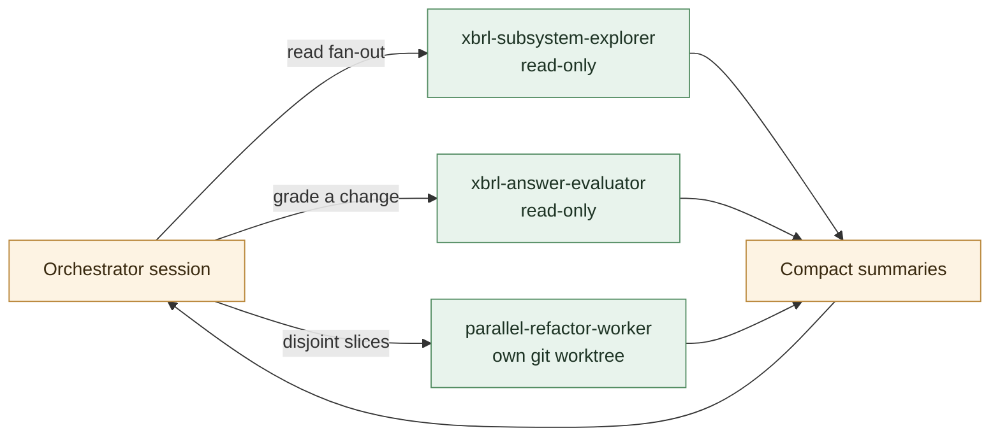

# Dev-time subagents and worktree isolation

XbrlRag ships three Claude Code subagents in [`.claude/agents/`](../../.claude/agents/) for
work that would otherwise flood one session's context or collide on disk: fan-out reads,
independent grading of an answer, and parallel mechanical edits. Read this before spawning
several agents at once or before adding a new agent definition.

## Overview



*Green: subagents · Amber: the orchestrating session and what it keeps.*

Workers return conclusions, not file dumps or diffs, so the orchestrator can fan out many of
them and keep its own context lean. Editors run in separate git worktrees so parallel edits
cannot corrupt each other or the main checkout.

## Roster

| Agent | Role | Tools | Edits? | Spawn with worktree? |
|-------|------|-------|--------|----------------------|
| [`xbrl-subsystem-explorer`](../../.claude/agents/xbrl-subsystem-explorer.md) | Map a subsystem and return a compact structural summary (entry points, key files, invariants, data flow, where a change would go) | Read, Grep, Glob, Bash | no | no |
| [`xbrl-answer-evaluator`](../../.claude/agents/xbrl-answer-evaluator.md) | Doer-not-judge check of a generated XBRL answer after a query-pipeline change: numbers audited, citations resolve; verdict PASS or NEEDS_WORK, defaulting to NEEDS_WORK | Read, Grep, Glob, Bash | no | no |
| [`parallel-refactor-worker`](../../.claude/agents/parallel-refactor-worker.md) | Apply one mechanical change to an assigned file slice, verify it, return a summary | Read, Edit, Write, Grep, Glob, Bash | yes | **yes** |

[`test/unit/test_subagents.py`](../../test/unit/test_subagents.py) checks every agent file
(frontmatter shape, known tool names, `name` equal to the file stem, no edit tools on the
read-only agents) and that every agent appears in this roster. Add a row here when you add an
agent.

## Fan-out, summary-return

1. **Decompose** the work into independent units: subsystems to map, or file-disjoint slices
   to edit.
2. **Fan out** one worker per unit, with several Agent calls in a single message so they run
   concurrently.
3. **Each worker returns a summary.** Its final message is the only thing the orchestrator
   sees.
4. **Synthesize** the summaries, then verify the merged result.

```
# Read fan-out: read-only, no worktree
Agent(subagent_type="xbrl-subsystem-explorer",
      prompt="Map the XBRL plan executor: how lookup/compute/screen/breakdown/narrative steps run.")
Agent(subagent_type="xbrl-subsystem-explorer",
      prompt="Map the publish gate: how a denied filing is kept out at read time.")
```

## Worktree isolation for parallel edits

Spawn `parallel-refactor-worker` with the Agent tool's `isolation: "worktree"`. Each worker
then edits an isolated copy, and the worktree is removed automatically if nothing changed.
Assign file-disjoint slices so the results merge without conflicts.

```
# One worker per disjoint slice, all concurrent, each isolated
Agent(subagent_type="parallel-refactor-worker", isolation="worktree",
      prompt="Add `from __future__ import annotations` to every file. Slice: src/embeddings/*.py")
Agent(subagent_type="parallel-refactor-worker", isolation="worktree",
      prompt="Same change. Slice: src/vectorstores/*.py")
```

Outside Claude Code, or to inspect a worktree by hand:

```bash
git worktree add ../XbrlRag-wt-embeddings -b refactor/embeddings
# edit and test in that directory with the py312 env
git worktree remove ../XbrlRag-wt-embeddings
```

**Repo notes.** All worktrees share the one `py312` conda env. `data/` is gitignored, so a
worktree is a cheap source-only copy; don't duplicate data directories into it. A change that
crosses a slice boundary is reported back as a cross-slice dependency, not edited across the
boundary. Remove a finished agent's worktree by its exact path, never by a glob that could
catch a worker still running.

## Guardrails still apply

- **Hooks** ([`.claude/hooks/README.md`](../../.claude/hooks/README.md)) run inside worktrees
  too: the PreToolUse guard blocks secret files and the PostToolUse fixer runs on each edited
  `.py`.
- **Watchdog** ([UNATTENDED_RUNS.md](UNATTENDED_RUNS.md)): scope it to a worker's process
  tree with `--root-pid` if one goes runaway.
- **Scope:** workers obey [`VISION.md`](../../VISION.md); `parallel-refactor-worker` is told
  not to expand beyond its slice.
- **Verification:** a worker verifies its own slice (targeted `pytest`, an import, or
  `check_features.py --gate`) before returning; the orchestrator re-runs `pytest test/unit` and
  the feature gate after merging.
