# One compound question, traced end to end

This page follows one question from the moment it arrives to the verified answer, using the
Trace Explorer (`/tech/traces/<query_id>`) in the UI. Every screenshot is of the real trace, and
the trace itself is saved next to this page as
[`trace-86b9693aedc644f9.json`](trace-86b9693aedc644f9.json) (header and all 36 events, as the
API serves them).

> **Rank the retailers by cash and equivalents for fiscal 2025; among the 3 highest, which
> reported the highest net income margin, and what was it?**

The question needs two things done in order. First, a screen across every retailer in the
corpus. Second, a calculation that only makes sense once the screen's top three are known. Every
number in the answer comes from a tagged XBRL fact reached by SQL, or from arithmetic on those
facts. The language model plans, words the answer and checks it, but it never supplies a number.

**Where the example comes from.** The case comes from the development split of the v2
evaluation (suite `xbrl_v2_dev_compound`, run `eval-c78dd0934732`, 2026-11-15). It was graded
CORRECT. The run used the DeepSeek development profile, which is why every LLM call below names
the same small model. Held-out cases are never used for examples like this: their questions stay
sealed. Ids such as `fact_id` 9636 come from the maintainer's local fact store, so yours will
differ, but the shape will not.

| | |
|---|---|
| Answer | Amazon: net income margin 10.8% (Costco 2.9%, Walmart 2.9%) |
| Sub-queries | 2: a screen, then a dependent computation |
| Plan steps | 10: 1 screen, 6 fact lookups, 3 computations |
| Statements | 14, each citing its facts; 0 dropped by the verifier |
| LLM calls | 10, $0.0121 in total, 0 retries |
| Wall time | 37.8 s |

## Part 1: the answer

### Final answer

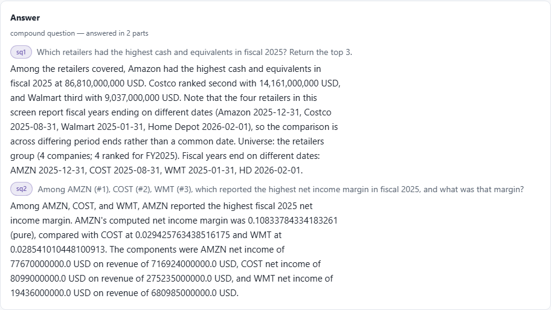

The answer comes in two parts, one per sub-query. The second part's question already names the
first part's result ("Among AMZN (#1), COST (#2), WMT (#3)…"). The first part also says what a
reader needs to judge the ranking: all 4 retailers were ranked, and their fiscal years end on
different dates.

The margins are shown as raw ratios (`0.10833784334183261 (pure)`), not percentages. That is how
the synthesizer words a unitless computed value today. The numbers are right, but the formatting
is plain.

### Supporting statements

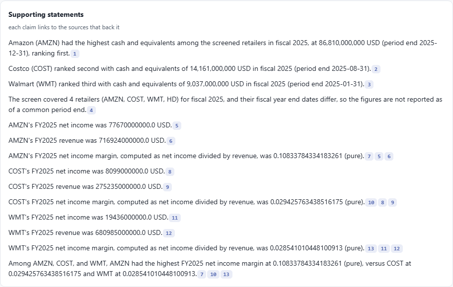

Each sentence of the answer is a separate statement with its own citations. A margin statement
cites the computation and both facts it was computed from (for example `7 5 6`). The final
comparison cites all three computations.

### Sources

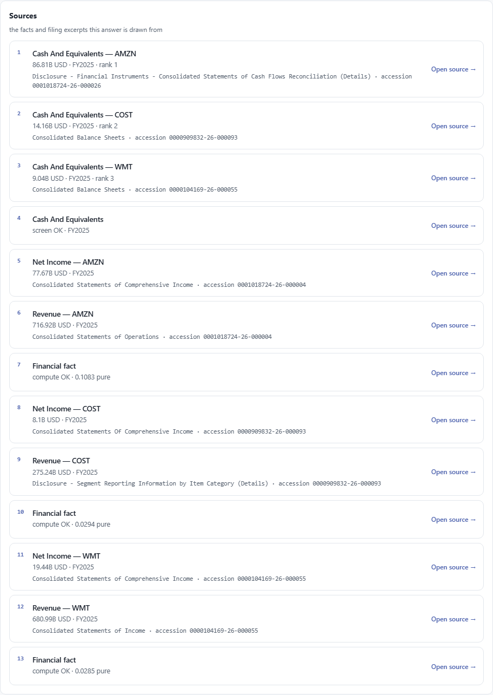

Every source is a fact. It gives the value, the fiscal year, the section of the filing it was
tagged in and the filing's accession number. Computed values appear as their own sources
(`compute OK · 0.1083 pure`). Not every fact comes from a primary statement. Amazon's cash figure
is tagged in a cash-flow reconciliation detail, and Costco's revenue in its segment note. The
source list shows where each number was actually found.

### How it was answered

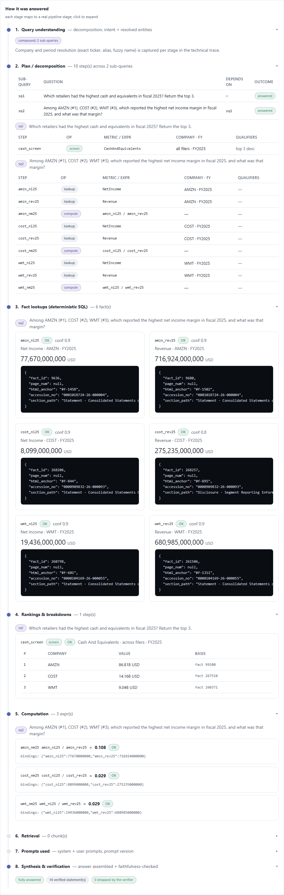

This is the same panel the Ask page shows under every answer:

1. **Query understanding:** the question is compound, with 2 sub-queries.
2. **Plan:** `sq1` is one `screen` step. `sq2` depends on `sq1` and has three lookup–lookup–compute
   groups, one per company.
3. **Fact lookups:** six facts, each with its `fact_id`, accession number, HTML anchor, statement
   section and a confidence score. Costco's revenue has confidence 0.8 because it came from the
   second-preferred concept.
4. **Rankings:** the screen's top three, with the fact behind each row.
5. **Computation:** each expression with its result, and the bindings it was evaluated on.
6. **Retrieval:** no text passages were needed, so no chunks were retrieved.
7. **Prompts used:** the system and user prompt behind each call, with its prompt version.
8. **Synthesis and verification:** fully answered, 14 statements verified, 0 dropped.

## Part 2: how the flow ran

### Overview

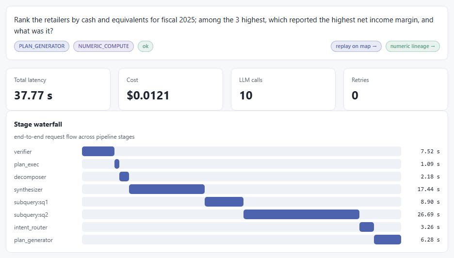

The waterfall adds up time per stage across both sub-queries. The `subquery:sq1` and
`subquery:sq2` rows are the wall time of each sub-query, so they overlap the stage rows rather
than adding to them. Decomposition (2.2 s), `sq1` (8.9 s) and `sq2` (26.7 s) together make the
37.8 s total. Most of `sq2` is its synthesizer call (14.6 s), which writes ten statements.

### The event stream

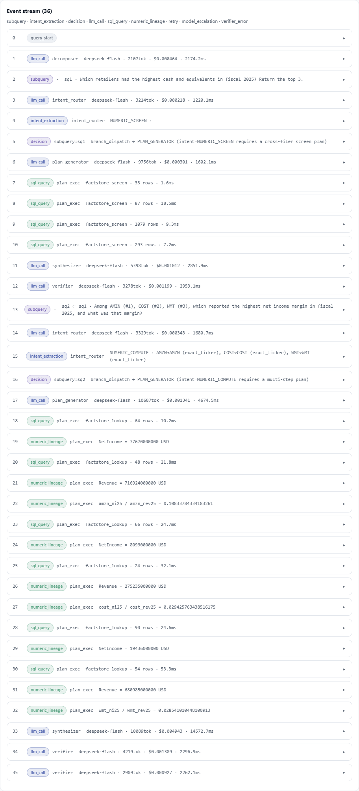

Each event is one row in `audit.query_event`, in the order it happened. The key steps:

| Seq | Event | What happened |
|---|---|---|
| 1 | `llm_call` decomposer | Split the question into `sq1` and `sq2`. `sq2` refers to the screen's result as `<<TOP:sq1:3>>`. |
| 2 | `subquery` sq1 | "Which retailers had the highest cash and equivalents in fiscal 2025? Return the top 3." |
| 3–4 | intent router | `NUMERIC_SCREEN`, universe `retailers`, `2025 → FY2025`. |
| 5 | `decision` | `branch_dispatch → PLAN_GENERATOR`: a screen needs a cross-filer plan. |
| 6 | `llm_call` plan generator | One `screen` step: `CashAndEquivalents`, FY2025, top 3, descending. |
| 7–10 | `sql_query` | The screen's SQL against the fact store (each statement is stored in full). |
| 11–12 | synthesizer, verifier | `sq1`'s four statements written, then each checked: all SUPPORTED. |
| 13 | `subquery` sq2 | `<<TOP:sq1:3>>` replaced by "AMZN (#1), COST (#2), WMT (#3)". `rewritten: true`, `depends_on: [sq1]`. |
| 14–16 | intent router, `decision` | `NUMERIC_COMPUTE`. Each ticker resolved by SQL (`exact_ticker`), not by the model. |
| 17 | `llm_call` plan generator | Six lookups (net income and revenue per company) and three divisions. |
| 18–32 | `sql_query`, `numeric_lineage` | Each lookup's SQL, the fact it returned, and each computation with its inputs. |
| 33 | `llm_call` synthesizer | `sq2`'s ten statements. |
| 34–35 | `llm_call` verifier | Statements 0–7, then 8–9, each checked against its own citations: all SUPPORTED. |

The two sub-answers are then merged into the answer in Part 1. The merge is plain code with no
model call, so it adds no event.

### Decomposition

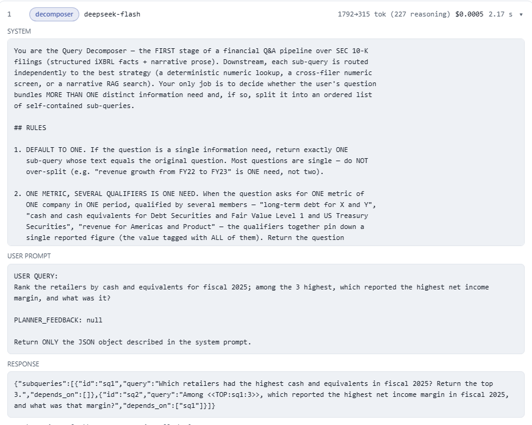

The decomposer's whole call is in the trace: system prompt, user prompt and response. The
response contains the dependency (`"depends_on": ["sq1"]`) and the placeholder that the pipeline
fills in once `sq1` has run.

### Resolution

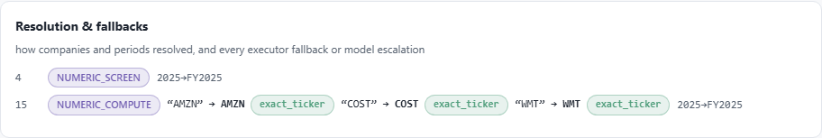

Companies and periods are resolved by deterministic code against the entity registry. The model
only lifts the mentions from the question. All three tickers resolved as exact matches, and
"fiscal 2025" became `FY2025` in both sub-queries.

### Key events up close

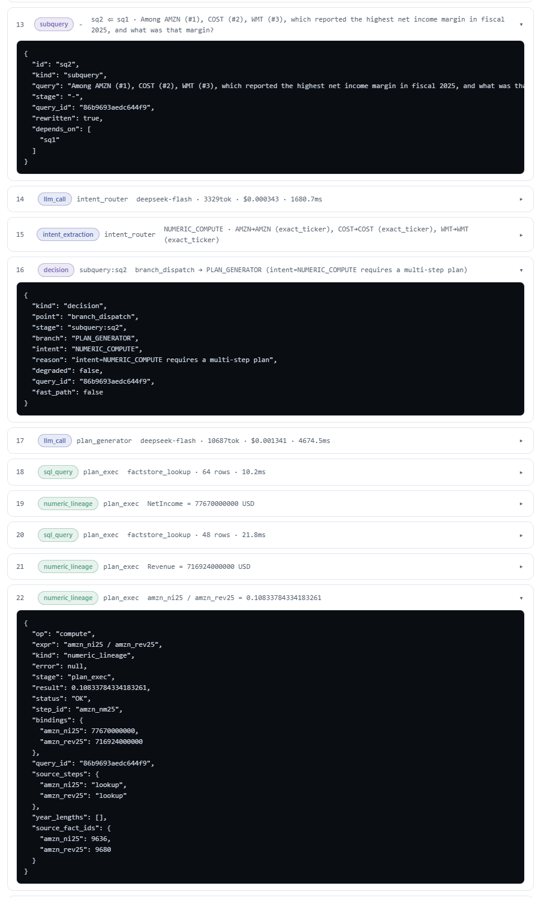

- **Event 13**: the rewritten dependent sub-query, with `depends_on: ["sq1"]`.
- **Event 16**: the branch decision for `sq2`, with its reason.
- **Event 22**: Amazon's margin. The expression `amzn_ni25 / amzn_rev25`, the values it was
  evaluated on, the steps they came from and their `source_fact_ids` (9636 and 9680). The model
  never did this division: it was computed by the sandboxed calculator from the two facts.

### Every LLM call, with its cost

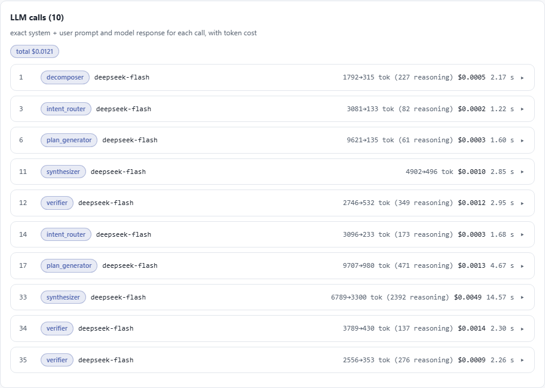

Ten calls in all: one decomposer call, then intent router, plan generator, synthesizer and
verifier for each sub-query, with `sq2`'s verifier running as two calls. Tokens, reasoning tokens, cost and latency are recorded per call. Each row expands to the
exact prompts and response.

### The verifier

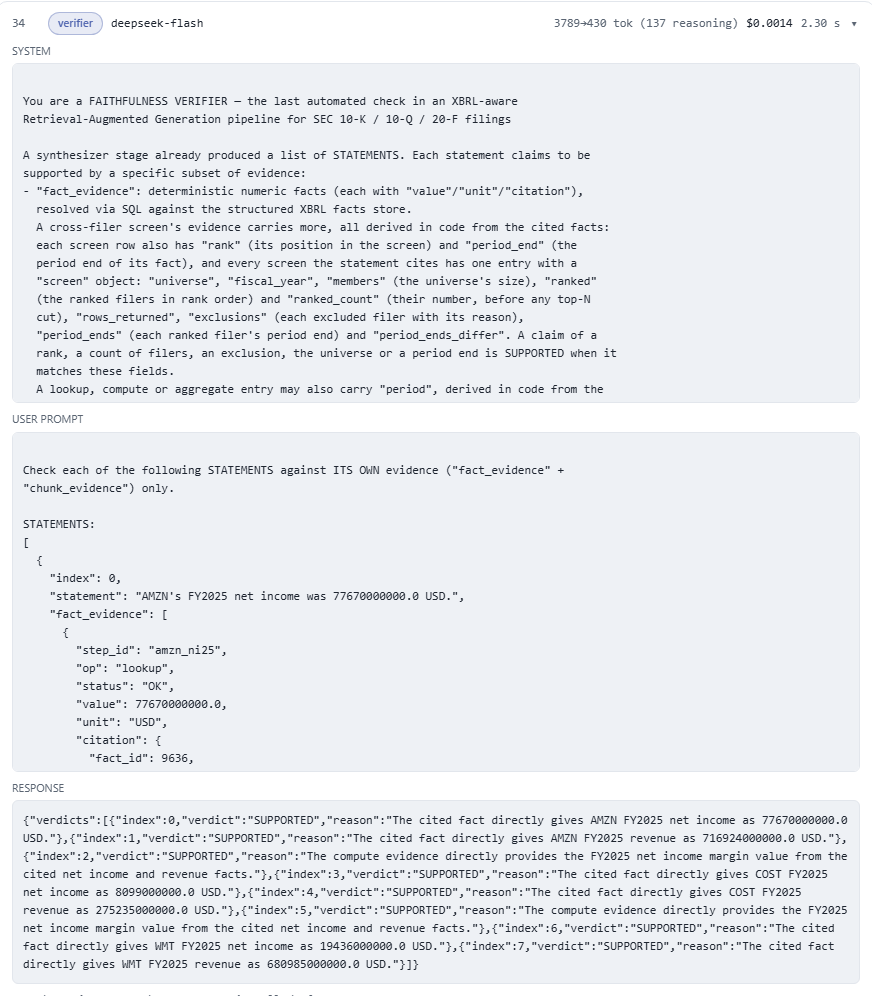

The verifier sees each statement together with only the evidence that statement cites. It
returns a verdict and a reason for each one. A statement its own evidence does not support would
be dropped from the answer. Here every statement was supported, so none were dropped.

## Regenerating these images

With the UI and API running locally:

```bash
python scripts/docs/capture_trace_showcase.py            # screenshots + trace JSON
python scripts/docs/capture_trace_showcase.py --skip-json # screenshots only
```

The script ([`capture_trace_showcase.py`](../../scripts/docs/capture_trace_showcase.py)) opens
the trace in headless Chromium at the UI's one-column width and saves one image per panel to
[`docs/images/trace-showcase/`](../images/trace-showcase/). Run it again after a UI change.
